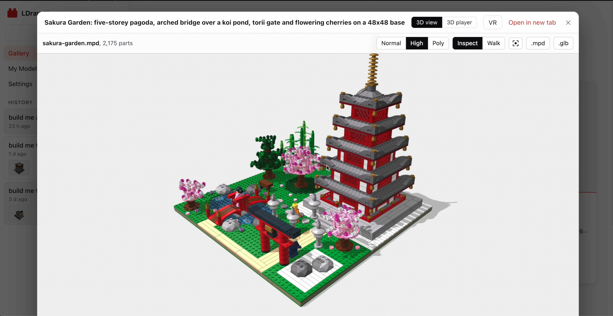
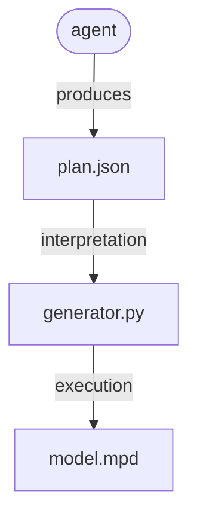

#  Open Brick Designer

Open Brick Designer is a fork of [anteloc/ldraw-nova](https://github.com/anteloc/ldraw-nova). The web app has a new name; the toolkit it packages is still **ldraw-nova** (`ldraw_tools`, `./ldraw-agent`).

**Give an AI agent a model idea. Guide it, let it build it, and get an LDraw LEGO© model.**

What you get when the building process finishes:

- Its **source code**, in **[LDraw language](https://www.ldraw.org/)**.
- **Different views:** 3D viewer, 3D player, images...
- **Blender editable** glTF file, in `.glb` format, metainfo as Blender's Custom Properties.
- **Chat history** and **agent thinking process**.
- and more... 👌

Take a look at [the video](https://youtu.be/YDjjxGqWpgU):

[](https://youtu.be/YDjjxGqWpgU)

## Installation


> [!IMPORTANT]
> **Tools** used by agents in order to find **suitable parts** and **example models** take advantage of [jev-rerank](https://github.com/anteloc/jev-rerank) (I'm also the author). 
> This is a **semantic search tool** with **re-ranking** backed by [TypeSafe](https://typesafe.ai/)'s [Jev System One](https://typesafe.ai/) AI model.
> 
> - **A TypeSafe API key is optional.** If you have one (`TYPESAFE_API_KEY`), set its value on the web app's **Settings** section to enable Jev semantic search.
> - **If you don't**, nothing breaks: searches automatically use **FTS (Full Text Search)** with keyword (BM25) ranking, which works but ranks parts and models **less well** than semantic search.

Run **Open Brick Designer** as a web app, with Docker. You need [Git](https://git-scm.com/downloads) and [Docker](https://docs.docker.com/get-started/get-docker/).

The web app runs dockerized. The Docker configuration and the web app live in [`app/`](app/), next to the toolkit it packages, so a single clone is all you need.

**1. Clone** the repo:

```bash
git clone https://github.com/AlessioNar/ldraw-nova.git
```

**2. Build** the Docker image. The first build takes a while and needs about 5 GB of disk space:

```bash
cd ldraw-nova/app
docker compose build
```

**3. Start** the app:

```bash
docker compose up -d
```

**4. Open** it in your browser at **http://localhost:8765**.

The app is reachable from this computer only (`localhost`). To open it from other devices on your network, set `LDRAW_NOVA_WEB_BIND=0.0.0.0` in `app/.env` (or in your shell) before `docker compose up -d`, then browse to your computer's IP, e.g. `http://192.168.1.20:8765`. The app has no login, so only do this on networks you trust.

To stop it: 

```bash
docker compose down
```

Your builds, chats and parts lists live in the Docker volume `ldraw-nova-docker_data` (not in the repo folder), so pages stay fast on Windows and macOS. `docker compose down` keeps it; only `docker compose down -v` would delete it. To copy your models out:

```bash
docker cp ldraw-nova-app:/data/generated ./my-models
```

## Why all of this?

Well, to summarize: I did this in order to get **agentic LLMs capable of designing buildable, physical things!**

Finding **LDraw**, an **assembly language** (pun intended! 😜) that would be at the same time **simple**, **low level**, and **executable** in order to **produce 3D CAD models**, gave me the idea of **experimenting** with both **ChatGPT** and **Claude** in order to try and make them **code in LDraw**, same as they do with other programming languages.

To my surprise, even though this language is heavily focused on **math** (parts rotations, positioning...), which LLMs are **usually bad** at, **agents did pretty well** instead on initial tests, and subsequent projects also yielded **good results**, but **never enough** in order to consider generated models to be correct:

- **Initial research:** [ldbuilder-ai](https://github.com/anteloc/ldbuilder-ai)
- **1st attempt** at an agentic python tooling: [py2bricks](https://github.com/anteloc/py2bricks)
- **2nd attempt**: [py4bricks](https://github.com/anteloc/py4bricks)

These three attempts, and quite some other experimentation, led me to the following **conclusions**:

**💡 Conclusion 1:** there is a **minimum resistance path to geometry math** for agents, i.e.:

- **Giving the agents tooling** to generate LDraw sources would **sidestep (evil!) geometry math**
- ... because they do way **better** at generating **python code** that **produces math**
- ... **than on producing math themselves!**

**💡 Conclusion 2:** 

- Agents tend to do **better when learning** from python **code** that **produces models**
- ... than from **models themselves** (LDraw's evil geometry, again...)

Then, the **only thing left 🤔** was to create a python-based tooling with the required **primitives, verbs, constructive vocabulary**... so agents would **learn by example** and **do similar things on their own.**

Which proved to be really **hard to get right**, even if vibe coding it... until **GPT-6 Astra** and **Claude Opus 5.5** arrived... and **vibe-coded it right!** 🚀🚀🚀

## How it works

**ldraw-nova** provides the tools, examples and instructions an agent needs to design models with real LDraw parts. 

The process is as follows:

1. The agent takes a **prompt**.
2. **Reads** [instructions.md](./instructions.md) and related documents to [LDraw language](https://www.ldraw.org/) and LEGO© models building.
3. **Plans** how to build the model: required parts, submodels to be created, aesthetics...
4. **Iteratively**:
	1. Renders images from the model/submodel(s)
	2. Inspects them, adjusts positioning, aesthetics... and back to rendering
5. ... until it considers the **model finished** and ready to deliver!

Provided tooling helps the agent in:

- **Finding** suitable parts.
- Also, **example models** and **submodels** to start with.
- **Collision** and **gaps detection** for placing parts correctly.
- **Headless rendering** for inspecting current results.
- and more...

The agent **doesn't actually start with placing parts**, except for things like e.g. prototyping and learning by altering pre-existing example models.

The way it produces models is more like:

- **Collects** the required information, from experimental results, docs and planning.
- **Builds** one or more **plans**, that fully describe the model and submodels, including its geometry, like e.g. [atlas-crane.plan.json](examples/atlas-crane/atlas-crane.plan.json)
- And with that plan, it creates one or more **generator scripts** like e.g. [generate.py](examples/atlas-crane/generate.py) 
- ... that when executed, **produce LDraw source** file(s), a very specialized **3D CAD language**.
- ... like e.g. [atlas-crane.mpd](examples/atlas-crane/atlas-crane.mpd)

To **summarize**, this is like:

- an **agent** creating a **generator** 
- ... that produces a **3D model** 
- ... in an **assembly language** named **LDraw** 🤯

A **compiler** of sorts, so to say 🤓





## Agent's informational sources

These are some of the guides and references given to the agent in order to make it a builder:

| I want to…                            | Read…                                                                                                              |
| ------------------------------------- | ------------------------------------------------------------------------------------------------------------------ |
| Ask an agent to generate a model      | [Agent instructions](instructions.md)                                                                              |
| Improve shape, colour and detail      | [Visual design guide](docs/agent/visual-design.md)                                                                 |
| Build vehicles                        | [Vehicle workflow](docs/agent/vehicles.md) and [examples](examples/vehicle-atlas/README.md)                        |
| Build advanced spaceships             | [Spaceship workflow](docs/agent/spaceships.md) and [atlas](examples/spaceship-atlas/README.md)                     |
| Learn a submodel and grow an atlas    | [Build-manual workflow](docs/agent/build-manuals.md)                                                               |
| Build Technic structures              | [Structural workflow](docs/agent/technic.md) and [examples](examples/technic-atlas/README.md)                      |
| Design creative Technic models        | [Design patterns](docs/agent/technic-design.md) and [Mecha construction studies](examples/technic-studies/README.md) |
| Build with mechanisms                 | [Mechanism workflow](docs/agent/mechanisms.md) and [build manuals](examples/mechanism-atlas/README.md)             |
| Find parts and reusable constructions | [Reference discovery](docs/agent/reference-discovery.md) and [reference atlas](examples/reference-atlas/README.md) |
| Organize a large model                | [Module workflow](docs/agent/complex-models.md) and [Copper Lane example](examples/modular-street/README.md)       |
| Understand connections and checks     | [Geometry](docs/agent/geometry.md), [snapping](docs/agent/snapping.md) and [validation](docs/agent/validation.md)  |
| Look up a command or file-format rule | [Tool reference](docs/agent/tooling.md) and [LDraw rules](docs/agent/ldraw-reference.md)                           |

## Reference models

The 1,821 annotated reference models (about 390 MB as `.mpd`) are stored in the repo compressed, as `models-packed/*.tar.xz` (about 36 MB, one shard per block of 100 set numbers) with a small `models-packed/manifest.json` (file, shard, sha256, size, licence, author of every model). The toolkit, the docs and the tests keep reading `data/models-annotated/*.mpd`; that folder is **not in git**, it is created from the shards by `tools/models_pack.py unpack`, which `setup.sh`, the Docker build and the test suite run for you. Plain Python 3, nothing to install.

```bash
python3 tools/models_pack.py unpack          # shards -> data/models-annotated/ (checks every sha256; skips what is current)
python3 tools/models_pack.py list '42*'      # what exists, without unpacking
python3 tools/models_pack.py verify          # shards and unpacked folder against the manifest
python3 tools/models_pack.py add my-set-12345-1.mpd   # add or replace a model: re-packs only its shard
```

`add` refuses files that are not valid LDraw `.mpd` or that carry no `0 !LICENSE` header, unless you pass `--licence` (and `--author`), which is then recorded in the manifest. Commit the changed shard and `manifest.json`. Rationale and measurements: [docs/plans/models-pack.md](docs/plans/models-pack.md).

## Development

Code checks are lint-only (no formatter). Install [ruff](https://docs.astral.sh/ruff/) 0.17.1 (`pip install ruff==0.17.1`) and run `ruff check` from the repo root; the rules are in `ruff.toml`. To run it together with the YAML, merge-conflict and large-file hooks, use `pip install pre-commit && pre-commit run --all-files` (or `pre-commit install` to run them on each commit). Frontend types are checked by `npm run build` in `app/web/frontend` (`tsc -b`). CI runs the same checks in the `quick` job.

Being this a **first release**, there are quite some things that still require some work:

- **Adapt for low-end agents:** adapt current tooling, docs and instructions in order to improve usage by low-end models like e.g. Luna, Haiku, etc.
- **Expensive generation:** currently, only **expensive**, high-end models, are currently capable of generating large-sized and correct models.
- **Improve efficiency:** generative process is currently slow.
- **Add and improve** more **model families:** 
	- Humans and animals: minifigs
	- Technic models: machines, engines... 
	- Spaceships: generated models are not very good
- **Building models from manuals:** it partially works, better if page manuals are given as images.
- **Fine-grained inspection:** for inspecting submodels and their step-by-step building processes.

## Contributing

COMING SOON

## Acknowledgements

I'd like to thank the following:

- [The LDraw Community](https://www.ldraw.org/)
- [LDView](https://tcobbs.github.io/ldview/)'s Travis Cobbs (@tcobbs), and contributors.
- [LeoCAD](https://github.com/leozide/leocad)'s Leonardo Zide (@leozide), and contributors.
- [LDCad](https://www.melkert.net/LDCad) and Shadow Library, Roland Melkert.
- [ldraw.rs](https://github.com/segfault87/ldraw.rs)'s Park Joon-Kyu (@segfault87), and contributors.
- [pyldraw3](https://github.com/hbmartin/pyldraw3)'s  Harold Martin (@hbmartin), and contributors.
- [Rebrickable](https://rebrickable.com/): the set catalog (`ldraw_tools/data/set-catalog.bin`, `ldraw-agent sets`) and the part and colour mapping derive from Rebrickable's database downloads. **Data from Rebrickable, rebrickable.com** (free for personal and commercial use provided Rebrickable is acknowledged as the data source).

... and thanks to all of the many other LDraw creators!

**NOTE:** For this work, I've used many LDraw models, libraries, tools, docs... from many sources.

There is a lot **amazing people** that generously contributed to this, even for **decades**, by **generously donating their finest work** to the public domain and open source community. 

If you think you should be included on this section, please **drop me an email!**

## Trademarks

**LEGO(R)** is a trademark of the **LEGO Group** of companies which does not sponsor, authorize or endorse this software. Set names, numbers and parts lists in the set catalog are factual data from Rebrickable; Rebrickable is not affiliated with this project either.
