# Building grammar: one generator for every building

Status: prototype on branch `build-grammar`. Engine, ontology, six presets, parts-aware mode, natural-language addressing, registry entry, tests and a clickable form mockup. No frontend code was changed.

## What it does

Today's generators are single hard-coded geometries with a few knobs. The grammar replaces that for buildings with one **ontology** ([ONTOLOGY.md](ONTOLOGY.md), [ontology.schema.json](ontology.schema.json)): Building → Footprint · Storeys · Walls · Openings · Corners · Roof · Details · Base. A configuration is a small JSON document; the engine (`ldraw_tools/grammar/`) turns it into a plan in the existing schema, deterministically, in 10-300 ms, with a `role` on every placement. The same config always gives the same plan, and it validates with the toolkit's own build and geometry analysis: no error diagnostics, one connected component.

Twenty-four presets are twenty-four configurations of that one grammar, not six generators:

| preset | what changes | parts |
|---|---|---|
| house | 16x10, 2 storeys, gable roof, chimney, porch, plinth | 346 |
| cottage | 14x8, one tall storey, half-timber, steep gable, chimney | 244 |
| shop with flat roof | glazed door beside a wide display window, sign band, cornices, plain parapet | 275 |
| two-storey townhouse | 12x12, hip roof, arched windows, cornice bands, balcony over the door | 369 |
| tower | 8x8, 3 storeys, stone, arrow slits, barred gate, battlements | 198 |
| castle keep | 20x20, double-thick stone walls, four 6x6 corner towers, battlements, gate | 1301 |

**Fourteen more buildings, seven of them Asian-style**, are further presets of the same grammar (new knobs: `storeys.eaves` puts a small hip roof round every storey but the top, `roof.finial` caps a hip roof). All validate with one connected component.

| Asian-style | general |
|---|---|
| pagoda (4 tiers), Japanese pagoda (3 tiers), temple hall, minka farmhouse, city gate tower, tea room, courtyard house (siheyuan) | barn, town hall, apartment block, courtyard fort, lighthouse, warehouse, manor house |

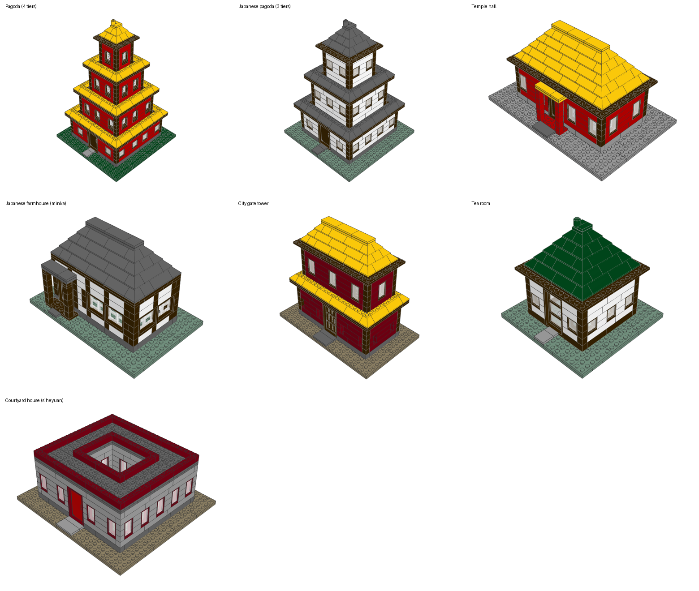
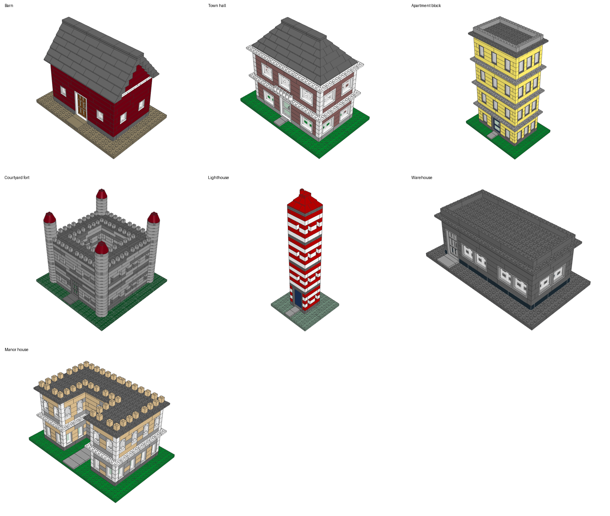
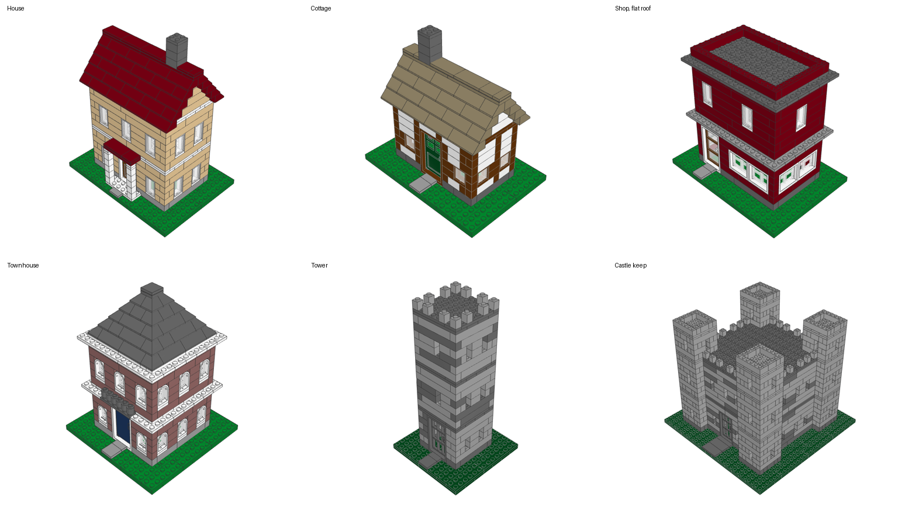

Asian-style limits: roofs are straight hip slopes, not the upswept curved eaves of real pagodas and temples (no part gives that curve at this scale), there is no lattice, dougong bracketing or ridge ornament, and the courtyard house has a flat parapet roof rather than rows of pitched ones.

Further knobs prove it is one grammar: an L-shaped hall, a courtyard building, round towers with cones (`variant-*` renders).

| house | cottage | shop |
|---|---|---|
| 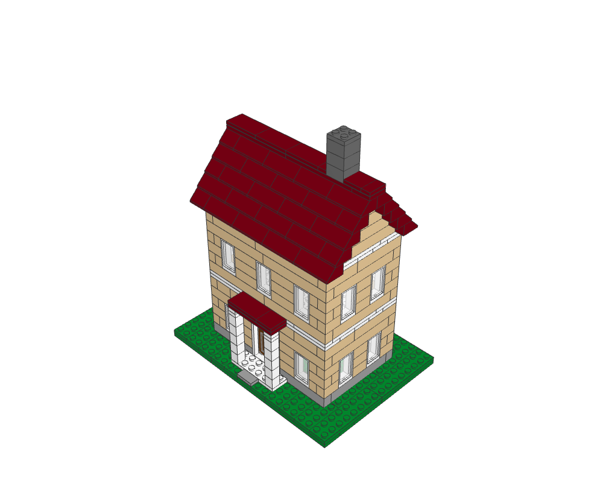 | 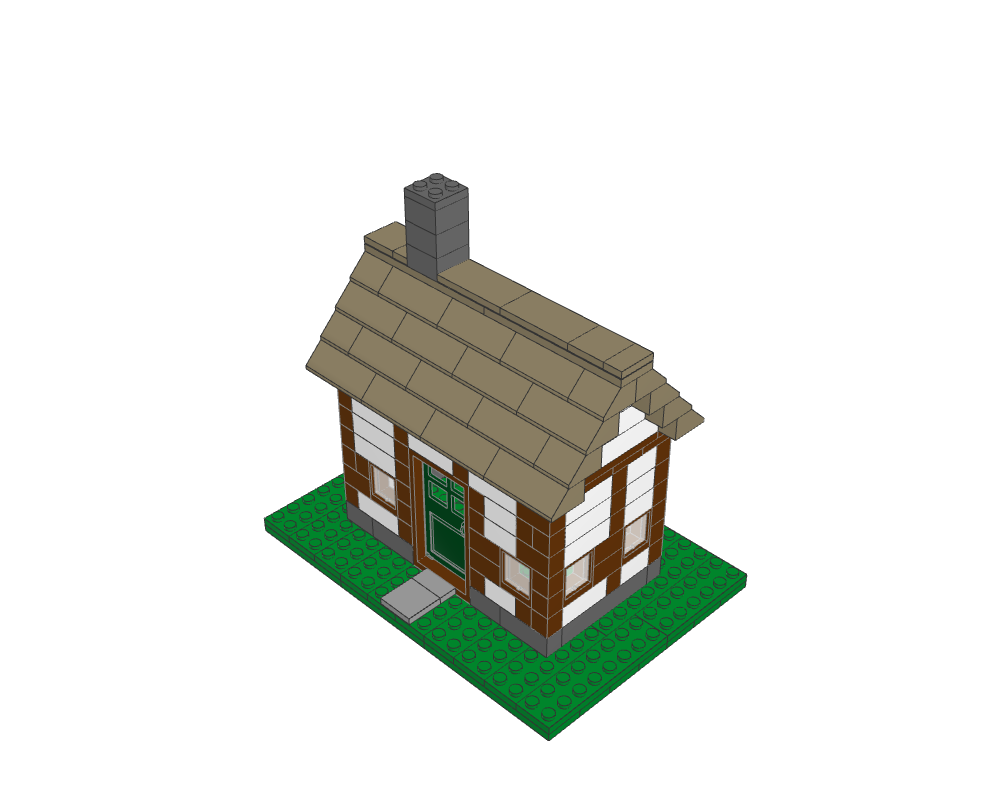 | 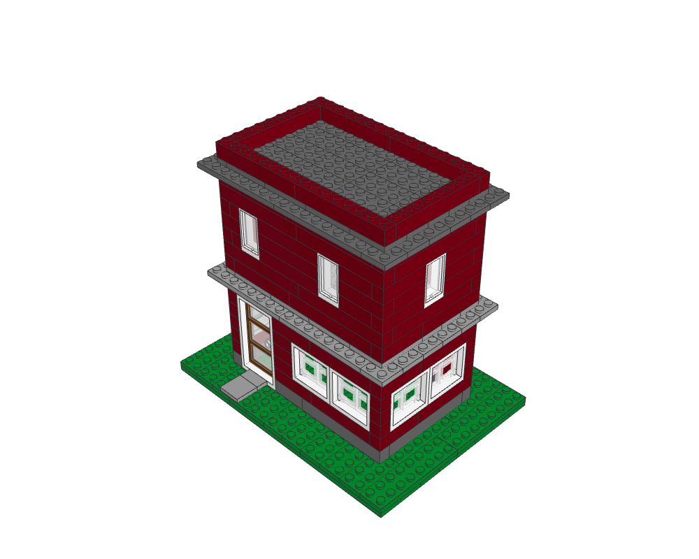 |
| **townhouse** | **tower** | **castle keep** |
| 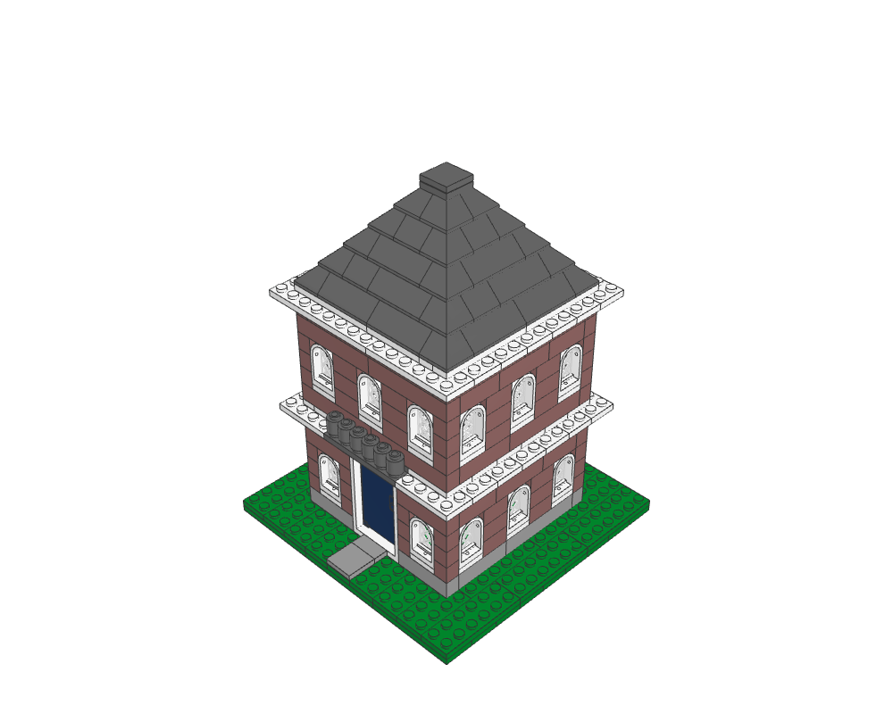 | 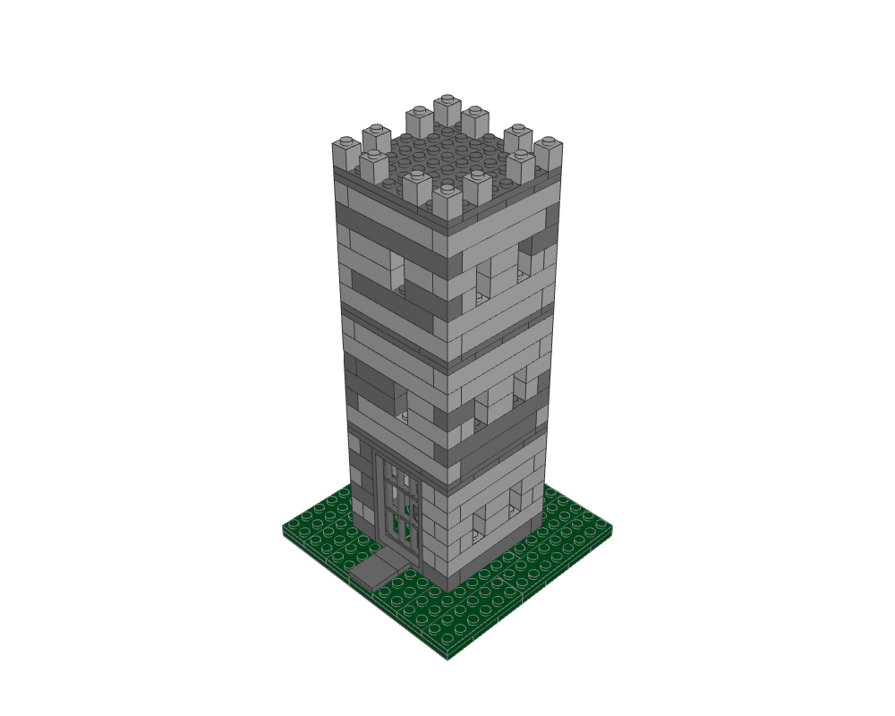 | 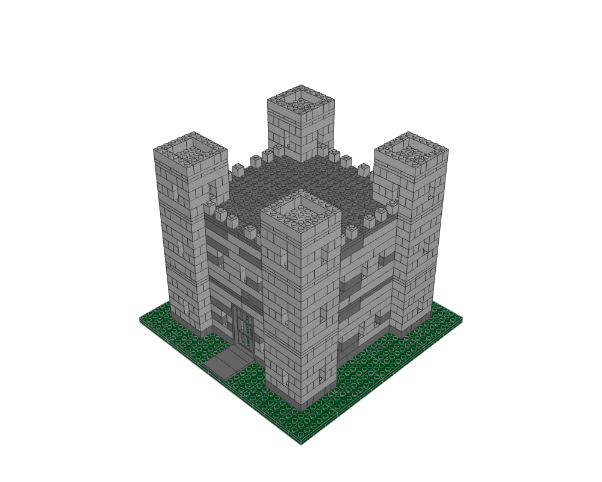 |
| **L-shaped hall** | **round towers** | **courtyard** |
| 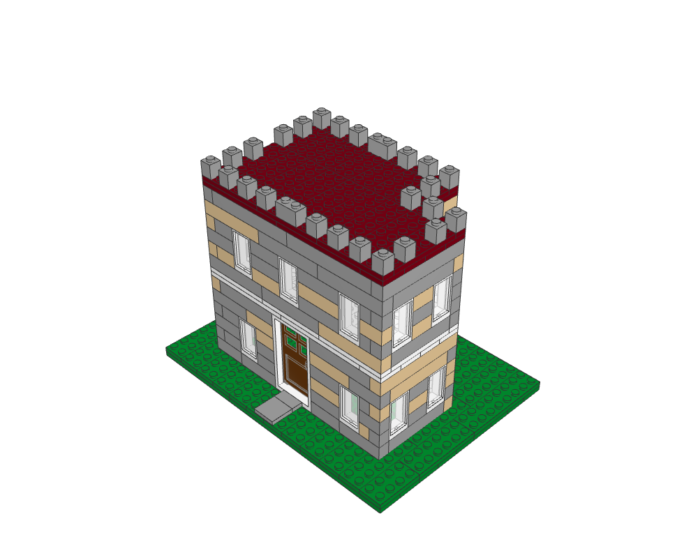 | 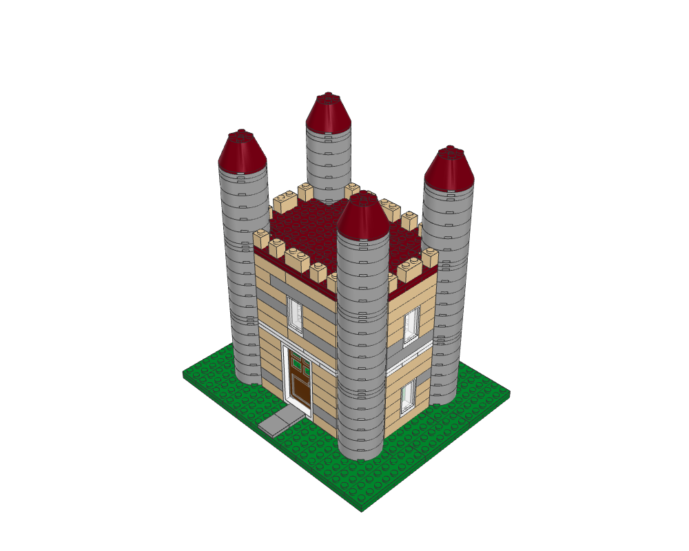 | 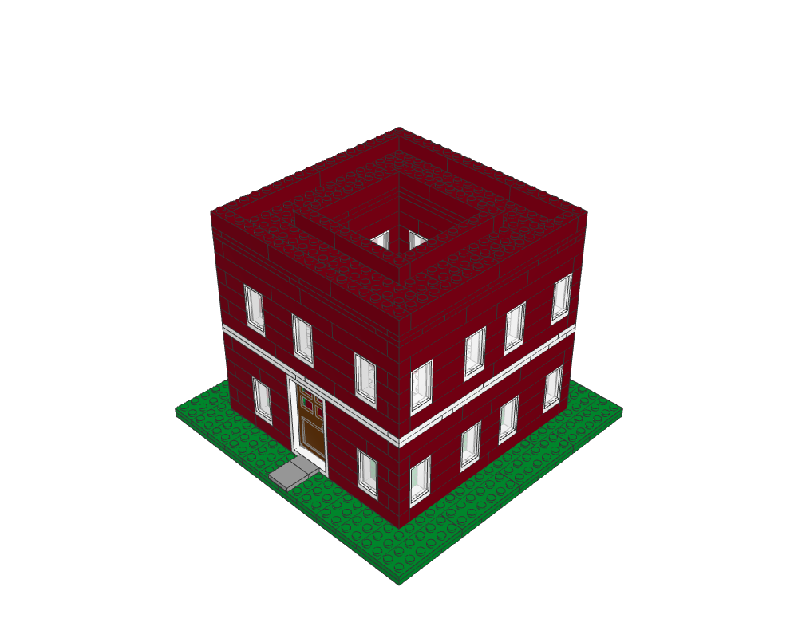 |

Front views are next to them in [`renders/`](renders/) (`*-front.png`). Course maps (top plans per storey, front elevation) are in [`maps/`](maps/) as text and SVG, so structure can be checked without a renderer.

## Renders: how they were made

Rendering worked in this environment: LeoCAD (`apt install leocad`) under `xvfb-run`, through `./ldraw-agent render`. LeoCAD's BOM export fails on this older build; the PNGs are written regardless. `render_presets.py` rebuilds every picture and map. I judged each render against real sets (the Creator small house 5891 and the 40290 castle from the reference library) and iterated: base plates were loose (now two crossed layers), interior floors floated (now two-layer slabs), panes were not recognised as connected (now placed on the hinge positions the library defines), cornices were detached (now cut with the band).

## What is verified

- `tests/test_grammar.py` (237 tests, no library needed): footprints, walls and bond, tiling, openings, roofs, towers, details, base, schema rules, determinism, parameter sweeps (about 60 cases, each must be one connected piece with a valid plan), parts-aware mode, natural language, registry, maps.
- `tests/test_grammar_validation.py` (42 tests, needs the LDraw library): every one of the 24 presets and 13 sweeps through `build_plan` + `analyze_geometry` (no errors, one optimistic component), the parts-aware plan, the registry route, and every catalogue part's footprint and height against the library's real bounds.
- A 356-case internal sweep (sizes 6-22 x 6-14, 1-3 storeys, three roofs, L/U/courtyard with thin and thick walls, square and round towers, every window and door kind, wall styles, every detail) found no collision and no loose part.
- `tests/test_generators.py -k "not parameter_range_corners"` still passes (29) after the routing change; the test that listed `house` first now expects `building` first with `house` still listed.

## Honest quality assessment against real LEGO

Good: running-bond walls with interlocking corners, real window, door and slope parts, floor bands, plinth and cornice, hollow stepped-gable roofs with ridge plates and tiles, chimney, porch, battlements, round and square towers, base with a path. Everything is one rigid, studs-up build with no floating pieces, and the plan is editable like any other. The house, cottage and shop read clearly as LEGO buildings at a glance.

Not yet at the level of a designed set. Comparing with 5891 (Creator small house) and 40290:

- **Detail density.** Real models add flower boxes, shutters, window sills, lamp posts, fences, trees, stairs and furniture; mine has a door, windows and a porch. Walls are single flat colours or a two-colour mix: no textured bricks, no SNOT trim, no brick-profile parts.
- **Roofs.** Only 45° slopes. Real small houses mix 33° and 45°, add dormers and gable windows, and finish eaves with inverted slopes; none of that exists yet. L, U and courtyard footprints get flat roofs only (no valleys), and towers rule out pitched main roofs.
- **Openings.** Standard window parts only, door fixed at 1x4x6 (minifig scale). `arch` windows have a lattice pane but no keystones; slits are plain gaps; the castle gate is a barred door, not an arch with a portcullis.
- **Towers.** Round towers are 4x4 only and chunky, the cone is a single part, tops are plain; square towers are plain blocks.
- **Stone.** The two-tone mix still reads slightly striped on long courses.
- **Interiors.** Floors only, no walls or furniture. The building is hollow.
- **Scale.** Everything is minifig scale; a micro or town-scale version would need new component implementations (the grammar would not change).
- **Parts-aware mode** substitutes brick lengths and colours; plates, slopes, windows and doors are counted and reported but not swapped.
- The toolkit confirms most contacts only as "optimistic" evidence (it cannot prove clutch); "one connected component" means that evidence graph.

I would call it a solid base for buildings that can be tuned by hand, not yet a generator whose output beats a designer's set. The parts that cost most to reach set quality are detail (windows with sills and shutters, roof variety) rather than structure.

## How it extends to vehicles and spaceships

The reusable parts are the ones that are not about houses: the **canvas** (cell occupancy, own connectivity graph, plan emission), the **tiling** programmes, **roles**, the **schema + rules + notes** pattern, **natural-language addressing**, **inventory mode** and the **validation** loop. Only the components change:

- Vehicle: Chassis (wheelbase, track, axles) → Body (cab, bed/box, doors, windows) → Wheels (size, arches) → Glass → Details (lights, bumpers, ladders). Spaceship: Hull (spine, sections, symmetry) → Wings → Engines → Cockpit → Details.
- What is new: vehicles and ships are not a studs-up stack of courses. The canvas must carry a full orientation (sideways studs, plates on edge) and axle/pin connections, and the existing `vehicle` and `spaceship` modules already know the wheel and connector rules. Symmetry (mirror one side) replaces facade layout.
- Roles already align with the templates work (`wheel`, `chassis`, `body`, `glass`, `wing`, `engine`), so edits by role work on both.

I would start with a Vehicle ontology that reuses the existing `vehicles.py` designs as the first implementations of the Body component, then wrap them in the same config → plan contract.

## Harvested components as alternative implementations

A component is a function `emit(ctx, region, params)`. Today each kind has one implementation (e.g. a `window` kind maps to a part). A harvested component is another implementation of the same kind: a submodel taken from a real model (`./ldraw-agent extract` copies a dependency-closed section with namespacing), described by its footprint in cells, its height in plates and its connection frame, with roles supplied by the classifier from the build-templates branch. The engine already asks every opening for `width`, `courses` and an origin, so a harvested window is a catalogue entry `{'section': ..., 'width': 3, 'courses': 3}`; selection by equal footprint makes the swap safe, and the validation loop (collisions, one component) is the gate. Roofs and towers could be harvested the same way as slices that repeat along the ridge. Licensing of the reference sets decides what can be shipped (open question 3).

## Relation to the build-templates branch

Templates derive their variations from an existing model; the grammar generates them from rules. They meet at roles: the grammar assigns roles exactly, the classifier infers them for other builds. The grammar's vocabulary is `roof wall window door glass base tower detail trim structure`; build-templates' is `roof wall window door base glass trim structure` plus vehicle roles. The two agree on eight names; `tower` and `detail` are grammar-only and should be aliases of `wall` and `trim` for any role-based edit written against the shared set. A grammar building can also become a template (it has exact roles) and give the classifier ground truth for houses.

## Effort to productionise

Wave 1 (about 1-2 weeks): backend integration. Route fast-path requests to `building` (flip the kinds), map `spec.v1` and the understanding model's output to a config patch (reuse `nl.apply_text` as the deterministic first pass), nested-group support in the generator form and `GeneratorEntry` (presets, notes), a preset API, validation sweeps in CI (about 2 minutes), role-based in-place edits ("make the roof blue" works on the plan by `role`), inventory input from the parts page.
Wave 2 (about 2-3 weeks): the UI in [ui/UI.md](ui/UI.md): component tree, per-component forms, preview (the viewer fed by the regenerated plan; Regenerate is about 20 ms plus the existing geometry check), saved presets.
Wave 3 (open-ended): quality. 33° roofs and dormers, gable windows, sills and shutters, arched gatehouses, more tower forms, per-wing roofs for L/U, interiors, harvested components, then vehicles.

## Decisions

1. **Routing: yes.** `building` now answers house, cottage, shop and townhouse requests. It is first in the registry and accepts the house generator's flat parameters (`compat.py`), so the fast path and the settings form keep working unchanged. The old `house` generator stays registered for saved builds. The backend test fixture (`app/web/backend/tests/generators_registry.json`) is a static dump of the old registry and was not regenerated; backend tests were not run here (no `fastapi` in this environment).
2. **Scale: minifig scale** (as now).
3. **Harvested components: yes**, the reference sets' windows, doors, roofs and towers may be shipped as alternative implementations of a component (see "Harvested components" above). Licences and attribution travel with each harvested section.
4. **Next: modular buildings** (not vehicles). First slice is done (see below); the rest is the plan.

## Modular buildings: what is built and what is next

Built now: four presets ([gallery](renders/gallery-modular.png)): bakery, town hall, apartment block, tea house. Each is a 32 x 32 module with sidewalk, kerb and street lamps; 2-4 storeys with lift-out floors, cornices and balcony on the front only, partition walls with doorways, Technic pin bricks in both side walls, nothing past the module edge. All validate with one connected component.

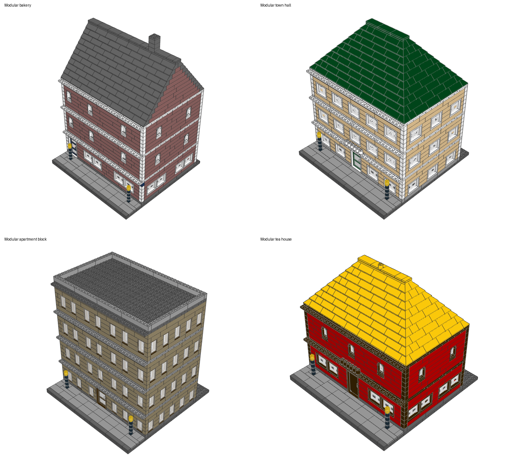

Done since (#206, #214, #221): furnished rooms (table with chairs, bed, cupboards, shop counter; `storeys.interior: furnished`), a striped shop awning (`details.awning`), a corner module (`base.corner`: a second sidewalk, windows and cornice on the two street sides), and a **street composer** (`grammar.compose_street`) that lays modules 32 studs apart with their fronts in line and reports how many Technic pins meet at each joint. Connector rows are now fixed relative to the module front (12 and 20 studs back; ground-floor pins at course 4), so any two modules bolt together; side walls are shared and carry no windows. Decision on open question 3 (#77): the roof and floors stay one model, no submodels.

Still open: staircases, a hinged or lift-off roof (not planned, see above), richer facades beyond sills, shutters, keystones and the flat awning (sloped awnings, shop-front prints are out of scope), a rounded or cut corner entrance, and upper-floor pins that only meet when storey heights match.

## Open questions

1. For modular buildings: should the street composer (several modules along a road, a corner, a park module) be part of this generator, or a separate "layout" feature above it?
2. Rooms need a furniture catalogue; build one from the reference sets (needs the harvesting pipeline) or hand-pick 20-30 parts?
3. Should a modular building default to a hinged/lift-off roof and floors as separate submodels in the plan (better manual and real behaviour, more sections to validate), or stay one connected model as now?
4. The cornice and sign band are hidden from above by the projecting plates; is a taller fascia (two courses) the right fix, or real sign tiles?
