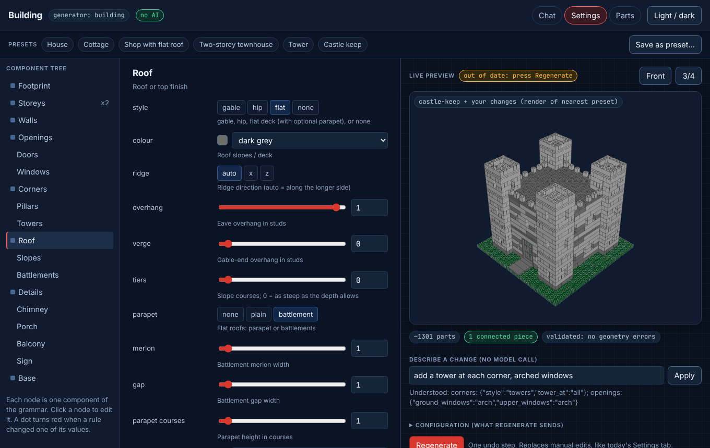
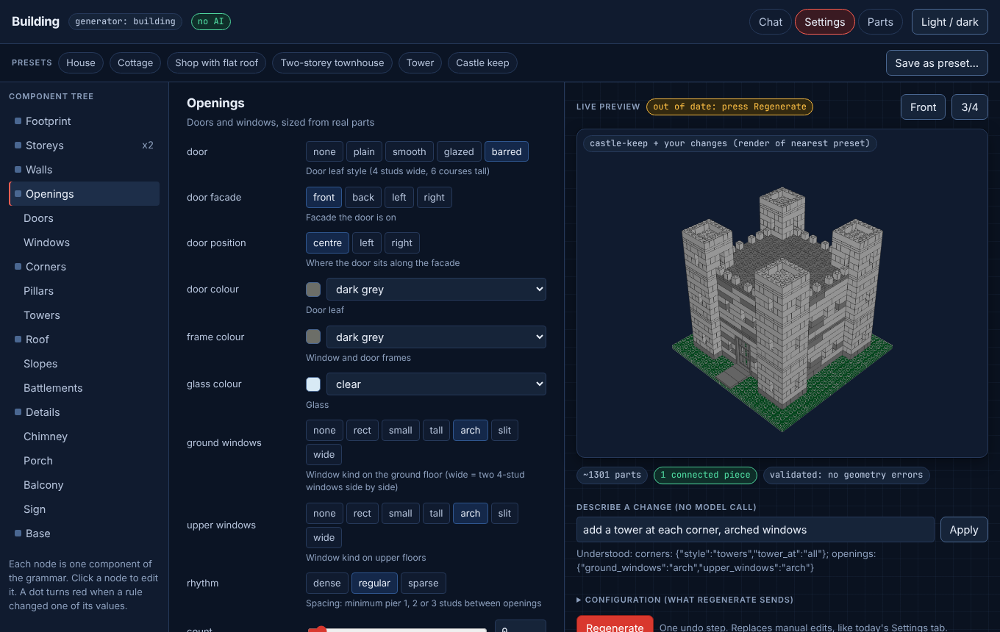

# UI: component tree, form, live preview, presets

Open [`index.html`](index.html) in a browser (static, no server; regenerate it with `python docs/plans/build-grammar/ui/make_mockup.py` - the form fields come straight from `grammar.SCHEMA`). It uses the app's Blueprint tokens (`theme.css` is copied in, dark and light) and shows the preset renders as the preview.

## Layout

- **Left: component tree.** Building → Footprint, Storeys (xN), Walls, Openings (Doors, Windows), Corners (Pillars, Towers), Roof (Slopes, Battlements), Details (Chimney, Porch, Balcony, Sign), Base. Clicking a node shows that component's form. A node's dot turns red when a validity rule changed one of its values.
- **Middle: the form for the selected component.** Generated from the schema: choices become segmented buttons, ranges become slider + number with the schema's min/max, flags become switches, colours become a swatch + name select (colour names from `colours.py`). Every field shows its `description` as a hint.
- **Right: live preview and notes.** The viewer shows the regenerated plan (the mockup shows the nearest preset render). Badges: part count, "1 connected piece", "validated". Rules fired by the last change appear as notes ("Courses raised to 6: the door is six courses tall (door-height)").
- **Top: saved presets.** The six presets as chips, "Save as preset…" stores the current configuration under a name (per user, in the app database like other saved settings).
- **Describe a change** (below the preview): a text box that applies `nl.apply_text` (no model call) and shows what it understood; anything it does not understand goes to the AI route as today.

## Where it plugs in

**Build workspace, Settings tab** (`components/workspace/SettingsPanel.tsx`). Today it renders the generator's flat `GeneratorForm` and "Regenerate" writes a new generated base as one undoable step. For `generator.id === "building"` the panel renders this tree + per-component form instead of the flat form; the rest is unchanged: changing a setting does nothing until Regenerate, one undo step, the warning about replacing manual edits stays. Because every placement carries a role, a manual edit made in the editor (or "make the roof blue" in chat) is applied in place by role and survives a Regenerate only if the user chooses to keep it; the existing banner covers that.

**New build, "Start from a type"** (`pages/NewBuild.tsx`, `way=type`). The list of types gains a "Building" card; opening it shows the preset chips first (House, Cottage, Shop, Townhouse, Tower, Castle keep, plus the user's saved presets) with the preview, then the same tree and form. "Create" posts `{generator: "building", params: config}` to the existing build-creation endpoint, exactly like other generators.

## What the app needs from the backend

- `GET /generators` already returns each entry's `params` schema; the `building` entry adds `presets` (name, title, description, config). Nested groups need a small extension in `GeneratorForm` (today parameters are flat).
- The regenerate call returns `notes` (already used for generators) and the plan; the grammar's `stats` and a validation verdict can ride along.
- Saved presets: a per-user table of `(name, config)`; no new generator code.

No frontend code was changed in this branch.
