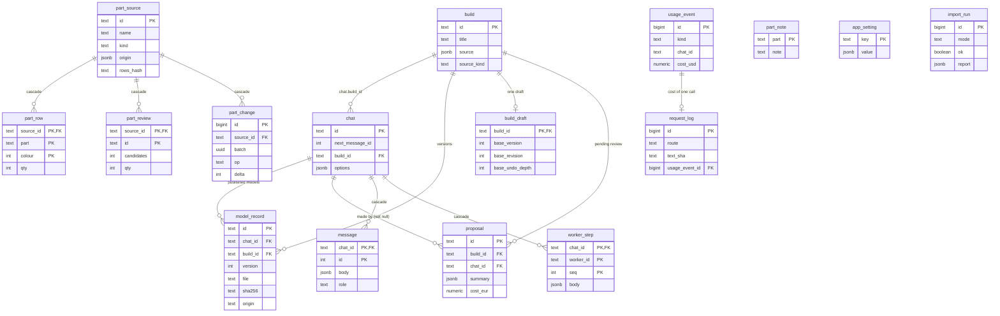

# Moving application state from JSON files to PostgreSQL

Proposal only; no app code changed. Base: master at 0a61b43e. Date: 2026-10-24.
Owner decision: "We should have a DB, preferably Postgres."

The DDL in section 2 is real and was run on a throwaway `postgres:18-alpine` container (hardened as in section 4): it loads cleanly, and the constraints and indexes below were exercised (duplicate version, wrong owner, bad slug, bad source kind, case-insensitive duplicate list name, negative quantity all rejected; a `pg_dump -Fc` / `pg_restore` round trip works). The file is [sql/0001_init.sql](sql/0001_init.sql). The container was removed afterwards.

---

## 0. Summary

| Question | Answer |
|---|---|
| What moves | Chats, messages, worker steps, published-model records, builds, versions (metadata), draft metadata, proposals (metadata), the parts collection (sources, rows, review items, notes, change log), the request log, the cost history, and a small `app_setting` table for non-secret settings |
| What stays files | MPD/LDR/PNG/CSV/GLB, proposal `.mpd`, the original uploaded CSVs, the editor session (`plan.json`, `state.json`, `preview.mpd`), the agent work folders, renders, the LDraw library, the reference models, SQLite reference data and every cache |
| Secrets | **Stay in `/config` files (root, 0700), not in Postgres, not encrypted in Postgres** (section 1.3) |
| Postgres | 18 (`postgres:18-alpine`, pinned by digest), one `db` service, own volume `ldraw-nova-docker_db`, not published to the host |
| Driver | psycopg 3 (`psycopg[binary]`, `psycopg_pool`), plain SQL in repository modules, no ORM |
| Migrations | Numbered `.sql` files plus a 60-line runner, forward only, checksummed, advisory-locked |
| Tests | Postgres everywhere (a throwaway `db-test` service on tmpfs), not SQLite |
| Existing data | Idempotent importer `migrate_json.py` with `--dry-run`, `--commit`, `--verify`; the JSON files are never modified or deleted |
| Agent sandbox | The agent user cannot reach the DB: firewall rule on port 5432, password only in a root-only file, never in any environment |
| Effort | 3 agent tasks, about 9 to 11 working days in total |

The key idea that keeps this safe: **the database holds records, the filesystem keeps blobs**. A version row points at `generated/<slug>-vN.mpd` and carries its sha256. The agent, LeoCAD, the toolkit CLI and the 3D editor keep working on files exactly as today. Only the bookkeeping around them moves.

---

## 1. Scope

### 1.1 What moves, and why

| Item | Today | After | Why it moves |
|---|---|---|---|
| Chats | `chats/<id>/chat.json`, rewritten whole on each update, scanned with `iterdir()` for the list | `chat` | Listing, ordering and the chat-to-build link become queries; no directory scan |
| Messages | `messages.jsonl`, whole-file read to find the next id and to render a chat, a crash can cut a line | `message` (`body jsonb`) | Atomic append, per-chat id counter under a row lock, no truncated line, partial reads (last N messages, last turn) |
| Turn usage | `_usage` inside each message, summed by reading all messages (`usage.usage_totals`) | stays in `body` (callers unchanged) **and** is appended to `usage_event` | Cost totals survive deleting a chat; queries by day, model, build |
| Worker transcripts | `workers/<id>.jsonl` | `worker_step` | Same as messages; cascade on chat delete |
| Published-model records | `models.jsonl` per chat and per build | `model_record` | Unique `(build, version)` makes version numbers race-free |
| Builds | `builds/<slug>/build.json`, `chats` list inside it | `build`; the chat list becomes `chat.build_id` | One source of truth for the chat-build link; no list to keep in sync |
| Versions | **Derived by scanning `data/generated/`** (`builds.group_versions`, mtime-keyed cache) | `model_record` rows (build_id set) pointing at the files | Today "what versions exist" is an inference from file names; the DB makes it a fact, with sha256 and part count. A reconcile step still adopts files dropped into the folder |
| Draft metadata | `draft.json` | `build_draft` | Transactional with save, discard, accept |
| Proposals | `proposals/<id>.json` + `.mpd` | `proposal` row + the `.mpd` file | Listing and pruning without globbing; the MPD is a blob |
| Parts collection | `inventories/<id>.json` (rows inside), `<id>.log.jsonl` (stage 1) | `part_source`, `part_row`, `part_review`, `part_note`, `part_change` | This is the one place where a database clearly beats files: edit a row, sum across sources, undo a batch, "where is part X". Today every edit rewrites a whole JSON file |
| Request log | not built yet (`CONFIG_DIR/telemetry/describe.jsonl`, nl-review section 7) | `request_log` | Built directly on the DB: no rotation code, SQL for the "NL health" page, a retention `DELETE` |
| Cost history | derived by summing messages | `usage_event` + view `cost_daily` | See above |
| Non-secret settings | mixed into `models.json` / env | `app_setting` (new settings only, see 1.3) | |

### 1.2 What stays files, and why

| Item | Stays | Why |
|---|---|---|
| `generated/*.mpd .ldr .png .csv .glb` | files | Blobs the browser, LeoCAD, the toolkit and the agent read by path; the gallery serves them as static files; `docker cp` of "My Builds" must keep working |
| Original uploaded CSV (`inventories/<id>.csv`) | file | An audit copy; never queried |
| Proposal `.mpd` | file | A blob, read by path to preview and accept |
| Editor session: `builds/<slug>/output/editor/plan.json`, `state.json`, `preview.mpd`, and the chat equivalents | **files** | Decision: these belong to the *resident editor worker and the toolkit CLI*, which are processes in the sandbox world reading and writing them with plain file I/O, and `state.json` is rewritten on every brick edit (a hot, bulky, undo-stack-shaped document). Putting it in Postgres would force the toolkit to speak SQL and would give the agent a reason to reach the DB. The DB keeps only the small `build_draft` pointer and counters. If the two disagree after a crash, open trusts `state.json` for the revision and the DB for the base fields |
| `output/<chat-id>/` agent work folders, `chats/<id>/renders/` | files | Scratch and images; never served raw or served as static files |
| LDraw library, reference models, `ldraw-info.db`, `catalog.sqlite`, set catalogue, Rebrickable maps | image / files | Read-only reference data baked into the image, 100s of MB, rebuilt by build steps. SQLite stays here: it is reference data and a cache, not user state |
| Caches: build-worker content-hash cache, GLB cache, buildable BOM cache, model discovery cache, Jev snapshots | files | Disposable; losing them costs time, not data. They would only bloat the backup |
| `/config/models.json`, `/config/environment.json`, `/config/generators.json` | files | Secrets (first two) and a regenerable cache (third); see 1.3 |
| `run_state` (running chats, SSE subscribers), `budget.BudgetLedger` | memory | Per-request, per-process state; a restart is allowed to forget it |

### 1.3 Secrets and settings: decision

**API keys and endpoints stay in `/config` and never enter Postgres.** Justification:

1. The security model today is "the agent cannot read `/config`" (separate volume, root 0700). The DB is reachable from the app container's network namespace; the config volume is not. Keeping keys where they are keeps that boundary unchanged.
2. Encrypting keys in the DB only moves the problem: the encryption key would have to live in `/config` or in the app env, so the DB adds a hop and no protection.
3. `pg_dump` files are what the owner will copy around (laptop, NAS, cloud). A dump with keys in it, even encrypted, turns a harmless backup into a credential. Keeping keys out makes "back up the DB" a safe, casual act.
4. `models.json` entries are free-form `litellm_params` (any `api_key`, `extra_headers`, `api_base` the owner types) and `llm_config` already has masking, endpoint-change guards and atomic `0600` writes. Re-implementing that on SQL is risk with no gain.

What does go into `app_setting`: **new** non-secret settings only (the request-log on/off switch and "keep sentences" opt-in, retention days, the nightly-backup flag, the last importer run, schema notes). The existing non-secret fields (`default`, `worker_default`, `understanding_default`) stay next to the entries in `models.json`: they reference entry ids and must change atomically with an entry delete, which a second store would break. They can move later if the owner wants one place; the repository seam makes it a one-module change.

---

## 2. Schema

Full DDL: [sql/0001_init.sql](sql/0001_init.sql). Conventions:

- Ids the app already uses stay `text` with a `CHECK` that mirrors today's regex (`CHAT_ID_RE`, `slugify`, the 12-hex proposal id). Existing URLs and chat ids do not change.
- Times are `timestamptz`. The repository returns **float epoch seconds** (`extract(epoch from ...)`) so routers and the frontend see the same shapes as today.
- jsonb is used where structure is fluid: agent messages (`message.body`, `worker_step.body`), `build.source`, `chat.options`, import metadata. Everything the code filters or joins on is a real column.
- `message.body` is the agent message **exactly as stored today** (minus `id` and `created_at`, which are columns). That is the compatibility trick: `history.py`, `usage.usage_totals`, `turn_stats` and the bounded-history code keep reading dicts with `_usage`, `_worker`, `_editor_publish` unchanged. `role` is a generated column for cheap filtering.
- Versioning of the schema: numbered migrations (section 3.3). Later changes are additive (new tables, new nullable columns); rename or drop only across two releases.

### 2.1 ERD



`schema_migration (version, name, sha256, applied_at)` is created by the runner itself and is not in the diagram.

### 2.2 Decisions worth explaining

- **`model_record` serves both chats and builds** (`CHECK num_nonnulls(chat_id, build_id) = 1`). Today a build's workspace key `b-<slug>` reuses the chat machinery and writes `models.jsonl` the same way, so one table keeps `store.add_model` unchanged. Partial unique indexes give `(build_id, version)` and `(chat_id, version)` uniqueness: two "Save as" clicks cannot both become v4.
- **`chat.next_message_id`** replaces the in-memory `_next_id` dict and the "max id + 1 by reading the whole file" scan. `UPDATE chat SET next_message_id = next_message_id + 1 ... RETURNING` is atomic and works across threads and processes.
- **`usage_event` has no foreign keys** on purpose. Deleting a chat deletes its messages; the money it cost stays in the history. It is written in the same transaction as the message that carries `_usage`. The importer backfills it from existing messages. Worker aggregate records (`_worker`) become `kind = 'worker'`. A priced-NULL (`cost_usd IS NULL`) keeps today's "unpriced steps" meaning.
- **`request_log` has no cost columns of its own**: it points to a `usage_event` (kind `understand`), so the cost history is one table. The nl-review field list maps one to one onto the columns plus `fields jsonb` for the long tail. `sentence` is NULL unless the owner opted in; `text_sha` is `sha256(text)[:12]` as approved.
- **Parts:** `part_row` keeps today's exact meaning (LDraw part + LDraw colour code + qty), so `combine`, `match_bom`, `owned_map` need no change. `part_review` keeps the "approximate, never counted" rule from the owner decisions. `part_note` is the owner's "free-text note per part"; the later **locations** step is one migration (`location` table with `parent_id`, `part_row.location_id`, primary key widened to include it, a data step `INSERT INTO location SELECT DISTINCT note ...` and mapping notes to bins). Row counts are in the thousands, so widening the key is instant.
- **Reservations** (parts-catalogue wave 3) are not in 0001: `reservation` plus `reservation_row`, added when that wave is built. `available_map(ids)` becomes one SQL aggregate.
- **Names unique case-insensitively** (`part_source_name_key`) replaces the `_name_taken` scan under a process lock.
- **Indexes:** only those a query needs today: chat list by `updated_at`, chat by build, `(chat_id, id)` primary key for messages, `(part, colour)` on rows for "where is this part", batch lookup for undo, time indexes for the logs. No GIN indexes until a feature needs jsonb search.

### 2.3 Size, so nobody over-engineers

A long agent chat is a few MB of jsonb (TOASTed and compressed). Thousands of chats are still hundreds of MB at most. The parts collection is tens of thousands of rows. The request log at 1 KB a row and 100 requests a day is 36 MB a year. No partitioning, no archiving, no connection pooler.

---

## 3. Stack

### 3.1 Postgres version and image

`postgres:18-alpine@sha256:898c60cb390d1085bc97bdd6a1ae968757421df394b071848b52b1c09c89d6a5` (18.6, musl, about 300 MB on disk, resolved 2026-10-24 and run in the validation). Pinned by digest like every other base image in `app/Dockerfile`; update procedure is the same (`docker buildx imagetools inspect`, review, replace the digest). 18 is the current major; the owner is starting fresh so there is no reason to start on an older one. Note the 18 image keeps data under `/var/lib/postgresql/18/docker`, so the volume mounts at `/var/lib/postgresql` (not `.../data`).

### 3.2 Driver: psycopg 3, plain SQL

| Option | Verdict |
|---|---|
| **psycopg 3 + `psycopg_pool`, SQL in repository modules** | **Chosen.** 3 packages (`psycopg`, `psycopg-binary`, `psycopg-pool`; `typing-extensions` is already in the lock via other packages). Native jsonb adaptation (`Jsonb(dict)` in, dict out), `row_factory=dict_row` gives exactly the dicts the code already passes around, server-side binding, pipeline and COPY for the importer |
| SQLAlchemy Core | Not chosen: adds SQLAlchemy (large) and, with Alembic, Mako and MarkupSafe; we need no dialect portability and no query builder for about 40 fixed statements |
| SQLAlchemy ORM | No: the code is built on plain dicts that go to JSON; an ORM adds mapping layers we would immediately flatten back |
| asyncpg | Fast but a different API, no sync mode; most of this backend (stores, agent loop threads, toolkit calls) is synchronous |

Hash pinning: add `psycopg`, `psycopg-binary` and `psycopg-pool` to `app/requirements.txt` with `==` pins, then regenerate `requirements.lock` with the documented `uv pip compile --generate-hashes` command and review the diff. `psycopg-binary` ships manylinux wheels for CPython 3.12 (the image's system Python), so no compiler and no `libpq-dev` enter the image. Nothing is installed at run time.

### 3.3 Migrations: numbered SQL files, not Alembic

`app/web/backend/migrations/0001_init.sql`, `0002_*.sql`, ... and `migrate.py` (about 60 lines):

1. Take `pg_advisory_lock(<constant>)` (two app processes, or a `--reload` restart, never race).
2. Create `schema_migration` if absent.
3. For each file in order: if applied, verify its sha256 matches the recorded one (an edited old migration is a hard error); if not applied, run it **in one transaction** together with the `schema_migration` insert.
4. Forward only. "Down" is "restore the pre-upgrade backup" (section 4.3), which is also the only real downgrade for a data migration.

Why not Alembic: its value is autogeneration and branching for ORM models, neither of which we have; it adds Alembic, SQLAlchemy, Mako and MarkupSafe to a hash-locked image, and its migration scripts are Python wrapping the SQL we would write anyway. The runner runs at app start (before the pool serves requests) and from `python -m migrate` for tests and the importer.

### 3.4 Connection handling

- One `psycopg_pool.ConnectionPool` (sync), `min_size=1, max_size=8`, created in the FastAPI lifespan, `open(wait=True, timeout=30)`; `connection_class` sets `row_factory=dict_row`. The backend is mostly synchronous code called from threads and from the agent loop, so a sync pool is the least invasive choice.
- Module `app/web/backend/db.py`: `pool`, `transaction()` (context manager yielding a connection, commit on exit, rollback on error), `fetch_one / fetch_all / execute` helpers, and `run(fn, *args)` = `await asyncio.to_thread(...)`.
- Rule for async handlers: single-row primary-key calls may run inline (a local Postgres round trip is about 0.2 ms, cheaper than the file I/O they replace); list and aggregate calls (chat list, parts detail, cost views) go through `db.run`. Agent-loop threads call repositories directly.
- Settings: `statement_timeout=15s`, `idle_in_transaction_session_timeout=30s`, `application_name=obd`. Timeouts turn a stuck transaction into an error instead of a frozen UI.
- If Postgres is down at runtime, requests fail with a 503 `{"detail": "The database is not available"}` (one exception handler for `psycopg.OperationalError`), `/api/health` reports it, and the pool reconnects by itself when it returns.
- The DSN is built in memory from `LDRAW_NOVA_DB_HOST=db`, user `obd_app`, and the password read from a root-only file (`/run/secrets/db_password`). It is never put in `os.environ`, so `sandbox.py`'s scrubbed environment cannot leak it by accident and `/api/environment` cannot show it.

### 3.5 Transactions around multi-step operations

Rule: **the database commit is the commit point; files are written first under a temporary name and moved into place just before the commit, and a failed commit removes them.** Orphan files are harmless (the reconcile step adopts or ignores them); a row without a file is not allowed.

| Operation | Today | Transaction |
|---|---|---|
| Save as vN (`draft/save`) | write mpd, png, csv, append `models.jsonl`, rewrite `draft.json`, bump `build.json` | `BEGIN; SELECT ... FROM build WHERE id=$1 FOR UPDATE;` next version = `max(version)+1`; `os.replace` the `<slug>-vN.mpd` temp file (O_EXCL name check first); `INSERT model_record`; `UPDATE build_draft` (base_version, counters), `UPDATE build.updated_at`; `COMMIT`. On failure: delete the new file. PNG and CSV are derived artifacts and are rendered afterwards by the existing background `gallery.ensure_artifacts` |
| Accept proposal | apply to draft session, delete proposal files | Apply to the editor session (file write, one undoable step) first; then `BEGIN; UPDATE build_draft ...; DELETE FROM proposal WHERE id=$1; COMMIT`; then unlink the `.mpd`. If the commit fails the proposal is still listed and can be accepted again; the editor step is undoable |
| Create proposal | write mpd, write json, prune old | write `.mpd`; `BEGIN; INSERT proposal; DELETE the oldest beyond MAX_PROPOSALS RETURNING id; COMMIT`; unlink the pruned files |
| Add message | append line, rewrite chat.json | `BEGIN; UPDATE chat ... next_message_id RETURNING; INSERT message; INSERT usage_event (when `_usage`); COMMIT` (one statement block, one round trip with a pipeline) |
| Delete chat | rmtree twice | `DELETE FROM chat` (cascades messages, workers; sets `proposal.chat_id` and `build` link null), commit, then remove the work folder and renders |
| Import commit (parts) | write json under a process lock | `BEGIN; INSERT part_source; COPY part_row; INSERT part_change (batch); COMMIT`. The preview-then-commit flow keeps the parsed result in memory or a temp file, never half in the DB. Replace-import keeps the id and writes one batch with every diff |
| Quantity edit / undo batch | rewrite json and append log | `UPDATE part_row ...; INSERT part_change ...` in one transaction; undo reads `WHERE batch = $1` and applies inverses in one transaction. Row locks (`SELECT ... FOR UPDATE`) replace the process-wide `_lock` |

The existing in-process locks (`ChatStore._lock`, `inventories._lock`) go away with the code they protect; the per-build serialisation of editor requests (a file concern) stays.

---

## 4. Compose and operations

### 4.1 Compose (additions to `app/docker-compose.yml`)

```yaml
services:
  db-secrets:                       # one-shot: generates the DB password once, on first start
    image: postgres:18-alpine@sha256:898c60cb390d1085bc97bdd6a1ae968757421df394b071848b52b1c09c89d6a5
    restart: "no"
    user: "0:0"
    network_mode: none
    cap_drop: [ALL]
    cap_add: [CHOWN, FOWNER, DAC_OVERRIDE]
    security_opt: [no-new-privileges:true]
    volumes: [secrets:/s]
    entrypoint: ["sh", "-c"]
    command:
      - '[ -s /s/db_password ] || { umask 077; head -c 32 /dev/urandom | base64 | tr -d "=+/\n" > /s/db_password; };
         chown 0:70 /s/db_password; chmod 0440 /s/db_password'

  db:
    image: postgres:18-alpine@sha256:898c60cb390d1085bc97bdd6a1ae968757421df394b071848b52b1c09c89d6a5
    container_name: ldraw-nova-db
    restart: unless-stopped
    user: "70:70"                   # the image's postgres user: no root, so no capabilities are needed at all
    init: true
    networks: [db-net]              # internal network, no published port
    depends_on:
      db-secrets: { condition: service_completed_successfully }
    environment:
      POSTGRES_USER: obd_admin      # bootstrap superuser, used only through the local socket (backups, restore)
      POSTGRES_DB: obd
      POSTGRES_PASSWORD_FILE: /run/secrets/db_password
      POSTGRES_HOST_AUTH_METHOD: scram-sha-256
      POSTGRES_INITDB_ARGS: "--auth-host=scram-sha-256 --auth-local=trust"
    volumes:
      - db:/var/lib/postgresql
      - secrets:/run/secrets:ro
      - ./db/initdb:/docker-entrypoint-initdb.d:ro   # creates the non-superuser role obd_app (owner of database obd)
    command: ["postgres", "-c", "shared_buffers=64MB", "-c", "max_connections=20", "-c", "work_mem=8MB",
              "-c", "idle_in_transaction_session_timeout=60000", "-c", "log_min_duration_statement=500"]
    healthcheck:
      test: ["CMD-SHELL", "pg_isready -U obd_admin -d obd"]
      interval: 5s
      timeout: 3s
      retries: 12
      start_period: 15s
    security_opt: [no-new-privileges:true]
    cap_drop: [ALL]
    read_only: true
    tmpfs: ["/tmp", "/run/postgresql"]
    mem_limit: 512m
    pids_limit: 128

  ldraw-nova-app:
    depends_on:
      db: { condition: service_healthy }
    networks: [default, db-net]
    environment:
      LDRAW_NOVA_DB_HOST: db
      LDRAW_NOVA_DB_NAME: obd
      LDRAW_NOVA_DB_USER: obd_app
      LDRAW_NOVA_DB_PASSWORD_FILE: /run/secrets/db_password
    volumes:
      - secrets:/run/secrets:ro     # file is root:70 0440: the server (root) reads it, agent uid 999 cannot

networks:
  db-net:
    internal: true                  # the database cannot reach the internet, nor can anything outside reach it

volumes:
  db:      { name: ldraw-nova-docker_db }
  secrets: { name: ldraw-nova-docker_secrets }
```

What was validated: the hardened `db` flags (`user 70:70`, `cap_drop: ALL`, no capabilities added, `no-new-privileges`, read-only root, tmpfs for `/tmp` and the socket directory, 512 MB limit) start Postgres 18 and accept connections. Idle memory was about 87 MiB including page cache with `shared_buffers=64MB`. The multi-container compose behaviour (healthcheck dependency, the one-shot secret service, `db-net: internal`) is design, to be tested in task 1.

Notes:

- **Why a generated password in a volume rather than `.env`.** Compose cannot generate a value; `.env` would need a host-side script (PowerShell and bash variants) and an owner step before the first `docker compose up`. The one-shot service makes plain `docker compose up -d --build` keep working. The password is irrelevant to dumps and restores, and anyone who wants to choose it can `docker run` the one-liner by hand or put `LDRAW_NOVA_DB_PASSWORD` in `.env`, which the entrypoint prefers if set (documented, not the default).
- **Roles.** `obd_admin` (bootstrap superuser) is reachable only through the local socket inside the db container (`docker compose exec db ...`), so backups and restores never need a password. The app connects over the network as `obd_app`, a plain role that owns the database `obd` (it can create tables for migrations, cannot create roles or databases, and is not a superuser). `db/initdb/10-roles.sh` creates it from the password file.
- **App waits** through `depends_on: service_healthy`; the pool also retries for 30 s at start so a `--reload` restart or a slow db start never crashes the app.
- **Resource use on a laptop:** about 60 to 100 MB resident, near-zero CPU when idle, a few MB of disk to begin with. Compared with the 4 GB app container this is noise. `max_connections=20` is 2.5x the pool.
- **`docker compose down -v` now also deletes the DB.** The README warning needs one more line; backups (4.3) are the answer, and the backups volume is not removed by `down -v` if it is a separate named volume (below).

### 4.2 Dev mode (`docker-compose.dev.yml`)

Add only: `db` publishes `127.0.0.1:5433:5432` (so `psql` and a GUI on the host work) and mounts nothing writable from the checkout. The backend's `migrations/` and `db/initdb` live under `app/`, already mounted `:ro` at `/app`. A `--reload` restart reopens the pool; migrations run again and are no-ops. Dev data is the same named volume, so switching modes keeps the data.

### 4.3 Backups

All commands run from `app/`. The database is small, so a logical dump is the right tool.

- **One-liner (any shell):**
  `docker compose exec db sh -c 'pg_dump -U obd_admin -Fc obd -f /tmp/obd.dump' && docker compose cp db:/tmp/obd.dump ./obd-backup.dump`
  (Written with `-f` and `cp` because PowerShell 5.1 corrupts binary redirects.) `pg_dump` takes a consistent snapshot while the app runs.
- **Whole-app backup** = the dump **plus** the data volume, because the MPD/PNG/CSV files live there:
  `docker run --rm -v ldraw-nova-docker_data:/d -v "$PWD":/b alpine tar czf /b/obd-data.tgz -C /d generated builds inventories chats`.
  The proposal says this plainly in Settings and the README: the dump alone is not a full backup (see question 2).
- **Scheduled option (opt-in compose profile `backup`):** a `db-backup` service from the same image, `profiles: ["backup"]`, on `db-net`, writing `obd-YYYY-MM-DD.dump` to a **separate named volume** `ldraw-nova-docker_backups` and keeping 7 daily and 4 weekly files, run by a `while sleep 86400` loop. Start it with `docker compose --profile backup up -d`. Alternative for people who prefer the host: the one-liner in Windows Task Scheduler or cron. Dumps contain no API keys (section 1.3), so copying them off the machine is safe.
- **Restore:** stop the app (`docker compose stop ldraw-nova-app`), then
  `docker compose cp ./obd-backup.dump db:/tmp/obd.dump && docker compose exec db sh -c 'dropdb -U obd_admin --if-exists obd && createdb -U obd_admin -O obd_app obd && pg_restore -U obd_admin -d obd --no-owner --role=obd_app /tmp/obd.dump'`, then start the app. The validation did a `pg_dump -Fc` and `pg_restore` round trip. Restore the data volume tarball the same way if files are lost too.
- **Before each migration step that changes data (tasks below)** the app writes a dump to `/tmp`-equivalent in the backups volume if the `backup` profile is on; otherwise the importer refuses to `--commit` unless the owner passes `--i-have-a-backup` or a dump younger than 24 h exists. Cheap, and it prevents the one irreversible mistake.

### 4.4 Upgrades

- **Image digest bump within 18:** pull, `docker compose up -d db`; same data directory, seconds of downtime.
- **Major version (18 to 19):** dump, create a new volume, restore into the new image, switch the compose volume name (or `pg_upgrade` offline). The dump/restore path is the supported one because the dataset is small.
- **App upgrades:** the runner applies new migrations at start. A migration that rewrites data takes a dump first (4.3).

### 4.5 Hardening constraints (from `docs/security/2026-10-24-security-pass.md`)

- `db`: non-root, `cap_drop: [ALL]` with nothing added, `no-new-privileges`, read-only root, tmpfs only for `/tmp` and the socket, `mem_limit`, `pids_limit`, no published port, `db-net` internal.
- `db-secrets`: no network, three capabilities, exits after one second.
- The app container's existing capability list does not grow. The DB credentials never appear in `docker inspect` (a file in a volume, not an env var), in the app environment, or in a log (`log_connections` stays off).
- `pg_hba`: `scram-sha-256` for network clients; `trust` only for the local socket inside the db container, reachable only through `docker exec`. No `host all all 0.0.0.0/0 trust`.
- Agent isolation: section 6.5.

---

## 5. Migrating the existing data

### 5.1 The importer

`app/web/backend/migrate_json.py`, run as `python -m migrate_json {--dry-run | --commit | --verify | --export DIR}`. It reads the **current** `/data` and `/config`-adjacent JSON files (never `/config` secrets) and writes Postgres.

| Source | Target | Mapping notes |
|---|---|---|
| `builds/<slug>/build.json` (or a legacy build derived from `generated/`) | `build` | Legacy builds with no `build.json` get a row built the same way `builds._legacy` does (title from the file description, dates from mtimes). `chats` list in the file is ignored; the link comes from each chat |
| `chats/<id>/chat.json` | `chat` | `build_id` kept; `next_message_id` = max message id + 1 |
| `messages.jsonl` | `message`, `usage_event` | Ids and `created_at` preserved, bodies copied verbatim; bad (truncated) lines are counted and reported, not guessed. One `usage_event` per `_usage` |
| `workers/<id>.jsonl` | `worker_step` | `seq` = line number |
| `models.jsonl` (chat and build) | `model_record` | `file` normalised from the chat-relative ref to a path under `/data`; `sha256` and part count computed from the file; duplicate `(build, version)` keeps the latest and is reported |
| `generated/*-vN.mpd` with no record | `model_record` | The reconcile step, also run at every start afterwards (cheap, mtime-gated) |
| `builds/<slug>/draft.json` | `build_draft` | |
| `proposals/*.json` with an existing `.mpd` | `proposal` | |
| `inventories/<id>.json` (+ `.log.jsonl`) | `part_source`, `part_row`, `part_review`, `part_change` | Schema 1 and 2 files both read; `unmapped_*` kept as jsonb |
| `part_notes` or notes (stage 1) | `part_note` | |

Properties:

- **Idempotent.** Every insert is `ON CONFLICT DO NOTHING` on the natural key (chat id + message id, build slug + version, source id + part + colour). One transaction per chat, per build and per source, so a crash leaves whole entities, never fragments, and re-running skips what is already there. Source files' size and mtime are recorded per entity in `import_run.report`, so a changed JSON file after a first import is **reported** (a warning with the entity id), not silently overwritten.
- **Dry run** (default when no flag is given): parses everything, runs the inserts inside a transaction that is rolled back, prints counts per entity, anomalies (truncated lines, duplicate versions, orphan files, unknown keys) and the estimated size. Writes `import_run` with `mode='dry-run'`.
- **Verification** (`--verify`, also run automatically after `--commit`): for each entity, JSON count equals DB count (chats, messages per chat, builds, versions, sources, rows, sum of quantities per source, change-log batches); a canonical-JSON sha256 over each chat's messages equals the one recomputed from the DB; every `model_record.file` exists and its sha256 matches; the sum of `usage_event.cost_usd` per chat equals `usage.usage_totals`. Any mismatch fails the run (`ok=false`) and the app does not mark the migration done.
- **First start.** If `app_setting['json_import']` is absent and `/data` contains JSON state, the backend runs dry-run, then commit, then verify, logs a one-paragraph report, writes `/data/_migration/report-<timestamp>.json`, and sets `app_setting['json_import'] = {done, at, counts}`. An empty volume (new installs, seeded showcase models) skips straight to a reconcile. `LDRAW_NOVA_DB_IMPORT=manual` disables the automatic run for owners who want to drive it by hand.
- **JSON stays as a read-only backup.** The importer never writes, moves or deletes the JSON files. After `json_import.done` the app never reads them again, so they stop changing and become a frozen snapshot of the moment of migration. They are cleaned up by an explicit owner action (a Settings button or a documented `rm`) after a release or two. For the parts collection the app **keeps writing** the derived JSON export described in 6.2 (a cache, not a backup).

### 5.2 Rollback

- **Before the first DB-backed release:** nothing to do; the old image still runs on the untouched JSON files.
- **Rolling back after the migration:** run the previous image against the same `/data` volume: it sees the JSON files exactly as they were at migration time. Anything done after the migration lives only in Postgres. To keep it, run `python -m migrate_json --export /data` (the inverse mapping, writing the same JSON layout, never overwriting a file that exists unless `--force`), which regenerates files from the DB first. This export is a deliverable of task 2, tested by round-tripping the importer's own output (JSON to DB to JSON equals the input for the fixture corpus).
- **No dual-write period.** Writing both stores doubles the bugs and hides which one is the truth; the dump, the frozen JSON snapshot and the export command are the safety net instead.

---

## 6. Code migration

### 6.1 Seams: repositories, not SQL in routers

Routers never see SQL. Each domain gets one module with the **same public functions it has today**, backed by Postgres:

| Module (today) | New backing | Seam kept |
|---|---|---|
| `store.py` `ChatStore` | `store.py` becomes `PgChatStore` with the same methods (`create_chat`, `get_chat`, `list_chats`, `update_chat`, `delete_chat`, `add_message`, `messages`, `add_model`, `models`); path helpers (`work_dir`, `chat_dir` for renders) stay. `get_store()` unchanged | routers, `agent_loop`, `tools`, `turn`, `workspace`, `builds` |
| `builds.py` | `read/write/exists/versions/group_versions/next_version` read `build` and `model_record`; the file reconcile replaces the mtime-keyed `_groups_cache` | `routers/builds_api.py`, `workspace_api.py`, `gallery` |
| `workspace.py` | `read_draft/write_draft/touch_draft`, `create_proposal/list_proposals/delete_proposal` use `build_draft` and `proposal`; MPD parsing helpers (`part_usage`, `diff_summary`, `check`) are untouched | `workspace_api.py`, `tools.py` |
| `inventories.py` | the parts-catalogue **stage 1 storage module** (JSON behind one set of functions, in progress now) | see 6.2 |
| `usage.py` | unchanged; `usage_event` writes live in the store's `add_message` and in a new `usage_log.record(...)` for non-chat calls | `agent_loop`, `understand` |
| `budget.py`, `run_state.py` | unchanged (in memory) | |
| `llm_config.py`, `environment_config.py` | unchanged (secrets stay files) | |

New modules: `db.py` (pool, helpers), `migrate.py` (runner), `migrations/`, `migrate_json.py`, `request_log.py` (insert and the retention job), `repositories` are the existing modules rather than a new package, which keeps the diff reviewable and the call sites untouched.

### 6.2 How the parts-catalogue storage module plugs in

Stage 1 (being implemented with JSON files) must put **all** collection reads and writes behind one module (`inventories.py` extended, or the proposed `collection.py`): `list/get/save/delete/rename`, `apply_ops(source, batch, ops)`, `undo(batch)`, `owned_map(ids)`, `available_map(ids)`. This proposal's only requirement of stage 1 is that **no other file opens `INVENTORIES_DIR`**. `workspace.owned_parts()` currently globs `inventories/*.json` itself; stage 1 should route it through the module, otherwise the migration has a second place to fix.

Then the Postgres version replaces the module's internals:

- `save`, `apply_ops`, `undo` become the transactions in 3.5; `detail(query, colour, limit, offset)` becomes SQL with `ILIKE`, `WHERE colour = $2`, `LIMIT/OFFSET` (the part descriptions still come from `ldraw-info.db`, joined in Python for the 50 rows on the page).
- **The sandbox toolkit needs files.** `ldraw_tools` (the CLI the agent and the buildable cache run, in a separate venv, as the sandbox user) reads `Inventory.from_json`. So after every committed change the module (a) updates `part_source.rows_hash` in the transaction and (b) writes the **derived** `<INVENTORIES_DIR>/<id>.json` atomically, outside the transaction, if the hash changed. This is a cache with a single writer; it is regenerated at start for every source whose file is missing or stale (hash in the file), and deleting it is always safe. It also makes the existing buildable cache keys (`collection_version` = hash of rows) fall out for free. The agent can read the export (as today) and cannot write the DB.
- The importer for parts is first in line because the owner already has real data there.

### 6.3 Order of migration (lowest risk first)

1. **Foundation** (`db.py`, `migrate.py`, `0001`, compose, secrets service, health, test fixtures, importer skeleton with `import_run`): no behaviour change; the app starts with the pool and does nothing with it yet.
2. **Request log and cost history** (`request_log.py`, `usage_event`, `cost_daily`): brand new data, nothing to migrate, read nowhere that matters; proves the pool, the transaction helper and the compose wiring in production before anything old depends on them.
3. **Parts collection**: a self-contained module with its own tests, replaced behind the stage-1 seam, importer for `inventories/`. Medium risk, high value (it is why the database is wanted).
4. **Chats, messages, worker steps, model records** (`store.py`): the hottest path (every agent step writes), highest test coverage (`test_store`, `test_history`, `test_chat_features`, `test_cost_and_budget`, `test_usage`, `test_subagents`).
5. **Builds, versions, drafts, proposals** (`builds.py`, `workspace.py`): the most file/row coupling (save as vN, reconcile, legacy builds from `generated/`), so last, when the chat store beneath it is already proven.
6. **Cutover**: automatic first-start import for everything, remove the JSON write paths and `_groups_cache`, README and `docs/system/data-and-storage.md` updated.

Each step keeps its tests green on its own; there are no feature flags and no long-lived file implementations. A step that is not finished is not merged.

### 6.4 Tests

**Decision: tests run against real Postgres, not SQLite.** The schema uses generated columns, jsonb, partial unique indexes, `num_nonnulls`, row locks and `RETURNING`. SQLite would test a different database, hide exactly the constraint bugs the DB exists to catch (version uniqueness, name uniqueness), and force a lowest-common-denominator SQL dialect on production code.

How it runs, matching the current "throwaway container from the app image" habit:

- A `db-test` service (profile `test`): same pinned image, `tmpfs` for the data directory, `fsync=off`, `synchronous_commit=off`, `full_page_writes=off` (fast, disposable, never a real dump source), on its own network with the app image. No volume, nothing to clean up.
- Command (extends the one in `tests/conftest.py`'s header):
  `docker compose --profile test run --rm --no-deps -e TEST_DATABASE_URL=postgresql://postgres@db-test/postgres ldraw-nova-app bash -c "... pytest -q"` with `depends_on: db-test: service_healthy`. As today, tests run in a throwaway container from the app image, not in the running app.
- `conftest.py`: before importing any app module it creates a template database `obd_template` once per session (applies `migrations/`), then each test module gets `CREATE DATABASE ... TEMPLATE obd_template` (about 100 ms) and an autouse fixture truncates all tables with `TRUNCATE ... RESTART IDENTITY CASCADE` between tests (milliseconds on 17 small tables). `db.pool` is pointed at it by `LDRAW_NOVA_DB_*` env vars set at the top of `conftest.py`, the same way `LDRAW_NOVA_DATA_DIR` is redirected today.
- If `TEST_DATABASE_URL` is not set, DB-dependent tests are **skipped with a one-line message** and the file-only tests (editor, LDraw, glb, providers) still run, so a contributor without Docker Compose is not blocked on unrelated tests. CI always sets it.
- New tests: importer round trip (fixture corpus: a truncated line, a legacy build with no `build.json`, a duplicate version, a schema-1 inventory), idempotency (run twice, equal state), `--verify` failure on a tampered row, concurrency (two threads saving v-next on one build yield v4 and v5; two threads adding messages give distinct ids), restore smoke (dump and restore into a second database, counts equal), and a migration runner test (checksum tamper rejected).

### 6.5 Agent sandbox: the agent must not reach the database

The agent's code runs as uid 999 in the **same network namespace** as the server, which is why `entrypoint.sh` already rejects its connections to the app port and the Docker host. The DB adds one more local target. Defence in depth, four layers:

1. **No credentials reachable.** The password is in `/run/secrets/db_password`, `root:70 0440` (the agent is uid 999, not in group 70) and never in the environment. `sandbox.py` already scrubs the env down to a whitelist; `LDRAW_NOVA_DB_HOST/USER` are not in `PASSTHROUGH_ENV` (a test asserts that no `LDRAW_NOVA_DB_*` name passes through, next to the existing key-scrubbing tests in `test_sandbox.py` and `test_security.py`).
2. **Firewall.** `apply_isolation` in `entrypoint.sh` gets one more rule, applied while `NET_ADMIN` is held and before it is dropped, for the agent user and **any destination**, port 5432: `iptables -I OUTPUT -m owner --uid-owner agent -p tcp --dport 5432 -j REJECT --reject-with tcp-reset` (and `ip6tables`). Any destination, not only the db's address, so a published dev port through the Docker host (already blocked by the host rule) and the db container's IP are both covered. The isolation file and `/api/environment` report it with the existing "Sandbox isolation: on/off" line; a failure to apply it is "off" exactly as the app-port rule is today.
3. **Network shape.** `db` sits on the `internal: true` network `db-net`; only the app container joins it. Nothing on the host or LAN can reach it, and there is no published port in the normal compose file.
4. **Privilege on the database side.** The only network role is `obd_app` (no superuser, no `CREATEROLE`, no access to other databases); `obd_admin` is socket-only inside the db container. Even a leaked `obd_app` password cannot read the host or touch `/config`.

What remains true, and is stated honestly: if the isolation rules cannot be applied (no `NET_ADMIN`), layer 2 is off, but layers 1, 3 and 4 still hold, so the agent has no password and no route that does not go through the app. The toolkit CLI the agent runs never imports `psycopg`; it keeps reading the derived JSON export (6.2), so no sandbox code path needs the DB.

---

## 7. Phasing

Three agent tasks, in order. Sizes assume one agent per task with tests.

### Task 1: Foundation, request log, parts collection (about 3.5 days; M)

- `db.py`, `migrate.py`, `migrations/0001_init.sql` (from `sql/0001_init.sql`), requirements and hash-locked `requirements.lock` update, compose (`db`, `db-secrets`, `db-net`, secrets volume, healthcheck, `depends_on`), `db/initdb/10-roles.sh`, entrypoint firewall rule, 503 handler, health.
- Test infrastructure: `db-test`, `conftest.py` template database and truncate fixtures, skip behaviour, sandbox env tests, migration runner tests.
- `request_log.py` and `usage_event` helper (used first by `understand.py`).
- Parts collection behind the stage-1 storage module: SQL implementation, derived JSON export for the toolkit, importer for `inventories/`.
- **Depends on** parts-catalogue stage 1 having landed with the one-module rule (6.2). If stage 1 is late, do the foundation and the request log, and move the parts step to the start of task 2.
- **Risks:** `psycopg-binary` wheel/hash availability for the image's Python (checked at lock time); compose behaviour on Docker Desktop for Windows (the one-shot secrets service and `internal: true` network are the two things to try first); stage 1 leaking direct file access around the module.

### Task 2: Chats, builds and the importer (about 4.5 days; L)

- `PgChatStore` (chats, messages with `usage_event`, worker steps, model records), run against the full existing store, history and cost tests.
- `builds.py`, `workspace.py` on Postgres: versions from `model_record` plus the reconcile, drafts, proposals, the save-as-vN, accept and create-proposal transactions (3.5).
- `migrate_json.py` complete: dry-run, commit, verify, the automatic first-start run, `--export`, the fixture corpus tests, concurrency tests.
- **Risks:** this is the biggest behaviour surface (every agent step writes through it); file/row consistency in save-as-vN and the "files dropped into `generated/`" case; the JSON-to-DB-to-JSON round trip being exact for odd legacy data (older message shapes with `_subagent` strings, chats whose `models.jsonl` has duplicate versions). Mitigation: import real copies of the owner's volumes into a scratch database and diff `--verify` output before cutover.

### Task 3: Cost views, settings, backups, cutover and cleanup (about 2 days; S to M)

- `app_setting` and the Settings entries (request-log switch, retention, backup status), `cost_daily` surfaced in the existing cost display, retention job for `request_log` (daily `DELETE`, default 180 days).
- Backups: documented one-liner, restore, the `backup` profile service with rotation, importer guard, `docs/system/data-and-storage.md`, `operations.md`, `security.md` and README updates (including the `down -v` warning).
- Cutover: remove the JSON write paths and `_groups_cache`, leave the read-only importer, final run against copies of the owner's volumes, a restore drill (dump, wipe the volume, restore, `--verify`).
- **Risks:** low; mostly documentation and cleanup. The restore drill is the point: an untested backup is not a backup.

### Open questions for the owner

1. **API keys stay in `/config` files, not in the database (not even encrypted). Confirm?** The reason is that it keeps database dumps safe to copy anywhere and keeps the agent boundary exactly as audited (section 1.3).
2. **Is a database dump plus the data volume acceptable as "the backup", or do you want one `pg_dump` to contain everything, including the MPD files?** Putting MPD blobs (a few hundred KB each) into the database is possible and makes one dump complete, but it costs the "files in `generated/` are My Builds, copy them out with `docker cp`" simplicity, the static serving path and the toolkit's file access. Recommendation: keep files, back up both.
3. **Backups: should the nightly `pg_dump` be on by default (a small volume inside Docker, 7 daily and 4 weekly), or opt-in, and where should copies go (a host folder, NAS, cloud)?** A backup that lives only on the same Docker host does not survive a lost disk.
4. **Retention: how long should the request log (default 180 days) and cost history (default forever, it is tiny) be kept, and should deleting a chat also delete its cost events?** The proposal keeps the spend after a chat is deleted so monthly totals do not shrink; say if you would rather have them vanish with the chat.

## Owner decisions (2026-10-24)

1. API keys stay in `/config` files, never in the database (not even encrypted).
2. "The backup" is a database dump plus the data volume (model files stay files).
3. Scheduled backups are opt-in (off by default); the manual backup command is always available.
4. Retention: request log 180 days; cost history kept forever and survives chat deletion.
