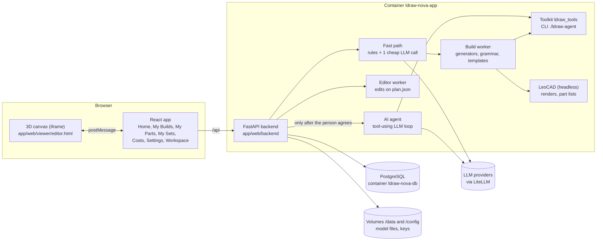

# Technical documentation

This is the technical manual for Open Brick Designer. It explains how every part of the app works, in plain language first and then with the code paths a developer needs to change it. It is written for two readers: the owner, who should be able to follow it without reading code, and a new developer, who should be able to pick up any part from here.

If you are new, read this page, then [Getting started](getting-started.md), then the page for the part you want to work on.

## What the app is

Open Brick Designer is a desktop web app for designing LEGO-compatible models. A model is stored as an [LDraw](https://www.ldraw.org/) file: LDraw is an open text format, used by the fan community for decades, in which every line places one real part (by its part number) with a colour, a position and a rotation. A file holding a model and its submodels is an **MPD** (multi-part document).

The app is a fork of [anteloc/ldraw-nova](https://github.com/anteloc/ldraw-nova). The upstream project was a toolkit that lets an AI agent write LDraw models. This fork keeps that toolkit and builds a product around it: builds with versions, a 3D editor, rule-based generators, your own parts collection and sets, and an RDF ontology describing what builds are made of.

Its guiding idea is **deterministic first**: code (rules and generators) builds whatever it can, for free and in seconds. One cheap LLM call is allowed to *read* a sentence and turn it into structured parameters. The expensive AI agent runs only when the person agrees to its price.

## The pieces at a glance

Everything runs on the person's own computer as two Docker containers: the app and a PostgreSQL database.

| Piece | What it does | Page |
|---|---|---|
| React frontend | The screens: the app bar (My Builds, My Parts, My Sets, Costs, Settings), Home and the build workspace | [Frontend](frontend.md) |
| 3D workspace | Always-3D editor for a build: place, move and recolour parts, versions, draft, chat | [Workspace and editor](workspace-and-editor.md) |
| FastAPI backend | The HTTP API, storage, workers and background jobs | [Backend and API](backend.md) |
| Fast path | Turns a typed request into a generator run, an edit, a question or an offer to use the AI | [Request lifecycle](request-lifecycle.md) |
| Generators and grammar | Code that builds models from parameters; the building grammar; roles and templates | [Generators, grammar and templates](generators-and-grammar.md) |
| Toolkit | The Python library and CLI that build, check, render and search LDraw models | [Toolkit and CLI](toolkit.md) |
| AI agent | The paid, multi-step LLM loop, its tools, sandbox, budget and worker swarm | [AI agent](ai-agent.md) |
| Providers and costs | LLM keys, model roles, prices and the cost history | [Settings and providers](settings-and-providers.md) |
| Search | Full-text search everywhere, Jev semantic search for the agent | [Jev and search](jev-and-search.md) |
| My Parts | Your bricks: imports, sources, review, what you can build, shortages | [My Parts](parts-and-collection.md) |
| My Sets | The offline set catalogue and the sets you own | [My Sets](sets.md) |
| Ontology | RDF/Turtle vocabulary for components, roles, sets and templates | [Ontology](ontology.md) |
| Storage | What lives in files, what lives in PostgreSQL, backups | [Data and storage](data-and-storage.md), [Database](database.md) |
| Quality | Tests, lint and the CI jobs | [Testing and CI](testing-and-ci.md) |
| Running it | Dev mode, rebuilds, logs, common tasks | [Operations](operations.md) |
| Security | Threat model and hardening | [Security](security.md) |

## Repository map

| Path | What is there |
|---|---|
| `app/` | The product: `Dockerfile`, `docker-compose.yml` (normal) and `docker-compose.dev.yml` (dev mode), `entrypoint.sh` |
| `app/web/backend/` | FastAPI backend (Python). Routers in `routers/`, Alembic migrations in `migrations/`, tests in `tests/` |
| `app/web/frontend/` | React + TypeScript app built with Vite. Pages in `src/pages/`, components in `src/components/` |
| `app/web/viewer/` | Static three.js pages served as-is: the editor canvas, the step-by-step player and the viewer |
| `app/web/viewer-deps/` | npm dependencies of the viewer pages, and their Playwright browser tests |
| `ldraw_tools/` | The toolkit (Python package): geometry, snapping, validation, generators, grammar, roles, templates, sets |
| `ldraw-agent` | The toolkit's command-line entry point |
| `tests/` | Toolkit tests (pytest) |
| `tools/` | Maintenance scripts: build the set catalogue, the ontology files, the role vocabulary, pack reference models |
| `ontology/`, `docs/ns/` | The RDF ontology in Turtle; `docs/ns/` is what the published IRIs resolve to |
| `models-packed/` | 1,821 annotated reference models, compressed; unpacked into `data/models-annotated/` |
| `data/` | Read-only data: `ldraw-info.db` (part and model descriptions), part categories, the LDCad shadow library |
| `examples/` | Example models and generator scripts the agent learns from |
| `instructions.md`, `docs/agent/`, `prompts/` | Instructions and guides given to the AI agent |
| `docs/` | This site: `system/` (this manual), `plans/`, `ontology/`, `ux/`, `reports/` |
| `scripts/` | `backup.sh` and `restore.sh` for the database and data volume |

## Reading paths

- **"How does a typed request become a model?"** [Request lifecycle](request-lifecycle.md), then [Generators, grammar and templates](generators-and-grammar.md).
- **"I want to change a screen."** [Frontend](frontend.md), then the page of that feature.
- **"I want to add an API endpoint."** [Backend and API](backend.md), then [Database](database.md) if it stores anything.
- **"I want to add a kind of model."** [Generators, grammar and templates](generators-and-grammar.md) and [Toolkit and CLI](toolkit.md).
- **"Where did my data go?"** [Data and storage](data-and-storage.md).
- **"Why did that cost money?"** [Settings and providers](settings-and-providers.md) and [AI agent](ai-agent.md).

## Glossary

| Term | Meaning here |
|---|---|
| **LDraw** | The open file format for brick models: one line per part, with part number, colour, position and rotation. |
| **MPD** | An LDraw multi-part document: one text file holding a model and its submodels. Versions and proposals are MPDs. |
| **Part** | One LDraw part file, for example `3001.dat` (brick 2 x 4). The LDraw parts library is baked into the image. |
| **Build** | A project: one model with its numbered versions, one editable draft, its chat and its source (how it was made). |
| **Version** | A saved, unchangeable snapshot of a build (an MPD plus a picture and a part list). |
| **Draft** | The single editable working copy of a build. Edits save into it automatically. |
| **Plan** | The JSON description of a model (placements, parts, colours, roles). The editor edits the plan, and the toolkit turns it into an MPD. |
| **Generator** | Code that turns parameters (width, colour, number of storeys...) into a plan. Free, fast and repeatable: the same parameters always give the same model. |
| **Building grammar** | One generator for buildings made of composable components (walls, openings, roofs, details) with named presets. |
| **Role** | What a part does in a model: wall, roof, glass, trim, wheel... Roles make text edits like "make the roof red" possible on any build. |
| **Template** | A model derived from a real build that can be stretched and recoloured by role. |
| **Fast path** | The cheap decision step for a typed request: rules first, then at most one small LLM call. |
| **Understanding model** | The cheap LLM the fast path may call to read a sentence into structured JSON. It sees only text. |
| **AI agent** | The paid, multi-step, tool-using LLM loop. It writes code, runs the toolkit, renders and checks, and returns a proposal. |
| **Proposal** | What the AI agent hands back to a build. The person keeps it (it replaces the draft as one undoable step) or discards it. |
| **Worker** | Either a long-lived toolkit process that keeps the parts library loaded (build worker, editor worker), or a cheaper LLM the agent delegates a small job to (subagent worker). |
| **Collection / My Parts** | The bricks the person owns, gathered from sources such as a Brickit scan, a set, or a file import. |
| **BOM** | Bill of materials: part, colour and quantity. Used for part lists, the parts check and "what can I build". |
| **Ontology** | The RDF vocabulary (Turtle files) that names components, roles, sets and templates with stable web addresses (IRIs). |
| **Jev** | A semantic search and re-ranking model (TypeSafe's Jev System One). Used only by the AI agent's search command, when a key is set. |
| **FTS** | SQLite full-text search with keyword (BM25) ranking. Local and free. |
| **LeoCAD** | An open-source LDraw editor, run headless in the container to render pictures and count parts. |

## Where status lives

This manual describes what is on `master`. Plans (intentions, designs, decisions) are under [docs/plans/](../plans/README.md). Open work, epics and owner decisions are tracked as [GitHub issues](https://github.com/AlessioNar/open-brick-designer/issues), which are the source of truth for what is next.
