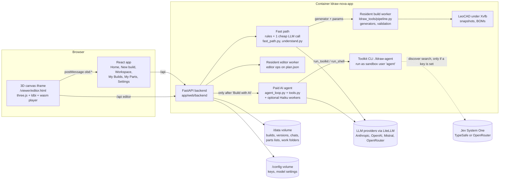

# Open Brick Designer: how the system works

This folder explains how the system works, written for the owner. It aims at understanding rather than API reference. Code paths are given as `file:line` (or `file` plus a function name) so you can dig deeper. Everything here was checked against the code on master at `bab92177` (2026-10-24). Where the code and a plan disagree, this folder says so.

| Page | Read it for |
|---|---|
| [request-lifecycle.md](request-lifecycle.md) | What happens when someone types a request, and where it is weak |
| [jev-and-search.md](jev-and-search.md) | **How Jev is actually used** (short answer: only by the paid AI agent), and every other search in the app |
| [ai-agent.md](ai-agent.md) | The paid agent: loop, tools, sandbox, budgets, caching, worker swarm, proposals |
| [workspace-and-editor.md](workspace-and-editor.md) | Builds, versions, the draft, the 3D canvas, editor operations |
| [parts-and-collection.md](parts-and-collection.md) | Parts lists, Brickit/Pileometer import, "maybe" pieces, what-can-I-build, parts check |
| [data-and-storage.md](data-and-storage.md) | What lives where: volumes, folders, files, the reference library |
| [settings-and-providers.md](settings-and-providers.md) | LLM providers, keys, the three model roles, cost tracking |
| [security.md](security.md) | The short version of the security pass |
| [operations.md](operations.md) | Dev mode, rebuilds, tests, logs, common tasks |
| [roadmap.md](roadmap.md) | What is done, what is in progress, and what is planned |

## What the app is

Open Brick Designer is a fork of `anteloc/ldraw-nova`, rebranded. It is **one Docker container** (`ldraw-nova-app`, on http://localhost:8765) that packages:

- a **Python toolkit** (`ldraw_tools/`, CLI `./ldraw-agent`) that builds, validates, renders and searches LDraw models;
- the **LDraw parts library** (baked into the image at `/opt/ldraw/ldraw`);
- a **reference library of 1,821 annotated real LEGO models** (`models-packed/`, unpacked to `data/models-annotated/`), described in `data/ldraw-info.db`;
- a **web app**: a FastAPI backend (`app/web/backend`), a React frontend (`app/web/frontend`) and static 3D pages (`app/web/viewer`) for viewing, editing and step-by-step playing;
- **LeoCAD** running under a virtual display (Xvfb) for snapshots and BOMs.

The product is centred on **builds**. A build is a model with numbered versions and one editable draft. People make a build in four ways: describe it, start from a type, import a file, or start empty. They edit it in an always-3D workspace. Their own bricks ("My Parts") can steer what gets built and show what is missing.

The product direction is **deterministic first**. Code (generators and rules) builds whatever it can for free. One cheap LLM call only *reads the sentence*. The expensive AI agent runs only after the person agrees to a price.

## The 5-minute mental model

The diagram shows five things worth keeping in mind:

1. **Most requests never reach a paid model.** The fast path tries rules first. Otherwise it asks one small model (Haiku 5.5 by default, about EUR 0.0003) to turn the sentence into a structured spec. A generator then builds the model for free in 11–21 s.
2. **The agent is a separate world.** It is a long tool-using LLM loop (EUR 1–2 and 15–30 minutes per request in practice). It runs code as an unprivileged user and returns its work to a build as a **proposal** that the person accepts or discards.
3. **Jev lives only in the agent's world.** It is a semantic search over parts and reference models, reached through the `discover search` command. Nothing in the deterministic path, the editor palette or My Parts calls it. See [jev-and-search.md](jev-and-search.md).
4. **There is no database.** Builds, versions, chats and parts lists are plain files on the `/data` volume. Keys are in `/config`.
5. **The 3D canvas is a separate static page in an iframe.** It talks to the React app by `postMessage`. The plan JSON, not the MPD file, is the source of truth for edits.

## Glossary

| Term | Meaning here |
|---|---|
| **Build** | A project: one model with its versions, its draft, its attached chats and its `source` (how it was made: generator, ai, import, editor, empty). Stored in `/data/builds/<slug>/build.json` (`app/web/backend/builds.py`). |
| **Version** | A saved, immutable model file `/data/generated/<slug>-vN.mpd`, with a `.png` snapshot and a `.csv` BOM next to it. "Save as vN" creates one. |
| **Draft** | The single editable working copy of a build. Edits autosave into it, and leaving the page keeps it. It is the build's editor session (`plan.json`, plus `draft.json` for its base version and change count). There is exactly one draft per build. |
| **Generator** | Pure Python code that turns parameters into a model plan: `house`, 7 vehicles, `starfighter` and 2 small accent pieces (11 in total, `ldraw_tools/generators/__init__.py:14`). It is free and deterministic, and the same params always give the same model. |
| **Template (planned)** | Not a code concept yet. The deterministic-first proposal plans a step after generators: "curated atlas example, then reference-model retrieval + recolour" (`docs/plans/deterministic-first/PROPOSAL.md:156`). That step is task 4, which was never built. Today, "Start from a type" means picking a generator. |
| **Fast path** | The free or near-free decision step: `POST /api/describe` (`fast_path.describe`). It decides between a generator build, an edit of the generator params, "needs the AI", or a clarifying question. |
| **Hint** | The live "Probably: Fast path, free, ~15 s" or "AI build ~EUR 1–2" line shown while typing (`GET /api/describe/estimate`). It uses rules only and never spends money. |
| **Understanding model** | The one cheap LLM the fast path may call to read a sentence into a `spec.v1` JSON. It is chosen in Settings. The default is `anthropic/claude-haiku-5-5` (`understand.py:42`). It sees only text, never parts or tools. |
| **Agent** | The paid, multi-step tool-using LLM loop (`agent.py`, `turn.py`, `agent_loop.py`, `tools.py`). It writes code, runs the toolkit, renders and checks. It starts only after "Build with AI", or when someone types in a chat. |
| **Worker** | Two meanings: (1) the **resident build worker** and **editor worker**, long-lived toolkit processes that keep the parts library loaded (`build_worker.py`); (2) a **subagent worker**, a cheaper model (Haiku 5.5 intended) the agent can `delegate` a bounded job to (`subagents.py`). |
| **Proposal** | What an agent attached to a build produces instead of a version: `/data/builds/<slug>/proposals/<id>.mpd`. The person chooses Keep (it replaces the draft as one undoable step), Preview or Discard. |
| **Parts list / source** | A parts list (code name "inventory") is an imported list of owned bricks: `/data/inventories/<id>.json` plus the original `.csv`. Its import format is the source: a Rebrickable CSV or a Brickit Pileometer export. A broader "Sources" concept is only proposed (parts-catalogue plan). |
| **Jev** | TypeSafe's "Jev System One" relevance model. The `jev-rerank` CLI uses it to rerank parts, models or submodels by meaning. In this app it is reachable only from the paid agent's tools. See [jev-and-search.md](jev-and-search.md). |
| **FTS** | SQLite full-text search (FTS5) with BM25 ranking: keyword matching, local and free. `discover search` falls back to it when Jev has no key. |
| **Plan** | The JSON description of a model (placements, parts, colours, roles) that the toolkit builds into an MPD. The editor edits the plan (`output/editor/plan.json`), never the MPD directly. |
| **MPD** | LDraw multi-part document: a text file holding a model and its submodels. Versions and proposals are MPDs. |
| **BOM** | Bill of materials: part + colour + quantity. It is used for the `.csv` next to each version, for the parts check and for what-can-I-build. |

## Things that surprised me

These are contradictions or surprises found while checking the code. Each is worth a decision or a small fix.

1. **Jev is effectively used only by the paid agent.** Settings presents the Jev key as something that "enables Jev semantic search for parts and models" (`EnvironmentSettings.tsx:30`). In fact the editor parts palette, the "Your parts" search, what-can-I-build and the whole fast path never call it. The editor palette does not even use FTS: it is a plain substring match (`ldraw_tools/commands/library.py:80-90`).
2. **A main OpenRouter key turns Jev on silently.** If `OPENROUTER_API_KEY` is set (for example because you use OpenRouter for the LLMs), Jev search goes through OpenRouter with that key. The key is then readable by agent-run code (`toolkit.py:39-50`). Settings shows a warning, and the fix is the separate `JEV_OPENROUTER_API_KEY`.
3. **"Required" vs "optional".** The backend calls `TYPESAFE_API_KEY` the `REQUIRED_NAME` (`environment_config.py:19`), but the UI and README say it is optional. It is optional in behaviour. The name is a leftover.
4. **The Jev key is put into the environment of every agent tool process.** That includes `run_python` and `run_shell`, not just `discover` (`tools.py:112-120`). This is by design (security finding M4), but it means any agent-run code can read it.
5. **The agent docs disagree on how to use Jev.** `prompts/ldraw-generative-tooling.md:26` tells the agent to "check service availability", pointing at an anchor that no longer exists. `docs/agent/reference-discovery.md:7` says "do not probe Jev". `instructions.md:62-69` also suggests calling `jev-rerank` directly on the raw parts table, which bypasses the FTS fallback and the filtering.
6. **The measured LLM numbers are mostly estimates.** The NL review could not run the understanding model live, because no key was available (`docs/plans/nl-review/REVIEW.md:7`). The swarm end-to-end check is "NOT RUN" (`docs/plans/swarm-subagents/E2E.md:3`). The Jev quality reports are hand-labelled pilots, not benchmarks.
7. **Text edits only work on builds that still have a generator source.** On AI-built, imported or hand-edited builds, "make the roof blue" offers an EUR 1–2 agent run. On a once-generated build, a text edit can silently overwrite later manual or AI changes (REVIEW findings 1 and 2).
8. **The understanding call's cost is not counted anywhere.** It is not in the chat budget and not persisted. It is only returned to the UI and logged (`fast_path.describe`; REVIEW.md:191).
9. **The prompt advertises a generator that does not exist.** The fallback digest given to the understanding model lists a "tower" row (`understand.py:67-79`), but there is no tower generator in the registry.
10. **"Empty" build opens the old editor page** (`/build/<id>/edit`, `NewBuild.tsx:110-112`), not the new `/build/:id` workspace.
11. **The sets catalogue is built but not wired in.** About 20,000 real sets live in `ldraw_tools/data/set-catalog.bin` with a working CLI, but there is no API or UI.
12. **Owner decision 3 (Brickit "maybe" pieces counted separately) is not implemented.** Colour-family pieces are simply left out of buildable and the parts check (`ldraw_tools/buildable.py`, `workspace.owned_parts`).
13. **Stale docs.** `docs/plans/chat-redesign/PROPOSAL.md` says "nothing implemented", but all four parts are merged. The `settings.py` docstring still calls subagents an off-by-default prototype with a `delegate_task` tool, but the tool is `delegate`.
14. **There is no app database at all.** Everything is JSON or JSONL files, and SQLite is used only for the read-only reference descriptions and search caches. That is simple and robust for one user, but worth knowing before multi-user plans.
