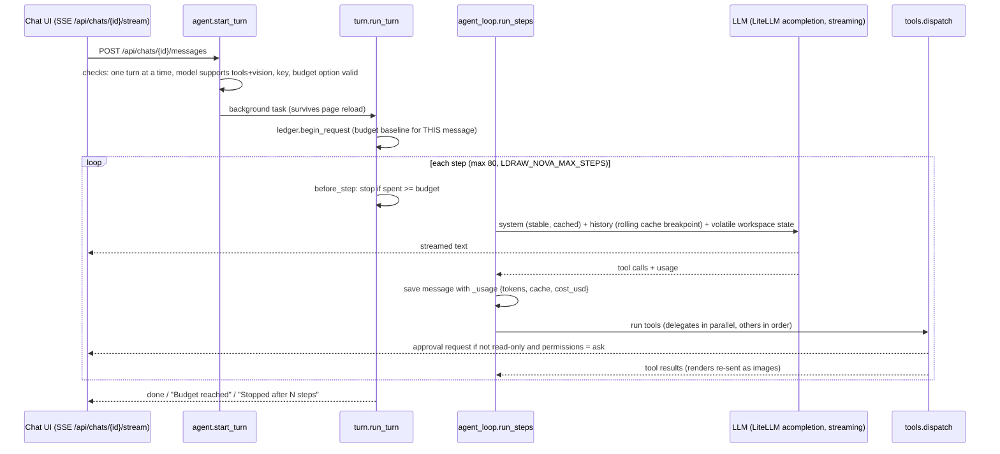

# The paid AI agent

Paths are relative to `app/web/backend/`. Prices are in `model_catalog.py` (PRICE_BOOK, read from Anthropic's page on 2026-10-23).

## When it runs

- After someone clicks **"Build with AI"** on a `needs_ai` decision. That creates a chat attached to the build, with `mode: agent` and `permissions: ask`.
- When someone types in a **chat** (the workspace AI tab or `/chat/:id`). There is no fast path in front of it.
- Never by itself: no background or scheduled runs.

## The loop

| Code | What it does |
|---|---|
| `agent.py:35` | `start_turn` |
| `agent.py:80` | `execute_tool`, the approval gate |
| `turn.py:22` | `run_turn` |
| `agent_loop.py:59` | `run_steps`, which calls `litellm.acompletion(..., stream=True, num_retries=2)` at line 84 |

## Tools

From `tools.py` (the `TOOLS` dict, about lines 427–509) and `editor_tools.py`:

| Tool | Purpose | Needs approval in "ask" |
|---|---|---|
| `run_toolkit` | Run any `./ldraw-agent` command: build, validate, render, discover, ... | yes |
| `run_python` | Run Python in the toolkit venv. The script is saved under `output/generators/`. | yes |
| `run_shell` | Run bash in the toolkit workspace | yes |
| `publish_model` | Validate, render and BOM a model, then make a **proposal** (in a build) or a model card (a loose chat) | yes |
| `write_file` | Write under `output/` (2 MB max) | yes |
| `read_file`, `list_files` | Read the toolkit docs and the chat's `output/` | no |
| `view_image` | Show a PNG render to the model, for visual review | no |
| `report_progress` | Send a short progress line to the UI | no |
| `my_parts`, `buildable_models` | Search owned parts / rank reference models by owned parts. Offered only when the chat uses parts steering. | no |
| `editor_open`, `editor_state`, `editor_edit` | Share a plan with the 3D editor and apply batched edits, with conflict detection | open/edit: yes |
| `delegate` | Hand a bounded job to a cheaper worker model | approved once, with the whole contract shown |

- Plan mode and `read_only` permissions restrict the agent to the read tools, and chat mode offers no tools (`tool_policy.py`).
- When a tool fails, the error comes back as text so the agent can retry (`tools.dispatch`).

## System prompt

The prompt is built by `system_prompt.py` from `prompts/system.md`, in two parts:

- **Stable part, cached.** It contains:
  - the agent rules;
  - `instructions.md`;
  - five foundation guides inlined in full (`toolkit.BUILDER_GUIDES`), about 18k tokens. One of them is the Jev or keyword-search discovery guide, depending on whether a Jev key is set (see [jev-and-search.md](jev-and-search.md)).
- **Volatile part, sent after the history.** It contains the files in `output/`, the "Where this chat stands" block (build, latest version, proposal rule, editor plan), `NOTES.md`, and any parts-steering instructions.
- **Lean prompt.** Models that cannot cache, or that have a context window under 200k, get a lean prompt that lists the guides instead of inlining them (`use_lean_prompt`, env `LDRAW_NOVA_LEAN_PROMPT`).

## Prompt caching

- **Where.** Caching is active on Anthropic and on Anthropic models via OpenRouter, Vertex or Bedrock (`providers.supports_prompt_caching`). Mistral caching is not wired.
- **Cache TTL**: 1 hour by default (`LDRAW_NOVA_CACHE_TTL`).
- **Rolling breakpoint.** A breakpoint on the latest message caches the history as well (`with_rolling_breakpoint`).
- **Volatile state goes after the history**, so a file write does not invalidate the cached history (`LDRAW_NOVA_TAIL_AFTER_HISTORY`, default on).
- **Old bulky tool outputs** (over 2,000 chars and older than 10 steps) are replaced by stubs in batches (`settings.py:65-89`).
- **Why it matters.** In two early Opus chats (EUR 19 together), **64% of the cost was cache writes**, because the cache kept breaking. A healthy cache would roughly halve that (`docs/plans/done/swarm-subagents/MEASUREMENTS.md:36-59`; the fixes are in `docs/plans/done/loop-perf/`).

## Budgets

- **Per request, in EUR.** Each new message gets its own budget: `ledger.begin_request` snapshots the chat's spend at that point (`turn.py:30`, `budget.py`).
- **Defaults.** The UI default is **EUR 2**. The backend default is no cap. The allowed range is 0–1000, and a budget is refused for models without prices (`model_catalog.validate_options`).
- **What happens at the limit.** The turn stops and says "Budget reached: about EUR X of the EUR Y budget". You continue by raising the budget and sending a message.
- **Step cap.** Second limiter: 80 steps per turn (`LDRAW_NOVA_MAX_STEPS`).
- **Conversion.** Prices are in USD internally. EUR = USD × `LDRAW_NOVA_EUR_PER_USD` (default 0.92).
- **What is not counted.** The understanding call of the fast path, and Jev fees, which are billed by TypeSafe or OpenRouter separately.

## Swarm: cheaper worker models

Code: `subagents.py`, `budget.py`, `worker_isolation.py`, `docs/plans/done/swarm-subagents/`.

- **When it is available.** Delegation is on when a worker model is configured (Settings → worker default) **and** the chat has full permissions, or the person approved the delegation contract. The intended worker is **Haiku 5.5**.
- **Roles.** Each role has its own tools and step limit:

| Role | Tools | Default steps |
|---|---|---|
| builder | read/list/write files, run_python, run_toolkit | 20 |
| researcher | read/list/write files, my_parts, run_toolkit (incl. `discover`) | 10 |
| reviewer | read/list files, view_image, run_toolkit | 12 |

  Workers never get `publish_model`, `delegate` or `run_shell`.
- **Money.**
  - Each worker defaults to EUR 0.10, with a maximum of EUR 1.00. Its spend is reserved out of the chat budget.
  - Up to 3 workers run in parallel (`LDRAW_NOVA_MAX_WORKERS`, at most 6), and up to 8 delegations per turn.
- **Safety nets.**
  - A worker stops after 8 steps without writing a file, or after the same call repeats 3 times.
  - The app validates declared LDraw outputs, including "one connected structure", after one repair round. The planner is told never to place a submodel that failed.
- **Transcripts.** Worker transcripts go to a side file, `chats/<id>/workers/<worker>.jsonl`, so the planner's cache is untouched.
- **Isolation.** File tools are confined to the worker's folder. `run_python` and `run_toolkit` are not a jail: stray writes are detected and undone afterwards (`worker_isolation.py:1-17`).
- **Evidence.**
  - Haiku workers passed 5 of 5 sub-assembly tasks first time, for EUR 0.072 total. 3 of 5 were not one connected structure, which is why the gate exists (`MEASUREMENTS.md:112-126, 218`).
  - Modelled swarm cost: Sonnet planner plus Haiku workers is about EUR 1.14, and Opus planner plus Haiku workers about EUR 2.01. **The end-to-end run was never done** (`E2E.md:3`, "NOT RUN").

## Sandbox

Code: `sandbox.py`, `app/entrypoint.sh`.

- **Unprivileged user.** The server runs as root. Every tool process drops to the user `agent` (`setpriv`).
- **Clean environment.** Tool processes get only a small allow-list of variables, plus the toolkit variables and the Jev key. LLM keys are not passed.
- **Limits.** CPU time is capped. Files can be at most 512 MB. The whole process group is killed on timeout. Output is capped at 20,000 chars and secrets are redacted.
- **No access to keys or the app.** `/config` (keys) is root-only, so the agent user cannot read it. A firewall rule blocks the `agent` user from the app's own API port and from the Docker host. Settings shows "Sandbox isolation: on/off".
- **Internet stays open.** Agent code can reach the internet. This is documented as a residual risk in [security.md](security.md).

## How results reach a build

| Situation | Result |
|---|---|
| Chat attached to a build | `publish_model` creates `/data/builds/<slug>/proposals/<id>.mpd` and `.json`, keeping at most 20. The UI shows Keep / Preview / Discard. Keep becomes one undo step in the draft. |
| Loose chat (no build) | `publish_model` writes a model into `/data/generated/`, which shows up in My Builds |
| Agent and person editing the same plan | `editor_state`/`editor_edit` with revision numbers. A conflict means re-read and redo. |

## What drives cost

1. **Model choice.** Per million tokens, input/output: Opus 5.5 $4/$20, Sonnet 5.5 $2/$10, Haiku 5.5 $0.10/$0.50 (5× over 100k-token prompts).
2. **Number of steps × prompt size.** Each step re-sends about 20k tokens of system prompt plus the whole history. Median requests were about 100k tokens in Opus chats (`loop-perf/analysis-output.md`).
3. **Cache health.** Cache writes cost 1.25×–2× input, and cache reads cost 0.05×–0.1× input.
4. **Big tool outputs carried forward.** In loop-perf, re-sent tool output was 41–60% of everything re-sent in the non-reasoning chats. By re-send weight, `read_file` was 47% of that, `run_shell` 22% and `discover` 14%.
5. **Output tokens.** Code and plan writing is about 32% of cost in the Opus sample.

Measured runs:

| Model | Request | Time | Steps | Cost | Notes |
|---|---|---|---|---|---|
| Sonnet 5.5 | "small" spaceship, run 1 | 25 min | 23 | EUR 1.51 | |
| Sonnet 5.5 | "small" spaceship, run 2 | 24 min | 29 | EUR 2.05 | stopped by the budget |
| Opus 5.5 | car | not recorded | 38 | $13.82 | early chat, broken cache (3.0M prompt tokens) |
