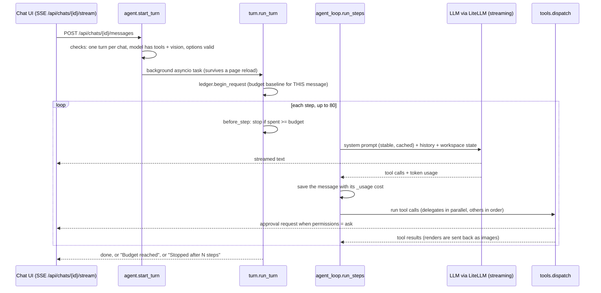

# The paid AI agent

The AI agent is a language model that builds LDraw models by running tools: it reads the toolkit guides, writes and runs Python generators, validates and renders models, and hands the result back to the person. It is the only part of the app that spends real money in large amounts (typically EUR 1 to 2 for a model), so everything around it is designed to ask first, show the cost, and stop at a limit the person chose.

Backend paths below are relative to `app/web/backend/`, and frontend paths to `app/web/frontend/src/`. LDraw is the open file format for LEGO models; an MPD is an LDraw file that holds several sub-models in one file; a proposal is a model the agent offers to a build that the person has not accepted yet.

## When it runs

The agent never runs by itself. There are no scheduled or background runs. A turn (one agent run, from one person message to its end) starts only in these cases:

- **In a build's workspace chat.** The chat has a Quick/AI switch. Quick sends the message to the free fast path (see [request-lifecycle.md](request-lifecycle.md)). AI sends it to the agent. The server also decides the default: while the agent is "engaged" (it asked a question, or has not delivered a proposal since the person last wrote) every message goes to the agent, unless the person flips one message to Quick (`chat_routing.py` `state()`).
- **After a "needs the AI" answer.** When the fast path cannot do a request, the chat shows "This needs the AI: about EUR 1 to 2, about 15 to 30 min" and a "Needs you" tray with **Ask the AI** and **Cancel**. Nothing is spent until the person presses Ask the AI (`components/workspace/ChatPanel.tsx`).
- **In a standalone chat** at `/chat/:id` (`pages/ChatPage.tsx`), reached from the "Older chats" list on My Builds. There is no fast path in front of it.
- **With attachments.** A message with images or documents always goes to the agent.

## How the person agrees to a price

There are four separate gates. The first three are in front of the person, the fourth is a hard stop.

1. **The estimate.** While typing, a rules-only hint shows "Free" or "Needs the AI, about EUR a to b" (`GET /api/describe/estimate`, no model call). The default estimate is EUR 1 to 2 and 15 to 30 minutes. After 3 finished chats it becomes the quartiles of the person's own past turns (`fast_path.py` `ai_estimate()`, `DEFAULT_ESTIMATE`).
2. **The explicit step.** The AI only starts when the person presses Ask the AI, switches the message to AI, or types into a chat that is already in AI mode. The switch shows "Costs apply, it asks before it spends".
3. **Per-tool approval.** With permissions "Ask first" (the default), every tool that is not read-only waits for **Allow once** or **Deny** (`agent.py` `execute_tool()`, `components/TurnStatus.tsx`). An answer is waited for up to 600 seconds, then the tool is denied. "Full access" skips this. "Read only" removes all writing tools.
4. **A budget per request, in euros.** Each message gets its own budget. The picker offers EUR 1, 2, 5, 10, 20, a custom amount, or no budget; the UI default is EUR 2 (`components/ChatSettings.tsx` `DEFAULT_BUDGET_EUR`). The backend default is no cap, and a budget from 0 to 1000 is refused for a model with no known prices (`model_catalog.py` `validate_options()`). At the limit the turn stops with "Budget reached" and the chat shows **Continue with +EUR n** or **Raise budget** (`components/BudgetStop.tsx`). Work done so far is kept.

The cost shown is an estimate from list prices (see [settings-and-providers.md](settings-and-providers.md)). It does not include the understanding call of the fast path, or any Jev fee (see [jev-and-search.md](jev-and-search.md)).

## How it works



Key facts about the loop:

- **One turn per chat.** `start_turn()` raises "this chat is already running a turn" if one is in flight (HTTP 409). It also refuses a model without tool calling and image input, an unknown worker model, and images for a model without vision.
- **Background task.** The turn runs as an asyncio task in `run_state.py` (`Run`), not tied to the browser. The browser follows it through a server-sent-events stream; on reconnect it first receives a snapshot of the draft text, running tools, pending approvals and workers.
- **Saved messages are the source of truth.** The chat's `messages.jsonl` is written by `ChatSink`; live events only carry what is in flight, plus a "saved" ping that tells the UI to refetch.
- **Step cap.** 80 model calls per turn (`LDRAW_NOVA_MAX_STEPS`), then "Stopped after 80 steps. Send a message to continue."
- **Stop button.** Cancelling the task saves the partial text, adds "Stopped." and cancels any workers.
- **Errors.** A provider failure ends the turn with a plain-words message (`provider_errors.py` `describe()`), not the whole chat.
- **Retries.** Each call is made with `num_retries=2` and `litellm.drop_params = False`, so an unsupported setting fails visibly.
- **Modes.** `agent` (all tools) and `plan` (read-only tools, "propose a plan, do not execute"). `tool_policy.py` also handles a `chat` mode with no tools, but `validate_options()` rejects it today, so the UI cannot select it.

## Tools

The tools are defined in `tools.py` (`TOOLS`), `editor_tools.py` and `subagents.py`. `tool_policy.py` decides which are offered.

| Tool | Purpose | Asks in "ask" mode |
|---|---|---|
| `run_toolkit` | Run any `./ldraw-agent` command: build, validate, render, discover, vehicle, and so on | yes |
| `run_python` | Run Python in the toolkit environment. The script is saved under `output/generators/` | yes |
| `run_shell` | Run bash in the toolkit workspace | yes |
| `publish_model` | Validate, render and list the parts of a model, then make a proposal (in a build) or a model card (loose chat) | yes |
| `write_file` | Write under `output/` (2 MB max) | yes |
| `read_file`, `list_files` | Read toolkit docs and the chat's `output/` | no |
| `view_image` | Show a PNG render to the model for visual review | no |
| `report_progress` | Send a short progress line to the UI | no |
| `my_parts`, `buildable_models` | Search the owned parts / rank reference models by owned parts. Offered only when the chat uses parts steering | no |
| `editor_open`, `editor_state`, `editor_edit` | Share a plan with the 3D editor and apply batched edits with conflict detection. `editor_state` and `editor_edit` appear once the chat has a plan | open and edit: yes |
| `delegate` | Hand a bounded job to a cheaper worker model (see the swarm section) | offered only with Full access |

Rules that matter when changing tools:

- `tool_policy.py` `available_tools()` removes the parts tools unless the chat uses parts steering, removes `delegate` unless a worker model exists **and** permissions are Full, and keeps only `READ_TOOLS` in plan mode or read-only permissions.
- `agent.py` `execute_tool()` re-checks that the requested name is allowed, so a model cannot call a tool that was not offered.
- When a tool fails, `tools.dispatch()` returns the error as text so the agent can retry. It never raises into the loop.
- With the opt-in `confirm_with_documents` setting, code tools still ask in Full access when documents are attached, because a document can carry injected instructions (`agent.py` `_documents_gate()`).
- Tool processes run through `run_command()`, which adds the Jev key (and only that key) to their environment.

## Sandbox and isolation

Agent-written code is the main risk surface. `sandbox.py` runs every tool process like this:

- **Unprivileged user.** The server runs as root in the container. Tool processes drop to the user `agent` with `setpriv`.
- **Clean environment.** Only a short allow-list of variables, plus the toolkit variables and the Jev key. LLM keys are not passed.
- **Limits.** CPU time follows the tool timeout, files are capped at 512 MB, the whole process group is killed on timeout, and output is capped at 20,000 characters with secrets redacted.
- **No access to keys or the app.** `/config` (keys) is root-only. `entrypoint.sh` adds firewall rules that reject TCP from the `agent` user to the app's API port, the database port and the Docker host. Settings shows "Sandbox isolation: on/off" from `sandbox.isolation_status()`.
- **Internet stays open** for agent code. This is a known residual risk, described in [security.md](security.md).

Workers add a second layer, `worker_isolation.py`. File tools refuse paths outside the worker's own folder (`output/workers/<id>/`). `run_python` and `run_toolkit` are not a jail, so the module hashes `output/` before and after a worker and undoes stray writes, reporting them on the worker's result. It cannot restore files over 2 MB and does not cover writes outside `output/`.

## Budgets

`budget.py` holds one `BudgetLedger` per run, shared by the planner (the main agent) and its workers.

- **Per request.** `begin_request()` snapshots the chat's spend, so the limit applies to what is spent after that point.
- **Check before every step.** `turn.py` `before_step()` compares `planner_spent_eur()` to the budget and stops with a saved "Budget reached" message that carries `_budget_reached` for the UI.
- **Workers reserve first.** A worker reserves its `max_eur` from the remaining budget (clamped to what is left). Its spending counts live, and its aggregate cost is saved on the `delegate` result so nothing is counted twice.
- **Conversion.** Prices are in USD; EUR = USD x `LDRAW_NOVA_EUR_PER_USD` (default 0.92).
- **Cost per step.** `agent_loop.py` stores `_usage {prompt, completion, cache_read, cache_write, cost_usd}` on each assistant message, and writes the same numbers to the cost history table (see settings page).

## Prompt caching

An agent step re-sends the whole conversation, so caching decides the cost. In earlier Opus chats 64 percent of the cost was cache writes because the cache kept breaking (`docs/plans/done/swarm-subagents/MEASUREMENTS.md`, fixes in `docs/plans/done/loop-perf/`). The current layout:

- **Where it works.** Anthropic, and Anthropic models through OpenRouter, Vertex or Bedrock (`providers.py` `supports_prompt_caching()`). Mistral caching is not wired.
- **Stable prefix.** The system prompt's first block (rules, instructions, five foundation guides, about 18k tokens) gets a cache marker (`system_prompt.py` `cache_control()`). The default time to live is 1 hour (`LDRAW_NOVA_CACHE_TTL`), because an approval prompt or a long tool run easily exceeds 5 minutes.
- **Rolling breakpoint.** A second marker on the latest message caches the history too (`with_rolling_breakpoint()`, at most 4 markers per request).
- **Volatile state goes after the history.** The file listing, `NOTES.md`, the "Where this chat stands" block and mode notes are sent as a trailing user message, so writing a file does not invalidate the cached history (`LDRAW_NOVA_TAIL_AFTER_HISTORY`, on by default).
- **Old tool output is replaced by stubs.** Results over 2,000 characters that are at least 10 steps old are masked, in batches of 10 steps so the cached prefix changes rarely (`settings.py` `mask_*`, applied in `history.py`).
- **Bounded history.** `inference.py` `bounded_history()` drops old turns to fit the chosen context size and tells the UI ("Earlier conversation was omitted").

## System prompt

`system_prompt.py` builds the prompt from `prompts/system.md`.

- **Stable part.** The agent rules, the toolkit's `instructions.md`, and five foundation guides inlined in full (`toolkit.py` `BUILDER_GUIDES`). Which discovery guide is inlined depends on whether a Jev key exists (see [jev-and-search.md](jev-and-search.md)).
- **Volatile part.** The files in `output/`, the "Where this chat stands" block (build, latest version, how proposals work, editor plan), `NOTES.md`, and parts steering instructions.
- **Lean prompt.** Models that cannot cache, or have a context window under 200k tokens, get a lean prompt that lists the guides instead of inlining them and adds efficiency rules (`use_lean_prompt()`, override `LDRAW_NOVA_LEAN_PROMPT`).
- **Delegation note.** When `delegate` is offered, the stable part gets a note on when to delegate (`DELEGATION_NOTE`). Because the tool set is constant for a chat, the prefix stays byte-identical.

## Worker swarm

A swarm means the main agent (the planner) hands small independent jobs to cheaper models (workers). The code is in `subagents.py`, `tool_policy.py` `worker_tools()`, `budget.py`, `worker_events.py` and `worker_isolation.py`.

- **Availability.** `delegate` is offered only when a worker model is set (Settings, Roles, "Worker model", or the chat's own worker choice) **and** the chat has Full access. Under "Ask first" the tool is not offered at all, so the contract-approval card (`approval_contract()`, `TurnStatus.tsx` `ContractView`) is not reachable today.
- **Contract.** The planner sends role, task (max 1500 chars), inputs, tools, outputs, `max_steps`, `max_eur` and `summary_chars`. `validate_contract()` rejects a bad contract with the reasons.
- **Roles.**

| Role | Tools | Default steps |
|---|---|---|
| builder | read_file, list_files, write_file, run_python, run_toolkit | 20 |
| researcher | read_file, list_files, my_parts, write_file, run_toolkit | 10 |
| reviewer | read_file, list_files, view_image, run_toolkit | 12 |

  Workers never get `publish_model`, `delegate` or `run_shell`. Steps are capped at 40.
- **Money.** Each worker defaults to EUR 0.10 with a ceiling of EUR 1.00, reserved from the request budget. A worker whose model has no known price is refused when a budget is set.
- **Parallel.** Consecutive `delegate` calls in one step run together, up to 3 at a time (`LDRAW_NOVA_MAX_WORKERS`, ceiling 6), with at most 8 delegations per turn (`LDRAW_NOVA_MAX_DELEGATIONS`).
- **Safety nets.** A worker stops after 8 steps in which it wrote no output, or when the same call repeats 3 times with the same result. The app then validates declared LDraw outputs itself (`_gate()`: toolkit validate with geometry, plus a one-connected-structure check) and allows one repair round. The planner is told never to place a sub-model whose verdict is not ok. Result statuses: ok, partial, failed, over_budget, step_cap, stuck, cancelled.
- **Transcripts** go to `chats/<id>/workers/<worker>.jsonl`, not the chat, so the planner's history and cache are untouched. `GET /api/chats/{id}/workers/{worker_id}` serves one.
- **Effort.** Workers run at the lowest reasoning effort their model offers (`worker_effort()`).

**Current measured status.** The code is merged and covered by tests. Two live measurements exist, both from 2026-10-23 (`docs/plans/done/swarm-subagents/MEASUREMENTS.md`, `E2E.md`):

- Haiku 5.5 as a worker completed five sub-assembly tasks through the app's loop for EUR 0.066 in total, all passing the toolkit's `validate`. Validate passing is weaker than the app's own connectivity gate, which is why the gate exists.
- The end-to-end run (Sonnet planner plus Haiku workers on the spaceship prompt) was **never run**; `E2E.md` is an empty template. Single-Sonnet baselines took 24 to 25 minutes and cost EUR 1.51 and EUR 2.05 (the second stopped at its budget). The projected saving from workers is an estimate, not a measurement.

## How results reach a build

| Situation | Result |
|---|---|
| Chat attached to a build | `publish_model` calls `_propose()`, which writes `proposals/<id>.mpd` and `.json` in the build (`workspace.py` `create_proposal()`, newest 20 kept). It never writes a version. |
| Loose chat (no build) | `publish_model` writes `/data/generated/<name>-vN.mpd` with a snapshot and parts list; it appears in My Builds and as a model card in the chat |
| Agent and person editing one plan | `editor_state` / `editor_edit` with revision numbers. A conflict means re-read and redo |

The person sees a proposal card above the composer: "Needs you, review before it joins the draft", with the parts added, removed and moved, and buttons **Keep in draft**, **Preview** and **Discard** (`ChatPanel.tsx` `ProposalCard`). Keep replaces the draft as one undoable step through `POST /api/builds/{id}/proposals/{pid}/accept`. Saving a version is a separate step. See [workspace-and-editor.md](workspace-and-editor.md).

## UI cards in the frontend

| Component | What it shows |
|---|---|
| `components/Composer.tsx`, `ChatSettings.tsx` | The message box, the budget chip, and the "This chat" popover: mode, permissions, parts, workers, budget, reasoning effort, context window. Last-used values are remembered in the browser |
| `components/workspace/ChatPanel.tsx` | The workspace chat: Quick/AI switch, cost line, "Needs you" tray, proposal card, session changes |
| `components/TurnStatus.tsx` | Pending approvals (Deny / Allow once) and the context-trimmed notice |
| `components/BuildHeader.tsx`, `UsageBadge.tsx` | Step, phase, time and cost against the budget; token and cache counters |
| `components/BudgetStop.tsx` | "Stopped: budget reached" with Continue and Raise budget |
| `components/MessageList.tsx`, `StepGroup.tsx`, `ToolCard.tsx` | The transcript, steps grouped with their tool calls, live tool output |
| `components/WorkerGroup.tsx`, `WorkerCard.tsx` | One row per worker with state, steps, cost against its cap, notices and the read-only transcript |
| `components/PartsCheckCard.tsx` | After a publish: how many of the model's parts the person owns and what is short |
| `hooks/useChatStream.ts` | The event stream: text, tools, approvals, workers, context, errors |

## Where the code is

| File | What it does |
|---|---|
| `app/web/backend/agent.py` | `start_turn()` checks and starts a turn; `execute_tool()` is the approval gate |
| `app/web/backend/turn.py` | `run_turn()`: budget check, message assembly, error and cancel handling |
| `app/web/backend/agent_loop.py` | `run_steps()`: stream, save, run tools; `ChatSink` and `FileSink` |
| `app/web/backend/tools.py` | Tool functions, schemas, `dispatch()`, `_propose()` |
| `app/web/backend/tool_policy.py` | Which tools a mode and permission setting offer; worker tool limits |
| `app/web/backend/editor_tools.py` | The three editor tools |
| `app/web/backend/sandbox.py`, `worker_isolation.py` | Process isolation; worker stray-write guard |
| `app/web/backend/budget.py` | `BudgetLedger`, `WorkerLimits` |
| `app/web/backend/system_prompt.py`, `prompts/system.md`, `toolkit.py` | Prompt assembly, cache markers, toolkit guides |
| `app/web/backend/subagents.py`, `worker_events.py` | The `delegate` tool, contract, worker loop, validation gate, live events |
| `app/web/backend/run_state.py` | Live run state, event fan-out, approvals |
| `app/web/backend/chat_routing.py` | Quick or AI: who answers a message |
| `app/web/backend/history.py`, `inference.py` | History sent to the model, masking, bounded history, per-provider parameters |
| `app/web/backend/routers/chats.py` | Chat API: messages, approvals, cancel, stream, worker transcripts |
| `app/entrypoint.sh` | Firewall rules that keep agent code away from the API |

## API

| Endpoint | Purpose |
|---|---|
| `POST /api/chats/{id}/messages` | Start a turn (202). 409 if one is running, 400 for invalid model or options |
| `GET /api/chats/{id}/stream` | Server-sent events: snapshot, text, tool_start, tool_output, approval, worker_*, saved, usage, done |
| `POST /api/chats/{id}/approvals/{approval_id}` | `{approved: bool}` |
| `POST /api/chats/{id}/cancel` | Stop the turn |
| `GET /api/chats/{id}` | Messages, models, build link and usage totals |
| `GET /api/chats/{id}/workers/{worker_id}` | A worker's transcript and files |

## Environment settings that change the agent

| Variable | Default | Effect |
|---|---|---|
| `LDRAW_NOVA_MAX_STEPS` | 80 | Model calls per turn |
| `LDRAW_NOVA_MAX_WORKERS` / `_MAX_DELEGATIONS` | 3 (max 6) / 8 | Parallel workers; delegations per turn |
| `LDRAW_NOVA_CACHE_TTL` | `1h` | `5m` or `1h` Anthropic cache lifetime |
| `LDRAW_NOVA_TAIL_AFTER_HISTORY` | on | Volatile state after the history |
| `LDRAW_NOVA_ROLLING_CACHE_BREAKPOINT` | on | Cache the history |
| `LDRAW_NOVA_LEAN_PROMPT` | `auto` | `on` or `off` forces the lean prompt |
| `LDRAW_NOVA_MASK_OLD_TOOL_OUTPUT` and `_MASK_*` | on, 10 steps, 2000 chars | Stub out old bulky tool output |
| `LDRAW_NOVA_EUR_PER_USD` | 0.92 | Currency conversion |
| `LDRAW_NOVA_SUBAGENTS`, `LDRAW_NOVA_WORKER_LLM_ID` | off | Only used as an environment fallback for the worker model; the Settings choice works without them |

## Changing it

- **Add a tool.** Write `t_<name>(ctx, ...)` in `tools.py` and add it to `TOOLS` with a schema from `_fn()`. If it only reads, add it to `READ_TOOLS` in `tool_policy.py`; otherwise it will ask for approval. Add a label in `components/ToolCard.tsx` `LABELS`. Raise `ToolError` for problems the agent can fix.
- **Change the prompt.** Edit `prompts/system.md`. Keep anything that changes during a chat out of the stable part, or the cache breaks and every step is re-billed. `tests/test_prompt_cache.py` guards the layout.
- **Change worker limits or roles.** Edit `ROLE_TOOLS`, `ROLE_STEPS`, `MAX_EUR` in `subagents.py`. Keep `NEVER_TOOLS` out of every role.
- **Make delegation work under "Ask first".** `available_tools()` hides `delegate` unless permissions are Full, and `approval_contract()` needs `LDRAW_NOVA_SUBAGENTS`. Both would have to change together.
- **Add a provider quirk.** Do it in `providers.py` and `inference.py` `params_for()`, not in the loop.
- **Never** pass an LLM key into `sandbox.run()` environments, and never relax the firewall or the `/config` permissions without reading [security.md](security.md).

## Testing it

Backend tests run inside the container (they need LeoCAD and the LDraw library):

```
cd /app/web/backend && pytest -q tests/test_agent.py tests/test_prompt_cache.py tests/test_subagents.py \
  tests/test_swarm_parallel.py tests/test_worker_model.py tests/test_worker_isolation.py tests/test_worker_events.py \
  tests/test_budget_ledger.py tests/test_cost_and_budget.py tests/test_sandbox.py tests/test_chat_routing.py \
  tests/test_editor_agent.py tests/test_bounded_history.py tests/test_token_savings.py tests/test_planner_prompt.py \
  tests/test_parts_steering.py
```

`tests/test_wire_anthropic.py` and `tests/test_wire_chat.py` check the actual HTTP request shape. `tests/test_wire_live_check.py` calls a real provider and is skipped without a key. The test setup is described in [testing-and-ci.md](testing-and-ci.md).

## Related

- [request-lifecycle.md](request-lifecycle.md): the free layers in front of the agent and the Quick/AI routing.
- [settings-and-providers.md](settings-and-providers.md): models, keys, prices and the Costs page.
- [jev-and-search.md](jev-and-search.md): the reference search the agent uses.
- [workspace-and-editor.md](workspace-and-editor.md): drafts, proposals, undo.
- [security.md](security.md): the sandbox threat model.
- Plans: `docs/plans/done/swarm-subagents/`, `docs/plans/done/loop-perf/`, `docs/plans/done/build-workspace/CONTRACT.md`.
