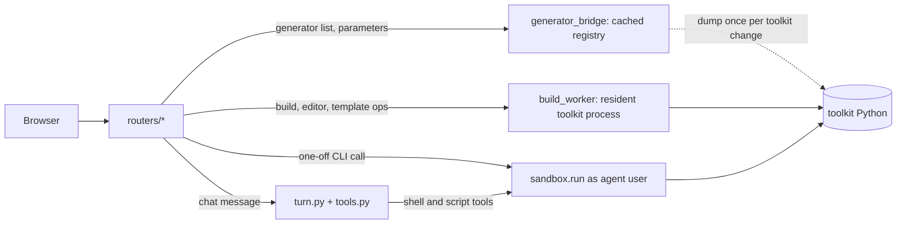

# The backend (FastAPI)

The backend is the Python web server inside the Docker container. It answers every request the browser makes (about 135 endpoints), runs the AI chat turns, keeps the chats, builds and parts lists, and starts the LDraw toolkit programs that build and render models. It is built with FastAPI, a Python web framework, and is started by `uvicorn`, the server that runs it: `uvicorn main:app --app-dir /app/web/backend --host 0.0.0.0 --port 8000`.

The backend does not contain the LDraw knowledge itself. LDraw is the open file format for LEGO-style models; an MPD file is one LDraw file that bundles a model and its sub-models. The code that generates, checks and renders models is a separate Python package, the toolkit (`ldraw_tools/`, installed at `/opt/ldraw-nova` in the image, with its own Python environment). The backend reaches it only by starting it as a separate process.

## How it works

### Start-up

`app/web/backend/main.py` builds the `app` object and runs `lifespan()` once at start. In order:

1. `environment_config.initialize()` runs before anything else is imported. It loads the saved environment variables (API keys) from `/config/environment.json` into the server's own environment.
2. The folders `generated/`, `chats/` and `output/` under the data folder are created, and `generated/` is handed to the unprivileged `agent` user (`sandbox.give_to_agent()`).
3. `db.migrate.upgrade_when_ready()` brings the PostgreSQL schema up to date (Alembic, under a database lock) and retries for up to 30 seconds while the database is still starting. If the database cannot be reached the app still starts, using JSON files, and Settings shows "Database: unavailable".
4. When the schema is ready: `request_log.prune()` deletes request-log rows older than 180 days, and `migrate_json.first_start()` runs the automatic import if `LDRAW_NOVA_DB_IMPORT=auto`.
5. `storage.refresh()`, `reset_store()` and `collection_store.refresh()` choose, once, between PostgreSQL and files for chats/builds and for the parts collection (see [database.md](database.md)). With the database in use, `builds.reconcile()` writes a version record for every model file of a recorded build, and `collection_store.start()` regenerates the derived JSON copy of the collection.
6. A daily background job prunes the request log again (`_prune_request_log_daily()`).
7. `generator_bridge.warm()` starts loading the generator registry in the background (next section).

Important detail: **the toolkit worker processes are not started here.** They start lazily on the first request that needs them (the build worker, the editor worker, the template worker). At shutdown the lifespan cancels running chat turns, closes the database pool and stops the workers (`build_worker.shutdown()`).

### Request guards (middleware)

All in `main.py`, applied before any router:

| Guard | What it does |
|---|---|
| Host check (`reject_unknown_host`) | Answers 421 unless the `Host` header is an IP address, `localhost`, `host.docker.internal`, or a name listed in `LDRAW_NOVA_ALLOWED_HOSTS`. Protects against DNS-rebinding attacks. |
| Same-origin check (`same_origin_api`) | For `/api/` paths, rejects cross-site requests (403) and a `Content-Length` over the limit (413). |
| Body limit (`ChunkedBodyLimit`) | The same size limit for requests sent without a `Content-Length`. The limit is 18 MB, or 27 MB for `/api/inventories` and `/api/collection/imports/preview` (CSV uploads). |
| Validation errors | `RequestValidationError` answers 422 without echoing submitted values, so keys never appear in error bodies. |
| `Cache-Control: no-store` | Set on `/api/environment*` and on paths ending in `/edit`. |

### From a request to the toolkit



There are three ways the backend runs toolkit code, each for a different job.

- **Resident workers** (`build_worker.py`). Starting the toolkit costs 15 to 25 seconds, so the backend keeps toolkit processes alive and talks to them in JSON lines (one request per line on stdin, one reply per line on stdout, protocol in `ldraw_tools/pipeline.py`). `BuildWorker` runs one request at a time and queues up to `max_queue` more; beyond that it raises `WorkerBusy`. A crash or a timeout kills the whole process group and the next request starts a fresh worker. There are three instances, created by getter functions:

  | Getter | Used for | Queue | Timeout |
  |---|---|---|---|
  | `get_worker()` | building a model from a plan or generator (`routers/pipeline.py`, `routers/builds_api.py`) | 4 (`LDRAW_NOVA_WORKER_QUEUE`) | 300 s (`LDRAW_NOVA_WORKER_TIMEOUT`) |
  | `get_editor_worker()` | the 3D editor's operations, and the template check and save (`routers/editor.py`, `routers/templates_api.py`) | 32 (`LDRAW_NOVA_EDITOR_QUEUE`) | 300 s |
  | `get_template_worker()` | "Make this a template", which can run up to hours | 1 | 4 hours (`LDRAW_NOVA_TEMPLATE_TIMEOUT`) |

  Editing has its own worker so that interactive edits do not wait behind a build that runs for minutes. Setting `LDRAW_NOVA_EDITOR_WORKER=0` makes the editor routes use a one-off CLI call instead (see `routers/editor.py`).

- **One-off sandboxed commands** (`sandbox.py`). `sandbox.run()` starts a command as the unprivileged `agent` user (via `setpriv`), with a scrubbed environment (no API keys), a CPU-time and file-size limit (`ulimit`) and a time-out that kills the whole process group. Output is bounded and any secrets passed in are redacted. It is used for the AI agent's shell and script tools (`tools.py`), for parts-list imports (`inventories.py`), for "What can I build?" (`buildable.py`) and for the editor's CLI fallback and palette checks. The server runs as root in the container and the agent user cannot read `/config` or the database password; see [security.md](security.md).

- **The generator registry** (`generator_bridge.py`). The fast path (the free, rule-based answer to a request, see [request-lifecycle.md](request-lifecycle.md)) needs to know every generator, its parameters and the colour names, but the generators live in the toolkit. `generator_bridge.ensure()` starts one short subprocess that prints the registry as JSON. The result is held in memory and saved to `/config/generators.json`, keyed on a hash of the generator, grammar and template files (and of the person's own templates), so a restart costs nothing and only a toolkit or template change triggers another dump. `cached()` reads it with no subprocess, `warm()` refreshes it in the background at start, and `apply_text()` asks the toolkit's building grammar to read phrases such as "three storeys". If the toolkit is missing, the fast path is simply unavailable.

`toolkit.py` is the glue to the toolkit checkout. `toolkit.root()` checks that it exists; `toolkit.workspace()` creates a chat's working folder with symlinks to the toolkit files; `toolkit.environment()` builds the environment for toolkit processes (including which Jev search key is in use and where the collection copy is); and `toolkit.builder_guides()` supplies the guide documents the AI reads.

## Where the code is

All paths are under `app/web/backend/` unless stated otherwise.

### Application core

| File | Purpose |
|---|---|
| `main.py` | App object, start-up and shutdown, middleware, mounts the routers |
| `settings.py` | Folder locations and the tuning knobs read from the environment (see the table below) |
| `environment_config.py` | The API keys and environment variables saved in the UI, stored in `/config/environment.json` |
| `routers/` | One module per area of the API (see the API reference) |
| `routers/common.py` | Shared helpers: 404 errors and how a model file is described to the UI |
| `routers/spa.py` | Serves the built frontend and the viewer, and the fallback to `index.html` (must be registered last) |
| `request_log.py`, `usage_log.py` | Routing telemetry and the cost history (database) |

### Toolkit and process handling

| File | Purpose |
|---|---|
| `build_worker.py` | `BuildWorker` and the three resident worker getters |
| `toolkit.py` | Toolkit path, environment, working folder, guides |
| `generator_bridge.py` | Cached generator registry and grammar text lookup |
| `sandbox.py` | Runs commands as the `agent` user with limits |
| `worker_isolation.py` | Guard against stray file writes by delegated AI workers |
| `render.py` | One LeoCAD render at a time (there is a single virtual display) |
| `glb.py` | Converts an MPD to a GLB 3D file with `mpd2glb.sh`, cached in `LDRAW_NOVA_GLB_CACHE_DIR` |

### Storage

| File | Purpose |
|---|---|
| `store.py`, `pg_store.py`, `pg_builds.py`, `storage.py`, `builds.py`, `workspace.py` | Chats, builds, drafts, proposals: files or PostgreSQL |
| `collection_store.py`, `collection_files.py`, `collection_pg.py` | Parts collection storage |
| `db/` | Database engine, models and migration runner |
| `migrations/`, `alembic.ini` | Alembic revisions |
| `migrate_json.py`, `migrate_collection.py` | One-way importers from JSON files |
| `paths.py`, `fsutil.py` | Safe path joining and atomic file writes |

Details are in [data-and-storage.md](data-and-storage.md) and [database.md](database.md).

### AI chat and decisions

| File | Purpose |
|---|---|
| `turn.py`, `agent_loop.py`, `agent.py` | The chat turn: stream a model reply, run tool calls, repeat |
| `tools.py`, `tool_policy.py`, `editor_tools.py` | Tools the AI can call and which are offered per mode |
| `system_prompt.py`, `history.py`, `inference.py`, `attachments.py` | Prompt assembly, history sent to the model, request normalisation, image inputs |
| `subagents.py`, `budget.py`, `worker_events.py`, `run_state.py` | Optional delegated workers, the shared euro budget, live events, state of a running turn |
| `fast_path.py`, `understand.py`, `chat_routing.py`, `parts_steering.py` | Free rule-based decision, the understanding step, quick-or-AI routing, parts steering |
| `llm_config.py`, `providers.py`, `provider_errors.py`, `model_catalog.py`, `model_discovery.py`, `model_versions.py` | Model entries, providers and their errors |
| `usage.py`, `usage_log.py` | Token and cost bookkeeping |

See [ai-agent.md](ai-agent.md) and [request-lifecycle.md](request-lifecycle.md).

### Parts, sets and models

| File | Purpose |
|---|---|
| `collection.py`, `collection_export.py`, `inventories.py`, `quick_add.py`, `reservations.py`, `buildable.py` | The parts collection and its tools |
| `set_catalog.py`, `set_detail.py`, `set_images.py`, `part_info.py`, `part_images.py` | Sets catalogue, set pages, pictures, part data |
| `gallery.py`, `ldraw.py`, `build_index.py` | My Builds listing, LDraw knowledge for the AI tools, the parts index built at image build time |

## API reference

Every route is declared in `routers/` and wired in `main.py`. Paths in braces are variables. The editor routes use `{space}`, which is `chats` or `builds`, so the same editor works for a chat and for a build. The spec files `spec.v1.schema.json` and `edit-intent.v1.schema.json` define the data shapes used by the understanding step.

### Environment and settings

| Method and path | What it does |
|---|---|
| GET `/api/environment` | Saved variables (values hidden), Jev key source, sandbox isolation, database and storage status |
| GET `/api/environment/check` | Whether a variable name collides with an existing one |
| PUT `/api/environment` | Save the variables |
| GET `/api/model-catalog` | Builder presets and model capabilities |
| GET `/api/llm-models`, POST `/api/llm-models` | List and create model entries |
| GET `/api/llm-models/{id}/edit`, PUT, DELETE `/api/llm-models/{id}` | Read for editing, update, delete one entry |
| POST `/api/llm-models/{id}/default` | Make an entry the default |
| PUT `/api/llm-workers/default`, PUT `/api/llm-understanding/default` | Default model for delegated workers and for the understanding step |
| POST `/api/llm-models/{id}/test` | Test an entry with a real call |
| GET `/api/llm-models/export`, POST `/api/llm-models/import` | Export and import entries as text |
| GET `/api/llm-providers`, `/api/llm-providers/keys`, `/api/llm-providers/{provider}/models` | Providers, which keys exist, a provider's models |
| POST `/api/llm-providers/{provider}/test` | Test a provider key |
| GET `/api/costs` | Spend per day and kind (needs the database, else 503) |
| GET, PUT `/api/request-log/settings` | Whether the request text is kept in the log |

### Chats and the AI agent

| Method and path | What it does |
|---|---|
| GET, POST `/api/chats` | List chats, create one |
| GET, PATCH, DELETE `/api/chats/{chat_id}` | Read, rename or change options, delete |
| POST `/api/chats/{chat_id}/messages` | Send a message; answers 202 and the turn runs in the background |
| GET `/api/chats/{chat_id}/stream` | Server-sent events for the running turn |
| POST `/api/chats/{chat_id}/approvals/{approval_id}` | Answer a permission prompt |
| POST `/api/chats/{chat_id}/cancel` | Stop the running turn |
| GET `/api/chats/{chat_id}/workers/{worker_id}` | A delegated worker's transcript |
| GET `/api/chats/{chat_id}/artifacts/{path}` | Download a file from the chat's work folder |
| POST `/api/chats/{chat_id}/build` | Build a plan into an MPD with checks and a GLB preview (build worker) |
| POST `/api/describe`, GET `/api/describe/estimate` | The fast-path decision; builds nothing |
| POST `/api/understand` | Internal test endpoint for the understanding step; the chat turn does not use it yet |

### Builds, workspace and generators

| Method and path | What it does |
|---|---|
| GET, POST `/api/builds` | List builds, create one |
| GET, PATCH, DELETE `/api/builds/{build_id}` | Read, rename, delete |
| POST `/api/builds/{build_id}/generate` | New version from a generator (build worker) |
| POST `/api/builds/{build_id}/import` | New version from an uploaded model file |
| POST `/api/builds/{build_id}/edit` | Open the build in the 3D editor |
| POST `/api/builds/{build_id}/chat` | Attach or create the build's chat |
| GET `/api/generators` | Generators with their parameters |
| POST `/api/generators/preview`, GET `/api/generators/previews/{name}.mpd` | Preview a generator's output |
| GET `/api/builds/{build_id}/workspace` | The workspace view: versions, draft, proposals |
| POST `/api/builds/{build_id}/draft/open`, `/save`, `/discard` | Open, save as a new version, discard the draft |
| POST `/api/builds/{build_id}/draft/regenerate`, `/describe` | Regenerate the draft from parameters; apply a plain-language description |
| GET `/api/builds/{build_id}/draft/parts-check` | Compare the draft's parts with the collection |
| POST `/api/builds/{build_id}/chat/note` | Add a note to the build's chat |
| GET `/api/builds/{build_id}/proposals` | AI proposals waiting for a decision |
| POST `/api/builds/{build_id}/proposals/{pid}/accept`, `/discard` | Accept or discard a proposal |
| GET `/api/builds/{build_id}/proposals/{pid}.mpd` | The proposal's model file |

### 3D editor

| Method and path | What it does |
|---|---|
| GET `/api/{space}/{chat_id}/editor/plans` | Plans the editor can open |
| GET, POST `/api/{space}/{chat_id}/editor` | Read the session; open one |
| POST `/api/{space}/{chat_id}/editor/edits`, `/undo`, `/redo` | Apply edits, undo, redo (editor worker) |
| POST `/api/{space}/{chat_id}/editor/publish` | Save the session as a model version |
| GET `/api/editor/colours` | The colour table |
| GET `/api/{space}/{chat_id}/editor/palette`, POST `.../palette/check` | Part search and the parts-collection check |
| POST `/api/models/{filename}/edit` | Open a model from My Builds in the editor |

### Templates

| Method and path | What it does |
|---|---|
| POST `/api/builds/{build_id}/template/check` | Check whether a build can become a template |
| GET `/api/builds/{build_id}/template/preview.mpd` | Preview |
| POST `/api/builds/{build_id}/template/jobs` | Start the derivation (template worker) |
| GET `.../template/jobs/{job_id}`, `.../files/{rel}` | Job status, files it produced |
| POST `.../template/jobs/{job_id}/cancel`, `/save` | Cancel, or save as a template |
| GET `/api/templates`, DELETE `/api/templates/{template_id}` | List and delete saved templates |

### My Builds, files and the LDraw library

| Method and path | What it does |
|---|---|
| GET `/api/models`, GET `/api/models/zip` | List models; download all as a zip |
| DELETE `/api/models/{filename}` | Delete a model file |
| GET `/api/glb` | A GLB for a model URL (`existing_only` skips conversion) |
| GET `/files/{path}` | Files under `generated/` and `chats/` only (never `output/`), sent with a restrictive security policy |
| GET `/files/set-image/{set_num}` | A set's picture, or a placeholder |
| GET `/reference-models/{path}` | Bundled set models, read-only |
| GET `/ldraw/{path}`, `/ldraw-id/{part_id}` | The LDraw parts library, case-insensitive, cached forever |

### Parts collection, sets and reservations

| Method and path | What it does |
|---|---|
| GET `/api/collection`, `/parts`, `/parts/{part}`, `/colours` | Overview, filtered parts, one part, colours |
| PUT `/api/collection/parts/{part}/note` | A free-text note on a part |
| POST `/api/collection/sources/{id}/ops`, GET `.../history`, POST `.../undo` | Edit a source with history, read history, undo |
| GET, POST `/api/collection/review` | The approximate ("maybe") items; resolve one |
| POST `/api/collection/imports/preview`, `/{preview_id}/diff`, `/{preview_id}/commit` | Import a CSV in three steps |
| GET `/api/collection/export/formats`, `/preview`, `/export`; POST `/export/lines` | Export |
| POST `/api/collection/sets`, `/sets/manual` | Add a set |
| POST `/api/collection/quick-add/parse`, `/quick-add` | Quick add from typed lines |
| GET `/api/catalog/sets`, `/api/catalog/sets/{set_num}` | Search the offline sets catalogue |
| GET `/api/sets`, `/api/sets/{source_id}` | Owned sets, one set with on-hand and missing parts |
| GET, PUT `/api/set-images/settings`; POST, DELETE `/api/sets/{source_id}/image` | Set picture settings and upload |
| GET `/api/parts/{part}/thumb` | Part thumbnail (202 while it renders) |
| GET, POST `/api/collection/reservations`, DELETE `.../{reservation_id}` | Parts held by built models |
| PUT `/api/collection/sources/{id}/set-state` | Mark a set built or not |
| GET `/api/collection/shortage`, `/shortage/export` | What a model still lacks |
| GET, POST `/api/inventories`; GET, PATCH, DELETE `/api/inventories/{id}`; PUT `.../family-colours` | The older inventory API |
| GET `/api/inventories/buildable`, `/buildable/status`; POST `/buildable/warm` | "What can I build?" |

Any other path falls through to the single-page-app handler, which serves the frontend.

## Configuration

Settings come from environment variables, read in `settings.py` and the modules named below. Folder variables normally keep their defaults inside the container; they exist so tests and local development can point elsewhere. Keys entered in Settings are stored in `/config/environment.json` and applied to the environment at start, except names that would change how programs start (`PATH`, `PYTHONPATH`, `LD_*`, and similar, listed in `environment_config.FORBIDDEN_NAMES`).

| Variable | Default | Meaning |
|---|---|---|
| `LDRAW_NOVA_DATA_DIR` | `/data` | Data folder (`leocad_render.py`) |
| `LDRAW_NOVA_WEB_CONFIG_DIR` | `/config` | Secrets and LLM settings folder |
| `LDRAW_NOVA_INVENTORIES_DIR` | `<data>/inventories` | Parts lists as files |
| `LDRAW_NOVA_TEMPLATES_DIR` | `<data>/templates` | The person's own templates |
| `LDRAW_NOVA_COLLECTION_EXPORT_DIR` | `<data>/collection-export` | Derived JSON copy of the collection |
| `LEOCAD_LIB` | `/opt/ldraw/ldraw` | LDraw library |
| `LDRAW_NOVA_INDEX_DIR` | `/opt/index` | Parts index |
| `LDRAW_NOVA_WEB_STATIC_DIR`, `_VIEWER_DIR`, `_VIEWER_VENDOR_DIR`, `_PLAYER_VENDOR_DIR` | `/opt/web/static`, `/opt/web/viewer`, `/opt/web/viewer-vendor`, `/opt/web/player-vendor` | Frontend and viewer files (`LDRAW_NOVA_WEB_` prefix) |
| `LDRAW_NOVA_TOOLKIT_DIR` | `/opt/ldraw-nova` | Toolkit checkout |
| `LDRAW_NOVA_TOOLKIT_PYTHON` | `<toolkit>/.venv/bin/python` | Toolkit interpreter |
| `LDRAW_NOVA_SCRIPTS_DIR` | `/opt/scripts` | Helper scripts on the agent's PATH |
| `LDRAW_NOVA_AGENT_USER` | `agent` | User that agent code runs as |
| `LDRAW_NOVA_ISOLATION_FILE` | `/run/ldraw-nova-isolation` | Where the entrypoint reports the firewall rule |
| `LDRAW_NOVA_ALLOWED_HOSTS` | empty | Extra host names accepted (comma separated) |
| `LDRAW_NOVA_STORAGE` | `auto` | `auto`, `files` or `postgres` ([database.md](database.md)) |
| `LDRAW_NOVA_DB_IMPORT` | `manual` | `auto` runs the JSON importer at first start |
| `LDRAW_NOVA_DATABASE_URL` | unset | Full database URL; replaces the next five |
| `LDRAW_NOVA_DB_HOST`, `_PORT`, `_NAME`, `_USER` | `db`, `5432`, `obd`, `obd_app` | Database connection parts |
| `LDRAW_NOVA_DB_PASSWORD_FILE` | `/run/secrets/db_password` | File holding the database password |
| `LDRAW_NOVA_WORKER_TIMEOUT`, `_WORKER_QUEUE`, `_EDITOR_QUEUE`, `_TEMPLATE_TIMEOUT` | 300 s, 4, 32, 4 h | Worker limits |
| `LDRAW_NOVA_EDITOR_WORKER` | `1` | `0` turns the resident editor worker off |
| `LDRAW_NOVA_MPD2GLB`, `_GLB_CACHE_DIR` | `mpd2glb.sh`, `/tmp/glb-cache` | GLB conversion |
| `LDRAW_NOVA_SET_CATALOG`, `_LOCAL_SET_CATALOG` | toolkit file paths | Override the sets catalogue files |
| `LDRAW_NOVA_SET_IMAGE_FETCH` | unset | `0` or `1` forces set-picture downloads off or on (beats the Settings switch) |
| `LDRAW_NOVA_KEEP_REQUEST_TEXT` | unset | `1` stores the full request text in the request log |
| `LDRAW_NOVA_UNDERSTAND_LLM_ID` | unset | Model entry for the understanding step |
| `LDRAW_NOVA_WORKER_LLM_ID` (or `_WORKER_MODEL_ID`) | unset | Model entry for delegated workers |
| `LDRAW_NOVA_SUBAGENTS` | off | Offer the planner the `delegate_task` tool |
| `LDRAW_NOVA_MAX_STEPS`, `_MAX_WORKERS`, `_MAX_DELEGATIONS` | 80, 3 (max 6), 8 | Turn limits |
| `LDRAW_NOVA_EUR_PER_USD` | 0.92 | Exchange rate for costs shown in euros |
| `LDRAW_NOVA_LEAN_PROMPT` | `auto` | `auto`, `on` or `off`: the shorter prompt for small-context models |
| `LDRAW_NOVA_MASK_OLD_TOOL_OUTPUT`, `_MASK_AFTER_STEPS`, `_MASK_MIN_CHARS`, `_MASK_BATCH_STEPS` | on, 10, 2000, 10 | Shrink old tool output in the history |
| `LDRAW_NOVA_IMAGE_EVICTION_BATCH`, `_READ_FILE_MAX_CHARS` | 4, 40000 | Image history and `read_file` size |
| `LDRAW_NOVA_TAIL_AFTER_HISTORY`, `_ROLLING_CACHE_BREAKPOINT`, `_CACHE_TTL`, `_COALESCE_REASONING` | on, on, `1h`, off | Prompt-cache layout |

The compose file also uses `LDRAW_NOVA_WEB_PORT` (default 8765) and `LDRAW_NOVA_WEB_BIND` (default `127.0.0.1`) on the host side to publish the port.

## Changing it

- **Add an endpoint.** Put it in the router module for its area (or add `routers/<area>.py` with `router = APIRouter()`), then, for a new module, import it and add it to the list in `main.py` (`for module in (...)`). The spa router must stay last. Use `routers/common.py` for 404 and file helpers. Never call `os.system` or `subprocess` directly; use `sandbox.run()` or a worker.
- **Add a request that needs the toolkit.** Prefer a worker: send a JSON request through `build_worker.get_worker()` or `get_editor_worker()` and add the matching operation in `ldraw_tools/pipeline.py`. A new worker kind follows `get_template_worker()`: its own getter, queue size and time-out, and a line in `shutdown()`.
- **Add a setting.** Read it in `settings.py` with `_env_int()` or `_flag()` and add a row to the table above.
- **Add a table or column.** See "Adding a migration" in [database.md](database.md).
- **Do not block the event loop.** The server is asynchronous. Blocking work (files, database) goes through `asyncio.to_thread()`, as `main.py` does for migrations.

## Testing it

The tests are in `app/web/backend/tests/` (about 64 files). They run inside the container image because they use the baked LDraw library, the indexes and LeoCAD. `tests/conftest.py` points `/data` and `/config` to temporary folders, forces `LDRAW_NOVA_STORAGE=files`, and allows the `testserver` host.

```
cd app
docker compose up -d --build
docker compose exec ldraw-nova-app bash -c \
  "pip install -q --break-system-packages -r /app/web/backend/requirements-dev.txt && cd /app/web/backend && pytest -q"
```

Run one file with `pytest -q tests/test_build_worker.py`. This is also what CI does (`.github/workflows/ci.yml`, "Backend tests").

| Test files | Cover |
|---|---|
| `test_api.py`, `test_security.py`, `test_paths.py` | Routes, host and origin guards, path safety |
| `test_build_worker.py`, `test_sandbox.py`, `test_toolkit.py`, `test_worker_isolation.py` | Workers, sandbox, toolkit glue |
| `test_fast_path.py`, `test_understand.py`, `test_nl_*.py` | Decision engine and language handling |
| `test_agent.py`, `test_wire_*.py`, `test_subagents.py`, `test_budget_ledger.py` | Chat turns, provider wire formats, workers, budget |
| `test_editor_*.py`, `test_workspace.py`, `test_builds.py`, `test_templates_api.py` | Editor, builds, templates |
| `test_collection*.py`, `test_inventories.py`, `test_reservations.py`, `test_buildable.py` | Parts collection |
| `test_database*.py`, `test_pg_store.py`, `test_migrate_json.py`, `test_collection_pg.py` | Database (skipped without a test database, see [database.md](database.md)) |

## Related

- [request-lifecycle.md](request-lifecycle.md): what happens to one chat message
- [ai-agent.md](ai-agent.md): the turn loop and tools
- [data-and-storage.md](data-and-storage.md), [database.md](database.md): where data lives
- [security.md](security.md): sandbox, host checks, secrets
- [operations.md](operations.md): running and updating the container
