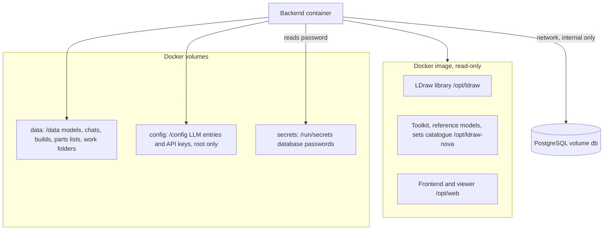

# Data and storage

Everything the app keeps lives in three places: Docker volumes that survive restarts (your models, settings and database), read-only reference data baked into the Docker image (the LDraw parts library, the bundled reference models, the sets catalogue), and caches that can be rebuilt. This page says which is which, where each folder is, and what is a plain file versus a row in PostgreSQL.

The short rule: **model files are always files. Chats, builds, drafts, proposals, the parts collection, the request log and the cost history are rows in PostgreSQL**, with JSON files as the fallback and the frozen backup. Secrets are files in a separate volume the AI's code cannot read. The table list and the switch between files and database are in [database.md](database.md).

## How it works



- The app container mounts `data` at `/data`, `config` at `/config` and `secrets` read-only at `/run/secrets`. The database lives in its own container with its own volume; the app reaches it over an internal Docker network.
- The volumes are **named volumes, not host folders**, because file access through a bind mount is slow on Windows and macOS. A new empty `data` volume is filled from `app/data/generated/` in the image, which contains the showcase models.
- The agent's code runs as a different user (`agent`). It can write only to its own work folders and `generated/`. It cannot read `/config`, `/run/secrets` or the database (firewall rule in `app/entrypoint.sh`). See [security.md](security.md).

### Volumes

Defined in `app/docker-compose.yml`. The compose project is called `ldraw-nova-docker`, which gives the volume names below.

| Volume | Mounted at | Holds |
|---|---|---|
| `ldraw-nova-docker_data` | `/data` in the app | Models, chats, builds, parts lists, work folders, caches |
| `ldraw-nova-docker_config` | `/config` in the app | `models.json` (LLM entries), `environment.json` (keys and variables), `generators.json` (cache of the generator registry). Folder mode 0700, root only |
| `ldraw-nova-docker_db` | `/var/lib/postgresql` in the `db` container | PostgreSQL data. Not mounted in the app |
| `ldraw-nova-docker_secrets` | `/run/secrets` | The two generated database passwords, root-owned, mode 0440 |
| `ldraw-nova-docker_backups` | `/backups` in the `db-backup` container | Scheduled dumps. Only exists when the opt-in `backup` profile is used |

**`docker compose down -v` deletes all of these.** Back up first (see Backups below). To copy models out without a backup: `docker cp ldraw-nova-app:/data/generated ./my-models`.

### Layout of `/data`

The folder names are set in `app/web/backend/settings.py` (and `leocad_render.py` for `generated` and `output`).

| Path | Contents | Served to the browser |
|---|---|---|
| `generated/` | Every saved model version: `<slug>-vN.mpd` (an MPD is one LDraw file holding a model and its sub-models), plus a `.png` snapshot and a `.csv` parts list. This is "My Builds". The AI's code can write here. | Yes, through `/files/` |
| `builds/<slug>/` | A build's workspace. With the database in use: `proposals/<id>.mpd`, `edit.json`, `output/` (the editor's `plan.json`, `state.json`, `preview.mpd`). In files mode also `build.json`, `models.jsonl` (version log), `draft.json`, `proposals/<id>.json` | Through the API only |
| `chats/<chat-id>/` | Always `renders/` and `workspace/`. In files mode also `chat.json`, `messages.jsonl`, `models.jsonl`, `workers/<id>.jsonl` | Yes (`chats/` is served) |
| `output/<chat-id>/` | The AI's work folder: scripts, plans, `NOTES.md`, scratch files. `/opt/ldraw-nova/output` is a symlink to it | **Never** served; reachable only through the chat artifact API |
| `inventories/` | Parts lists as files: `<id>.json`, `<id>.csv`, `<id>.log.jsonl`, plus dot-files for notes, reservations and CSV mappings. Used when the collection is in files mode, and kept as the frozen backup after the import | Through the API |
| `collection-export/` | Only with the collection in PostgreSQL: a derived JSON copy that the toolkit command line reads (it never reads the database). Rebuilt at start and after each change | No |
| `templates/` | The person's own build templates (`<id>.json`) made by "Make this a template" | No |
| `cache/part-thumbs/`, `cache/set-images/`, `cache/set-images-settings.json` | Part thumbnails, set pictures and the "download catalogue pictures" switch | Through the API |
| `_migration/` | Reports written by the JSON importer (`report-<time>.json`) | No |

The web server serves only `generated` and `chats` (`settings.WEB_DIRS`, checked again on the resolved path in `routers/files.py`, so `../output` cannot be reached). Files are sent with a `sandbox` content-security policy because AI code can write any file type into `generated/`.

### What is a file and what is a row

| Data | Where | Why |
|---|---|---|
| Model versions (`.mpd`, `.png`, `.csv`) | Files in `generated/` | Big, easy to copy out, other programs read them. What exists is what is on disk |
| Chats, messages, worker transcripts, published-model records | PostgreSQL (files as fallback) | Queries, safe numbering, no half-written files |
| Builds, drafts, proposals (the records) | PostgreSQL (files as fallback); a proposal's `.mpd` stays a file | Same |
| Parts collection | PostgreSQL (files as fallback) | Same, with change history |
| Request log, cost history | PostgreSQL only | Telemetry; without the database they are not recorded |
| LLM entries and API keys | Files in `/config` | Must stay out of the database and out of reach of agent code |
| Editor state, AI work folders, renders, caches | Files | Working data, rebuilt or discarded freely |
| Templates | Files in `templates/` | Read directly by the toolkit |

### Baked into the image (read-only)

| What | Where in the image | Source in the repo |
|---|---|---|
| LDraw parts library (pinned release, checked by SHA-256) | `/opt/ldraw/ldraw`, served at `/ldraw/` | Downloaded at image build (`app/Dockerfile`, argument `LDRAW_COMPLETE_SHA256`). When a newer release appears the check fails on purpose; update the checksum to move on |
| The toolkit and its own Python environment | `/opt/ldraw-nova` | `ldraw_tools/`, `ldraw-agent`, `prompts/`, `docs/agent/` |
| 1,821 reference models | `/opt/ldraw-nova/data/models-annotated/` | `models-packed/`: 130 `.tar.xz` shards plus `manifest.json`, unpacked by `tools/models_pack.py` |
| Descriptions of parts, models and sub-models | `data/ldraw-info.db` in the toolkit (SQLite, about 26 MB, opened read-only) | `data/ldraw-info.db`, committed to the repo |
| Offline sets catalogue | `ldraw_tools/data/set-catalog.bin` | `tools/build_set_catalog.py` |
| Rebrickable mappings | `ldraw_tools/data/rebrickable-*.json` | `tools/build_rebrickable_maps.py` |
| Parts index for `find_parts` | `/opt/index` | `app/web/backend/build_index.py`, run at image build |
| Frontend, viewer, wasm player | `/opt/web/static`, `/opt/web/viewer`, `/opt/web/viewer-vendor`, `/opt/web/player-vendor` | `app/web/frontend`, `app/web/viewer`, `app/vendor/` |
| LeoCAD (the renderer, pinned version) | `/opt/leocad` | Downloaded at image build |

SQLite appears only here, as read-only reference data and search caches (`ldraw-info.db`, the discovery `catalog.sqlite` under `/opt/ldraw-nova/.cache/`). It is never used for user data.

### How writes stay safe

- **Atomic writes.** JSON records and parts lists are written to a temporary file in the same folder and then renamed, so a reader never sees half a file (`fsutil.atomic_write()`, `builds.py`, `llm_config.py`).
- **One writer at a time.** `fsutil.lock` guards read-modify-write sequences in the collection; editor requests go through one resident worker; renders are serialised by `render.py` because the container has a single virtual display (Xvfb).
- **Paths cannot escape.** `paths.safe_join()` resolves a path under a root and rejects `..`, absolute paths and symlinks that leave the root. For the LDraw library (case-insensitive on LDraw but not on Linux) it retries by matching each folder name ignoring case.
- **Content-addressed caches.** The build worker caches results by a hash of the toolkit version, library, options and plan; the GLB cache and the generator registry cache are keyed the same way.

### Backups

`scripts/backup.sh` writes a PostgreSQL dump (`obd-<stamp>.dump`) and a tarball of the data volume (`obd-data-<stamp>.tgz`). The tarball contains only `generated`, `builds`, `inventories` and `chats`. It does **not** contain:

- `/config` (API keys and LLM entries): back it up separately; the command is in the header of `scripts/backup.sh`;
- `templates/` (the person's own templates) and `output/`: copy these yourself if you care;
- `cache/` and `collection-export/`: rebuilt automatically.

Details, restore and the scheduled-backup profile are in [database.md](database.md).

## Where the code is

| File | Purpose |
|---|---|
| `app/web/backend/settings.py` | Every folder location and its environment override |
| `leocad_render.py` | Defines `DATA_DIR`, `GENERATED_DIR`, `OUTPUT_DIR` from `LDRAW_NOVA_DATA_DIR` |
| `app/web/backend/paths.py` | `safe_join()`, `rel_to()`: safe path handling |
| `app/web/backend/fsutil.py` | `atomic_write()` and the shared collection lock |
| `app/web/backend/storage.py` | Chooses PostgreSQL or files for chats and builds |
| `app/web/backend/store.py` | `ChatStore`, the file implementation; `get_store()` picks the backend |
| `app/web/backend/pg_store.py`, `pg_builds.py` | The PostgreSQL implementation |
| `app/web/backend/collection_store.py`, `collection_files.py`, `collection_pg.py` | The same choice for the parts collection |
| `app/web/backend/builds.py`, `gallery.py` | Builds and the model files in `generated/` |
| `app/web/backend/llm_config.py`, `environment_config.py` | Files in `/config` |
| `app/web/backend/routers/files.py`, `routers/common.py` | What the browser may read from `/data` |
| `app/docker-compose.yml`, `app/Dockerfile`, `app/entrypoint.sh` | Volumes, image contents, ownership and firewall |

## Changing it

- **Add a folder under `/data`.** Define it in `settings.py` with an environment override, create it where it is first used, and decide: is it served (add to `WEB_DIRS`, rarely right) or private? Decide if it belongs in the backup tarball (`scripts/backup.sh`) and update the list above.
- **Add reference data to the image.** Put the source in the repo, copy it in `app/Dockerfile`, and read it from `settings.py` (path override) rather than hard-coding `/opt/...`.
- **Write a file.** Use `fsutil.atomic_write()`; resolve user-supplied names with `paths.safe_join()`.
- **Add a new kind of stored record.** If it has to be queried or numbered, it belongs in PostgreSQL (see [database.md](database.md)); if it is a document someone else opens, keep it a file.
- **Do not put secrets under `/data`.** The AI's code can write into parts of that volume. Secrets go in `/config` or `/run/secrets`.

## Testing it

```
docker compose exec ldraw-nova-app bash -c \
  "pip install -q --break-system-packages -r /app/web/backend/requirements-dev.txt && cd /app/web/backend && \
   pytest -q tests/test_paths.py tests/test_store.py tests/test_gallery.py tests/test_collection.py tests/test_security.py"
```

`test_paths.py` covers path escapes, `test_store.py` the file store, `test_collection.py` the collection files, `test_security.py` what `/files/` may serve. Tests redirect `/data` and `/config` to temporary folders (`tests/conftest.py`).

## Related

- [database.md](database.md): the tables, the files-or-database switch, importers, backup and restore
- [backend.md](backend.md): configuration variables
- [security.md](security.md): why `/config` and `output/` are separate
- [operations.md](operations.md): running, updating and cleaning up the containers
- [parts-and-collection.md](parts-and-collection.md): the parts collection
- [PostgreSQL plan](../plans/active/postgres/PROPOSAL.md)
