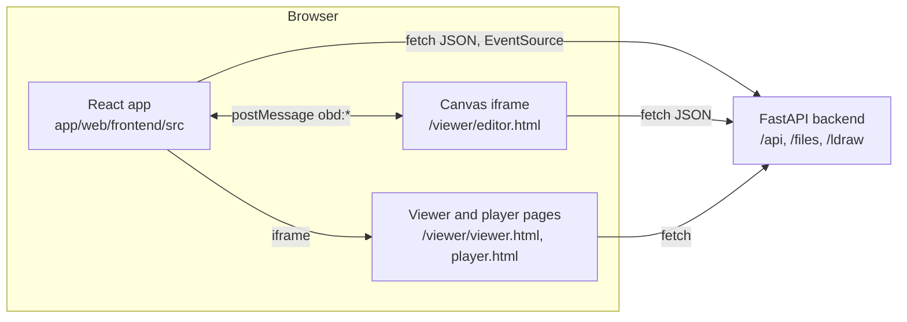

# The frontend

The frontend is the web page the person uses: a React app that shows the Home menu, My Builds, My Parts, My Sets, Settings and the build workspace. It does no real work itself. It asks the backend (see [backend.md](backend.md)) for data and shows it. The one part that is not React is the 3D canvas, which is a separate static page loaded in an iframe, and the two talk to each other with browser messages.

The app is desktop only. Some code still has small-screen branches (a menu button, a `phone` flag in the workspace); they are leftovers and are not supported or documented.

## How it works



**Build and serve.** The app is built with Vite (a build tool that bundles the TypeScript into plain files) and checked with `tsc` (the TypeScript compiler, strict mode, no unused variables). `npm run build` runs `tsc -b` and then `vite build`, and writes `app/web/frontend/dist/`. In the Docker image a Node stage does this (`app/Dockerfile`, stage `frontend`) and copies `dist/` to `/opt/web/static/`. The backend serves those files and falls back to `index.html` for any unknown path, so the browser router can handle URLs like `/build/my-house` (`app/web/backend/routers/spa.py`, `spa()`). There is no server-side rendering.

**Entry point.** `src/main.tsx` renders `<App />` inside React `StrictMode` and a `BrowserRouter` (React Router v7), and imports `src/styles.css`. `src/App.tsx` loads shared data once, provides it through a context, and declares the routes.

**Routes and pages.** Every page sits under the app bar.

| Route | Page file (`app/web/frontend/src/pages/`) | What it does |
|---|---|---|
| `/` | `Home.tsx` | Menu of five tiles (New build, My Builds, My Parts, My Sets, Settings), each with one live line (build count and latest build, pieces and items to review, sets and how many are built). Shows `FirstRun` hints when there are no parts or builds. |
| `/new` | `NewBuild.tsx` | No screen. Creates an empty build (`buildsApi.create`) and redirects to `/build/:id`. A prompt passed in router state is handed on to the workspace chat. |
| `/build/:id` | `BuildPage.tsx` | Renders the workspace (`components/workspace/Workspace.tsx`), keyed by the build id. See [workspace-and-editor.md](workspace-and-editor.md). |
| `/builds` | `Builds.tsx` | Every build as a card with a name filter, New build and "Import a model file". "Older chats" and "All model files" (`Models.tsx`) fold away below. `/models` redirects here. |
| `/chat/:id` | `ChatPage.tsx` | The older stand-alone agent chat, for chats that belong to no build. A chat attached to a build is shown in the workspace Chat tab instead. |
| `/chat/:id/edit`, `/build/:build/edit` | `EditorPage.tsx` | Legacy stand-alone editor: the canvas iframe plus a parts palette. Reached from the chat page's "Edit in 3D" link and from My Builds, All model files, Edit. |
| `/parts`, `/parts/:id` | `Parts.tsx` | My Parts (collection, sources, review queue). See [parts-and-collection.md](parts-and-collection.md). |
| `/sets`, `/sets/:id` | `Sets.tsx`, `SetDetail.tsx` | My Sets and one set's page. |
| `/costs` | `Costs.tsx` | Spend per day and kind from `GET /api/costs`. |
| `/settings` | `Settings.tsx` | Provider keys, models and roles. See [settings-and-providers.md](settings-and-providers.md). |
| anything else | | Redirects to `/`. |

**The app bar** (`components/AppBar.tsx`) is the slim bar on top of every page, workspace included. The logo and name link Home; links on the right are My Builds, My Parts, My Sets, Costs and Settings. The workspace adds its own second bar under it (`TopBar`).

**Component folders** (`src/components/`):

| Folder or group | Holds |
|---|---|
| `workspace/` | The build workspace panels: `Workspace`, `TopBar`, `ToolRail`, `CanvasPane`, `ChatPanel`, `PartsPanel`, `PiecePanel`, `SettingsPanel`, `TemplatePanel`, `BuildingEditor`, `BottomBar`, `Splitter`, `ColourPicker`, `Icon`. |
| `parts/` | My Parts and My Sets building blocks: dialogs for adding sources and sets, collection and source views, review queue, reserved and buildable panels. |
| `editor/` | `Palette.tsx` and `paletteLogic.ts`, the parts palette of the legacy `EditorPage`. |
| top level | Chat pieces shared by the chat page and the workspace chat (`Composer`, `MessageList`, `ToolCard`, `TurnStatus`, `StepGroup`, `Worker*`, `Markdown`), settings forms (`AgentForm`, `ProviderSettings`, `ModelPicker`, `EnvironmentSettings`), and general bits (`AppBar`, `Logo`, `KeyBanner`, `FirstRun`, `ViewerModal`, `ViewerStage`, `GeneratorForm`). |

## Talking to the backend

- **`src/api.ts`** is the typed client. `request<T>(url, init)` wraps `fetch`: it sets the JSON header when there is a body, turns a non-2xx answer into an `Error` carrying `status` and the server's `detail`, and parses JSON or text. Grouped objects wrap endpoints: `api` (chats, models, providers, environment, costs), `buildsApi` (builds, generators, describe), `inventoryApi`, `collectionApi`, `setsApi`, `reservationsApi`, `editorApi`, `paletteApi`. The TypeScript types for backend answers live in the same file. Helpers build URLs: `viewerUrl()`, `editorUrl()`, `workspaceBase()` (an id starting with `b-` is a build, anything else a chat) and `downloadGlb()`.
- **`src/workspace/wsApi.ts`** and **`templateApi.ts`** are small clients for the workspace endpoints (`/api/builds/{id}/workspace`, `draft/*`, `proposals/*`) and for "Make this a template" (`/api/builds/{id}/template/*`). Their types are in `src/workspace/types.ts`.
- **`src/hooks/useChatStream.ts`** follows a running chat turn. It opens an `EventSource` on `/api/chats/{id}/stream` and keeps the in-flight text, tool calls, approvals and workers. The database stays the source of truth: every "saved" event triggers a reload of the chat. `useMediaQuery.ts` is a small media-query hook.
- **Polling.** `useWorkspace` refetches the build while snapshots are still rendering (every 1.5 s) and the version geometry checks while they run (every 4 s). The standalone editor page polls every 3 s when not embedded.

## State management

There is no state library. State lives in three places:

1. **App context** (`src/context.ts`, provided in `App.tsx`): the chat list, the build list and "older chats", the configured models (`llms`, default main and worker model), the provider label catalogue, and `openViewer()`. Pages read it with `useApp()` and call `refreshBuilds()` / `refreshChats()` / `refreshLlms()` after a change. `App.tsx` also refetches builds on every route change, so a version saved elsewhere shows up in My Builds.
2. **The workspace hook** (`src/workspace/useWorkspace.ts`): one hook that owns everything about the open build (build detail, workspace data, draft, parts check, selected tool and tab, canvas selection, toast, confirm dialog) and every button's action. Components only render it and call it. Details in [workspace-and-editor.md](workspace-and-editor.md).
3. **Local component state** (`useState`) for everything page-specific.

Browser storage is used only for conveniences and is always wrapped in try/catch: panel sizes (`localStorage` key `obd.ws.layout`, `src/workspace/useLayout.ts`), chat defaults and parts steering (`ChatSettings`, `PartsControl`), the remembered model (`modelChoices.ts`), and the running template job id (`sessionStorage`, `TemplatePanel`).

## Styling and design system

The look is called "Blueprint with Toy box touches": deep slate background, a faint measurement grid, mono numbers, brick-coloured accents. Plain CSS, no CSS framework.

- `src/styles.css` imports the files in `src/styles/` in order and holds the small rules for the legacy editor palette.
- `src/styles/theme.css` is the design system: CSS variables (colours `--bg --surface --fg --accent --ok --warn --danger`, spacing `--sp-1..7`, radii, type sizes `--fs-*`, brick colours), the base element styles (buttons, inputs, `.banner`, `.badge`, `.label`), and the self-hosted fonts Hanken Grotesk and JetBrains Mono (`app/web/frontend/public/fonts/`, SIL OFL licence). Dark is the default; light ("paper print") follows `prefers-color-scheme`, and either can be forced with `<html data-theme="dark|light">`. `button.primary` is the only filled red button.
- One file per area: `layout.css` (app bar, page frame), `workspace.css` (the build workspace), `chat.css`, `chat-stage.css`, `parts.css`, `collection.css`, `set-detail.css`, `settings.css`, `providers.css`, `costs.css`, `build.css`, `model-card.css`, `modal.css`, `responsive.css` (the old narrow-screen rules).
- The viewer pages cannot import these files, so `app/web/viewer/tokens.css` holds a copy of the same token block. When you change a token in `theme.css`, change it there too.

## The canvas and the static viewer pages

The 3D pages are plain HTML and JavaScript in `app/web/viewer/`, not part of the React bundle. They use classic script tags and global variables (`THREE`, `LDR`) from vendored libraries, which should not mix with a bundled app. The backend serves the folder at `/viewer/`; vendored libraries come from `/viewer/vendor/` (three.js and the ldbi LDraw loader) and `/viewer/player-vendor/` (the WebAssembly player).

| File (`app/web/viewer/`) | Role |
|---|---|
| `editor.html`, `editor.js` | The editor canvas. `editor.js` is the glue between three.js, the DOM, the backend editor API and the parent page. Opened with `?space=builds&id=<slug>&embed=1&mode=edit|view|player&theme=dark|light`. With `embed=1` it shows only the canvas. |
| `editor-core.js` | Editor maths and request building with no DOM or three.js (picking, snapping, nudging, copy and paste, edit batches, predicted results). Loaded by the page and by node tests. |
| `editor-scene.js` | The three.js scene: one group per part, so an edit touches only the parts it changes. |
| `editor-player.js` | Loads the WebAssembly step player into the editor's Player mode. |
| `viewer.html`, `viewer.js`, `glb-view.js` | The read-only 3D viewer (`?model=<url>`), with GLB support. |
| `player.html`, `player.js` | The stand-alone step-by-step player. |
| `viewer-common.js`, `*.css` | Shared helpers (query parameters, status line) and styles. |

React shows the viewer and player in `ViewerModal` (a pop-up) and `ViewerStage` (beside the old chat page), both an iframe built with `viewerUrl()`.

### The `obd:*` message protocol

The workspace (`CanvasPane.tsx`) embeds `editor.html` and exchanges `postMessage` messages with it. Both sides check the sender: React accepts only messages from its own iframe window and the same origin; the canvas accepts only its parent (`EditorCore.trustedMessage`). The types are in `src/workspace/types.ts` (`CanvasEvent`, `CanvasCommand`).

Canvas to React (events):

| Message | Meaning |
|---|---|
| `obd:ready {mode}` | The model is loaded. |
| `obd:selection {pieces}` | The selected parts changed (id, part, name, colour, position, rotation, section). |
| `obd:changed {revision, undo_depth, redo_depth}` | An edit, undo or redo was confirmed by the server. |
| `obd:error {message}` | Something was refused or failed; shown as a toast. |
| `obd:mode {mode}`, `obd:tool {tool}` | The canvas changed mode (`edit`, `view`, `player`) or tool by itself (for example Esc back to select). |
| `obd:steps {total, current}` | Player progress. |
| `obd:shortcut {action: "save"}` | Ctrl+S pressed inside the canvas. |

React to canvas (all sent as `{type: "obd:command", cmd, ...}`):

| `cmd` | Effect |
|---|---|
| `undo`, `redo`, `delete` | Same as the keyboard action. |
| `set-tool {tool}`, `set-mode {mode}`, `set-colour {colour}` | Change tool, mode, or the paint colour (recolours the selection when something is selected). |
| `add-part {part, colour}` | Arm the add tool with a part. |
| `view-version {url}`, `back-to-draft` | Show a saved version or an AI proposal read-only, or return to the draft. |
| `reload` | Re-read the draft from the server. |
| `select {ids}` | Select parts by `section:id` and frame them ("Show them" in the chat). |
| `focus` | Reset the camera. `step {n}` goes to a player step. |

## Where the code is

| Path | What it is |
|---|---|
| `app/web/frontend/package.json`, `vite.config.ts`, `tsconfig.json` | Scripts (`dev`, `build`, `preview`), the dev proxy, strict TypeScript settings. |
| `app/web/frontend/index.html`, `src/main.tsx`, `src/App.tsx` | Page shell, entry point, routes and shared data loading. |
| `app/web/frontend/src/api.ts` | Typed backend client and URL helpers. |
| `app/web/frontend/src/context.ts` | `AppContext` and `useApp()`. |
| `app/web/frontend/src/workspace/` | Workspace state hook, layout hook, workspace and template API clients, types. |
| `app/web/frontend/src/pages/`, `src/components/` | Pages and components, as above. |
| `app/web/frontend/src/styles/`, `src/styles.css` | Design system and styles. |
| `app/web/viewer/` | The canvas, viewer and player pages. |
| `app/web/viewer-deps/` | Node tests and pinned dev dependencies for the viewer pages. |
| `app/web/backend/routers/spa.py` | Serves `dist/`, `/viewer`, and the `index.html` fallback. |
| `app/Dockerfile`, `app/docker-compose.dev.yml` | Production build stage and the dev setup. |

## Running it in development

Start the backend with the dev compose file, then run Vite:

```bash
cd app
docker compose -f docker-compose.yml -f docker-compose.dev.yml up -d
cd web/frontend && npm install && npm run dev      # http://localhost:5173, hot reload
```

`vite.config.ts` proxies `/api`, `/files`, `/ref`, `/ldraw`, `/ldraw-id` and `/viewer` to `http://localhost:8765`, the port of the running backend. Alternatively run `npm run build` and reload port 8765: the dev compose file mounts `web/frontend/dist` as the served static folder. The viewer pages are served by the backend, so edits to `app/web/viewer/` apply on reload with no build step.

## Changing it

- **Add a page.** Create the file in `src/pages/`, add a `<Route>` in `App.tsx` (above the `*` route), and a link in `AppBar.tsx` (`LINKS`) or a tile in `Home.tsx` if people should reach it.
- **Add a backend call.** Add the answer type and a function to the right group in `src/api.ts` (always through `request<T>`, so errors carry the server's message). Do not call `fetch` directly in components.
- **Add shared data.** Put it in `App.tsx` state and in the `AppState` type in `context.ts`. Prefer local state if only one page needs it.
- **Change a colour or size.** Edit the variable in `styles/theme.css` and the copy in `app/web/viewer/tokens.css`. Do not hard-code colours in component CSS.
- **Add a canvas message.** Add the type to `CanvasEvent` or `CanvasCommand` in `src/workspace/types.ts`, handle it in `onCanvasEvent` (`useWorkspace.ts`) or send it with `ws.send`, and in `app/web/viewer/editor.js` post it with `post()` or handle it in `handleCommand()`. Keep both ends in step; there is no shared schema.
- Run `npm run build` before you commit: it is the type check. There is no linter or unit-test setup for the React code.

## Testing it

| What | Command |
|---|---|
| Types and bundle | `cd app/web/frontend && npm run build` |
| Editor maths (node) | `cd app/web/viewer-deps && npm ci && npm run test:core` |
| Viewer, editor and canvas in a real browser (Playwright) | `npm test`, `npm run test:editor`, `npm run test:canvas` in `app/web/viewer-deps` (files `test/viewer.browser.mjs`, `editor.browser.mjs`, `canvas.browser.mjs`) |
| Whole workspace journey | `app/web/viewer-deps/test/workspace.e2e.mjs`, against a throwaway running app; the setup commands are in the file header |

## Related

- [workspace-and-editor.md](workspace-and-editor.md): what the workspace components do and how the editor works.
- [request-lifecycle.md](request-lifecycle.md): what the backend does with a chat message.
- [settings-and-providers.md](settings-and-providers.md), [parts-and-collection.md](parts-and-collection.md): the Settings and My Parts pages.
- [operations.md](operations.md): Docker, dev mode and CI.
- `docs/plans/done/build-workspace/CONTRACT.md`: the original message contract.
