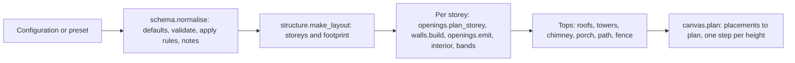

# Generators, the building grammar, roles and templates

This page covers the deterministic model builders of Open Brick Designer. A **generator** is a piece of code that turns a handful of settings ("width 10, red roof, two windows") into a complete, valid LEGO model in LDraw format, the same way every time and without any AI. The **building grammar** is the largest of them: one rule set that builds houses, shops, towers, castles and pagodas. **Roles** label every brick in a model with what it is for (roof, wall, wheel), which is how "make the roof blue" works on any model. **Templates** turn a real, finished model into a new kind of generator with a few sliders. These pieces exist so that most requests are answered in seconds for free instead of by the paid agent (see [request-lifecycle.md](request-lifecycle.md)).

## How it works

### What a generator is

Every generator is a `Generator` object (`ldraw_tools/generators/base.py`) with:

| Field | Meaning |
|---|---|
| `id`, `title` | Stable name (`house`, `grand-tourer`) and a display name |
| `families` | Broad classes the generator answers: `car`, `house`, `spaceship`, `garden`... These are the same names as `subject.family` in the spec schema |
| `kinds` | Synonyms for matching a request: `cottage`, `coupe`, `x-wing` |
| `params` | A JSON Schema `properties` object. Each parameter has a type, range, default and description. Colour parameters are marked `x-colour` and accept a name ("dark grey") or an LDraw code |
| `roles` | The role names the generator stamps on its parts |
| `build(params)` | Receives validated parameters with defaults filled, returns `(plan, notes)` |
| `quality`, `coverage` | A short honest description of how good it is and what its parameters cover. Entries whose quality starts with "Small accent piece" are only chosen when the request names their kind |

Two properties matter. A generator is a **pure function of its parameters**, so `(id, params)` is a valid cache key. And it **adjusts instead of failing**: out-of-range values are clamped, and each adjustment is added to `notes` ("width 7 adjusted to 8 (even, 6-24)"), which the app shows to the person.

A **plan** is the toolkit's JSON description of a model (sections, steps, placements with part, colour, position and optional `role`). The builder turns it into an MPD file. See [toolkit.md](toolkit.md).

### The registry and how the fast path finds generators

`ldraw_tools/generators/__init__.py` holds `REGISTRY`, a dictionary from id to `Generator`. These are registered today:

| Id | Module | Families | What it builds | Main parameters |
|---|---|---|---|---|
| `building` | `grammar/registry.py` (re-exported by `generators/building.py`) | house, building | The building grammar (below). Accepts its own nested settings and the old house settings | footprint, storeys, walls, openings, corners, roof, details, base, `preset` |
| `house` | `generators/house.py` | house, building | The original parametric house, kept so saved builds still open | width, depth, courses, door, windows, roof, porch, chimney, dormer, 6 colours |
| `grand-tourer`, `delivery-van`, `pickup`, `tipper-truck` | `generators/vehicles.py` | car, van, truck | Road vehicles on measured running gear | length, wheelbase, palette, body/roof/trim/wheels/glass/accent colours |
| `touring-motorcycle`, `harbour-launch`, `courier-jet` | `generators/vehicles.py` | motorcycle, boat, aircraft | Fixed-size designs | palette and colours |
| `starfighter` | `generators/spaceship.py` | spaceship | Blocky starfighter | length, wingspan, wing_style, nose, engines (1, 2, 4), colours |
| `arcade-bay`, `street-lantern` | `generators/recipes.py` | building, garden, scene | Small accent pieces from reference recipes | height, colour, accent |
| `tree` | `generators/scenery.py` | garden, scene | A garden tree | trunk_courses, foliage, trunk, flower, ground colours |
| `toy-train`, `cargo-ship` | `generators/transport.py` | train, boat | Steam train with wagons; container ship | wagons, colours; length, bays, colours |

`generators/colours.py` holds the colour name to LDraw code table (`colour_code()`, `colour_names()`), which is how a request such as "dark grey" needs no catalog lookup.

The registry reaches the web app in three steps:

1. **Dump.** The backend does not import the toolkit (it needs the LDraw library). `app/web/backend/generator_bridge.py` runs a short subprocess that prints every generator's `entry()` (id, kinds, parameter schema, defaults, roles, presets), the colour names, and a one-line-per-generator **digest**. The result is kept in memory and in `CONFIG_DIR/generators.json`, keyed by a hash of the generator, grammar and template files, so a toolkit update triggers one new dump and a restart costs nothing.
2. **Prompt.** The digest goes into the understanding model's cached prompt (`generators.digest()`), so the model knows which families, kinds and parameters exist.
3. **Routing.** `app/web/backend/fast_path.py` `choose()` scores each registry entry: a kind match counts 4, a family match 2, a first-family match 1, an exact kind 1. Ties go to a generator before a template, then to the entry with presets (so `building` beats the old `house`), then registry order. `params_from_spec()` maps a spec's colours, size and features onto the chosen entry's parameters and `clamp()` checks them against its schema. Nothing in the backend names a specific generator, so a new generator is found as soon as it is registered.

The worker builds by id: `ldraw_tools/pipeline.py` handles `{"op": "build", "generator": id, "params": {...}}`, and an id starting with `template:` is built from a template instead.

### The building grammar

`ldraw_tools/grammar/` is one **ontology of buildings**: a fixed vocabulary of components, each with typed parameters, plus rules that keep combinations valid. A JSON configuration (usually partial) goes in; a validated, role-tagged plan comes out, deterministically. The schema is `grammar/schema.py` `SCHEMA` (JSON Schema draft 2020-12 with two extra keywords: `x-component` names the ontology component and `x-colour` marks colours). The machine-readable source of truth is `ontology/obd.ttl` (see `tools/build_obd.py`), and `tests/test_component_ontology.py` checks that the hand-kept schema agrees with it.



The components and what they control:

| Component | Parameters (examples) |
|---|---|
| Footprint | `shape` (rect, L, U, courtyard), `width`, `depth`, notch and courtyard sizes |
| Storeys | `count`, `courses` per storey, `setback`, `floors`, floor-band colour and projection, `eaves`, `interior` partitions |
| Walls | `style` (brick, timber, stone), `thickness`, colours, `plinth`, accent courses |
| Openings | `door` style and position, window kinds for ground and upper floors (`rect`, `small`, `tall`, `arch`, `slit`, `wide`), `rhythm`, `sills`, `shutters`, `keystones` |
| Corners | `style` (plain, pillars, towers), tower shape, size, roof and arrow slits |
| Roof | `style` (gable, hip, flat, none), colour, ridge, overhang, tiers, finial, parapet and battlements, gable windows |
| Details | `chimney`, `porch`, `balcony`, `sign`, flower boxes, `fence`, `connectors` (Technic pins for modular buildings) |
| Base | `kind` (none, plate, modular), margin, path, sidewalk, lamps |

The files, in the order the engine uses them: `engine.py` (`build()` sequences everything), `schema.py` (components, defaults, `CONSTRAINTS`, `normalise()`), `footprint.py` (footprints as cell sets, wall geometry), `structure.py` (storeys, bands, towers, tops), `walls.py` (running-bond wall courses), `tiling.py` (cutting runs and areas into real part lengths: `tile_run()` for walls, `rect_cover()` for plate floors), `openings.py` (where doors and windows go and the real parts that fill them), `roofs.py` (gable, hip and flat roofs from real slope parts), `details.py`, `interior.py`, `canvas.py` (placements, occupancy and its own stud-connectivity check), `catalog.py` and `parts.py` (real part dimensions and the owned-parts mode), `roles.py` (the grammar's slice of the role vocabulary), `nl.py` (rule-based text addressing), `compat.py` (house-dialect settings), `maps.py` (ASCII and SVG elevations for checking without a renderer) and `validate.py`.

**Validity rules.** `schema.CONSTRAINTS` lists 21 named rules, for example `door-height` (a door is 6 courses tall), `pitched-needs-rect` (gable and hip roofs need a rectangular footprint), `towers-flat`, `chimney-pitched`, `modular-fits`. `normalise()` applies them and returns a note for every change, so the person sees "chimney removed: it needs a gable or hip roof (chimney-pitched)" rather than a silent edit.

**Tiling.** Walls are built in running bond: each course is split into real brick lengths so vertical joints never line up with the course below (`tiling.tile_run()`). Floors and decks are covered with plates (`rect_cover()`), with a second layer that bridges the seams (`two_layers()`). In owned-parts mode (`grammar.generate(cfg, inventory=rows, mode='prefer' | 'only')`) the same helpers choose lengths, windows and doors the person owns, record every substitution, and report shortages.

**Validation.** `grammar/validate.py` `check()` builds the plan with the toolkit and runs its geometry analysis: ok means the plan builds, no error diagnostics (rectangular body overlaps are errors), and the optimistic connectivity graph is one component. The grammar also keeps its own cheap stud-connectivity check in `canvas.py`, reported in `stats` (`components`, `largest`), so the engine works without a parts library.

**Compatibility with the old house.** `compat.py` lets `building` accept the old `house` generator's flat settings (`width`, `depth`, `courses`, `door_side`, `roof_colour`...). `translate()` maps them to grammar configuration and reports what it cannot express (the dormer is not built by the grammar yet). This keeps saved builds and the fast path's edit logic working.

**Text addressing.** `grammar/nl.py` `apply_text(config, text)` reads short phrases ("three storeys", "arched windows", "add a tower at each corner", "make the roof blue") into configuration patches with rules only, and returns what it understood and what it did not. The fast path uses it only when it understands the whole sentence.

#### Presets

A preset is a named, complete configuration (`grammar/presets.py` `PRESETS`) with a title, description and `keywords` that the fast path matches against the request's kind. `grammar.generate(cfg, preset='castle-keep')` starts from a preset and applies the configuration on top. All 26:

| Group | Presets |
|---|---|
| Core | `house`, `cottage`, `shop`, `townhouse`, `cottage-garden`, `arched-townhouse`, `tower`, `castle-keep` |
| `asian` | `pagoda`, `temple-hall`, `minka`, `gate-tower`, `tea-room`, `white-pagoda`, `siheyuan` |
| `general` | `barn`, `town-hall`, `apartment-block`, `courtyard-fort`, `lighthouse`, `warehouse`, `manor` |
| `modular` | `modular-bakery`, `modular-town-hall`, `modular-flats`, `modular-tea-house` (32-stud modules with sidewalk that bolt together with Technic pins) |

`fast_path.pick_preset()` chooses the preset: an exact name, then a whole-word keyword match, otherwise the plain `house`.

### Roles

A **role** says what a brick is for, independent of its part number or colour: `roof`, `wall`, `window`, `door`, `glass`, `base`, `wheel`, `tyre`, `chassis`, `body`, `wing`, `engine`, `tower`, `detail`, `trim`, `structure`. Roles are stored per placement in the optional plan field `role`.

- **One vocabulary.** `ldraw_tools/role_vocab.py` is generated from `ontology/roles.ttl` (a SKOS concept scheme) by `tools/build_role_vocab.py`. It defines `ROLES`, `ALIAS` (narrower names fold into canonical ones: `hull` to `body`, `canopy` to `glass`, `tower` to `wall`), `WORDS` (what people say: "tyres", "glazing") and `GRAMMAR_WORDS`. Edit the Turtle file and regenerate; `tests/test_role_ontology.py` fails if the Python is out of date.
- **Generators stamp exact roles** while they build (`tag_roles()` and `inherit_roles()` in `generators/base.py`, and the `Module.role` setting in `architecture.py`), never by guessing from colours. The grammar stamps one of its ten roles on every placement.
- **Everything else is classified.** `ldraw_tools/roles.py` `classify(plan, parts, hints=...)` scores each part from its library description, its colour (transparent means glass or window), its geometry in the model (height band, share of the footprint, slopes near the top, wheels below the body), the name of the submodel it sits in, and the model's own text. It returns a role and a confidence per placement. `tag_plan()` writes the roles into a copy of the plan and keeps roles already present unless told to overwrite.

### Role edits

`ldraw_tools/role_edits.py` turns words into edits for **any** model that has roles, which is what lets "make the roof blue" work on an AI-built, imported or hand-edited build with no generator behind it.

- Primitives are pure functions from a plan to a list of editor operations: `recolour_role()`, `recolour_selection()`, `recolour_like_selection()`, `remove_role()`, `remove_selection()`. Transparent colours stay transparent when a window or lamp is recoloured. Nothing touches geometry or positions; `ldraw_tools/editor.py` stays the only thing that changes plans.
- **Stripes.** A role that is striped in several colours (a wall of red and yellow courses) has per-colour sub-roles, `wall:stripe-a`, `wall:stripe-b`, `wall:stripe-c`, named in the order the colours first appear. They are narrower concepts of the role in `ontology/roles.ttl` (`role_vocab.SUBROLES`, and `canonical()` folds them back into the role), found by `ldraw_tools/subroles.py` `split_stripes()` from the colours already in the plan: a colour needs at least two parts and a tenth of the role's parts, and a role with a single colour has no stripes. "Make the wall stripes red and white" recolours stripe A red and stripe B white; "the wall stripe b blue" changes one; "the wall blue" still changes all of it. Stripes are never guessed by AI and a part the person set by hand is never moved. In "Make this a template" the role preview lists the stripes under their role, the person can set a stripe on a selection, and the template gets one colour knob per stripe (the form folds them under the role's colour).
- `resolve(plan, parts, edits, selection=, force=)` is the entry point the app uses. It classifies the plan, resolves the person's word to a role (a role the plan really has wins over the vocabulary), and returns the editor ops, a list of `changes` (label, from, to, count), `notes`, and a `clarify` question when it should not act blindly: no selection for "paint this", a word that matches nothing, or at least half of the matched parts below the 0.5 confidence threshold (`LOW_CONFIDENCE`) unless `force` is set.
- The backend reaches it through the build worker's editor op: `app/web/backend/routers/editor.py` `apply_role_edit()` writes a request file, runs `ldraw-agent editor role`, and answers with the delta. See [workspace-and-editor.md](workspace-and-editor.md).

### Templates

A **template** (`ldraw_tools/templates/`) is a finished model, with roles, plus the sliders its own geometry offers. It has the same surface as a generator (`id`, `families`, `kinds`, `params`, `generate()`), so the same registry lookups and the same fast path can route to it. In the registry its id is `template:<id>`.

**How a template is derived from a real build** (`templates/derive.py`, nothing hand-written per model):

1. The model is flattened to its physical parts and every part gets a role (from the plan, or classified by `roles.classify`).
2. The derivation looks for knobs, and offers a knob only after the variant it produces was actually built and checked (no new validation error, no extra disconnected component compared with the source):

| Knob | Effect |
|---|---|
| `colour_<role>` | Recolours every part of a role, stripes included |
| `colour_<role>_stripe_a`, `_b`, `_c` | Recolours one colour group of a striped role; applied after `colour_<role>`, so it wins |
| `x_delta`, `z_delta` | Stretch: add or remove studs along an axis. Parts crossing a cut become the next longer or shorter equivalent part from the same family (a Brick 2 x 4 becomes a 2 x 6), or get a filler of their own family; parts beyond the cut move |
| `x_repeat`, `z_repeat` | Repeat or remove a section (a wall bay with its window, a train car's panel run) |
| `courses_delta` | Repeat or drop one slice of wall height |
| `swap_<set>` | Swap an equivalent set of parts (same footprint and height) |
| `include_<name>` | Keep or drop an optional sub-assembly that nothing rests on |

3. Everything `generate()` needs is stored in the template JSON (poses, roles, which part may become which at each cut), so building a template is a pure, fast function that needs no part library (`templates/core.py` `build()`).

**Where templates come from.** Six ship with the toolkit in `ldraw_tools/data/templates/` (`small-house`, `willowbank-cottage`, `brick-house`, `tractor-trailer`, `passenger-car`, `flatbed-truck`). A person's own live in the backend's templates folder, read through the environment variable `LDRAW_NOVA_TEMPLATES_DIR`. The workspace's "Make this a template" runs a quality gate (`templates/make.py` `gate()`), a role preview where the person can correct roles (`preview()`, `apply_corrections()`), and then a long job (`templates/job.py`, the worker's `template` op) that writes progress and a result with every offered knob and thumbnails of its extreme values. The person can switch knobs off before saving (`without_knobs()`). The backend endpoints are in `app/web/backend/routers/templates_api.py` (`/api/builds/{id}/template/...`, `GET /api/templates`, `DELETE /api/templates/{id}`). A long-lived worker calls `templates.refresh()` so templates saved since it started appear and deleted ones go.

`templates.candidates(family, kind)` ranks generators and templates together: a kind match beats a family match, a generator wins a tie, and a template wins only for a kind only it covers (a named real model, the person's own build).

## Where the code is

| Path | What it holds |
|---|---|
| `ldraw_tools/generators/__init__.py` | `REGISTRY`, `get()`, `generate()`, `find()`, `digest()` |
| `ldraw_tools/generators/base.py` | `Generator`, `colour_param()`, `tag_roles()`, `inherit_roles()`, `digest_line()` |
| `ldraw_tools/generators/house.py`, `vehicles.py`, `spaceship.py`, `recipes.py`, `scenery.py`, `transport.py` | The generators listed above |
| `ldraw_tools/generators/colours.py` | Colour names to LDraw codes, custom vehicle palettes |
| `ldraw_tools/grammar/` | The building grammar (files listed above); `registry.py` makes it the `building` generator |
| `ldraw_tools/architecture.py` | The construction vocabulary the generators and grammar share (`Module`, `slab`, roofs, rooms) |
| `ldraw_tools/roles.py`, `role_vocab.py`, `role_edits.py` | Role classifier, vocabulary, edits by role |
| `ldraw_tools/templates/` | `core.py` (template and its pure build), `derive.py`, `make.py`, `job.py` |
| `ldraw_tools/data/templates/*.json` | The bundled templates |
| `ontology/roles.ttl`, `ontology/obd.ttl` | Sources of truth for roles and for the grammar's components |
| `app/web/backend/generator_bridge.py` | Registry dump, cache, `apply_text()` |
| `tools/build_role_vocab.py`, `tools/build_obd.py`, `tools/validate_shapes.py`, `tools/derive_template_candidates.py` | Generators of derived files and offline checks |

## Reference

CLI to inspect generators (see [toolkit.md](toolkit.md)):

```sh
./ldraw-agent generate list --family house
./ldraw-agent generate show building
./ldraw-agent generate plan house --param width=10 --param windows=3 --output output/house.plan.json
./ldraw-agent generate digest
```

Python:

```python
from ldraw_tools import generators, grammar
result = generators.generate('house', {'width': 8, 'windows': 2})   # generator, params, notes, plan
result = grammar.generate({'roof': {'style': 'hip'}}, preset='cottage', validate=True)
```

## Changing it

**Add a generator.**
1. Create a module in `ldraw_tools/generators/` with a `build(params)` that returns `(plan, notes)` and a `Generator(...)` with a unique `id`, `families` that are valid `subject.family` values (see `spec.v1.schema.json`), `kinds` synonyms, a parameter schema with defaults and ranges, `roles`, and an honest `quality` line. Use `colour_param()` for colours and give every parameter a default.
2. Stamp roles as you build (`tag_roles()` with section prefixes or a function of the placement, then `inherit_roles()`), never by colour.
3. Clamp instead of failing, and append a note for each adjustment.
4. Register it: import the module in `generators/__init__.py` and add it to `REGISTRY`.
5. Add it to the test sweep (below). The registry cache signature includes `generators/*.py`, so the backend picks the new entry up after the next dump with no other code. If the generator should be found for words no existing `kinds` covers, put those words in `kinds`; the prompt digest and `choose()` read them.
6. If the output of other generators must not change, run `python tools/plan_hashes.py` before and after: it hashes every generator plan for a few parameter sets.

**Add a building preset.** Add an entry to `PRESETS` in `ldraw_tools/grammar/presets.py` with `title`, `description`, `keywords` and a partial `config` (any nested subset of the schema; the rest comes from defaults). Optionally add `group=`. Use keywords a person would say; they feed routing. Build it with `grammar.generate(preset=name, validate=True)` and look at it before committing; `tests/test_grammar.py` iterates the presets.

**Add a grammar parameter or rule.** Add the property in `schema.py` (and in `ontology/obd.ttl`, which `tests/test_component_ontology.py` compares), implement it in the right component file, add a `CONSTRAINTS` entry and a `normalise()` branch if combinations can be invalid, and add a note for each automatic change. Every placement must keep a `role` from the grammar's ten.

**Add a role.** Edit `ontology/roles.ttl`, run `python tools/build_role_vocab.py`, commit the regenerated block in `role_vocab.py`. Teach the classifier in `roles.py` (`KINDS`, `NAME_ROLES`) if it should be guessed for other models.

**Do not** change a generator's parameter names casually: saved builds store `params` and the fast path edits them by name (`ROLE_PARAMS` and `FEATURE_WORDS` in `fast_path.py` map words to parameter names).

## Testing it

Toolkit tests are in `tests/` and are run from the repository root (see [toolkit.md](toolkit.md) for setup):

```sh
uv run pytest -q tests/test_generators.py tests/test_grammar.py tests/test_grammar_validation.py tests/test_roles.py tests/test_role_edits.py tests/test_templates.py tests/test_make_template.py
```

| Test file | Covers |
|---|---|
| `tests/test_generators.py` | Registry shape, digest size budget, bad parameters, colour names, defaults and every parameter-range corner build without validation errors, CLI |
| `tests/test_grammar.py` | Components, schema rules, determinism, owned-parts mode, text addressing, registry (no parts library needed) |
| `tests/test_grammar_validation.py` | Grammar plans through the real build and geometry checks (needs the LDraw library) |
| `tests/test_roles.py`, `tests/test_role_edits.py` | Classifier, generator roles, edit primitives and `resolve()` |
| `tests/test_role_ontology.py`, `tests/test_component_ontology.py`, `tests/test_shapes.py` | Ontology files agree with the Python |
| `tests/test_templates.py`, `tests/test_make_template.py`, `tests/test_derive_template_candidates.py` | Derived knobs, pure `generate()`, validity of every offered variant, the gate and job |
| `app/web/backend/tests/test_fast_path.py`, `test_nl_regression.py`, `test_templates_api.py` | How the backend routes to and uses generators and templates (backend tests run in the container, see [request-lifecycle.md](request-lifecycle.md)) |

## Related

- [request-lifecycle.md](request-lifecycle.md): how a sentence reaches a generator
- [toolkit.md](toolkit.md): the Python package, the CLI and the build pipeline
- [workspace-and-editor.md](workspace-and-editor.md): drafts, undo, "Make this a template" in the UI
- Plans: `docs/plans/active/build-grammar/` (ontology and presets), `docs/plans/active/build-templates/PROPOSAL.md`, `docs/plans/active/build-ontology/`, `docs/plans/done/deterministic-first/PROPOSAL.md`
