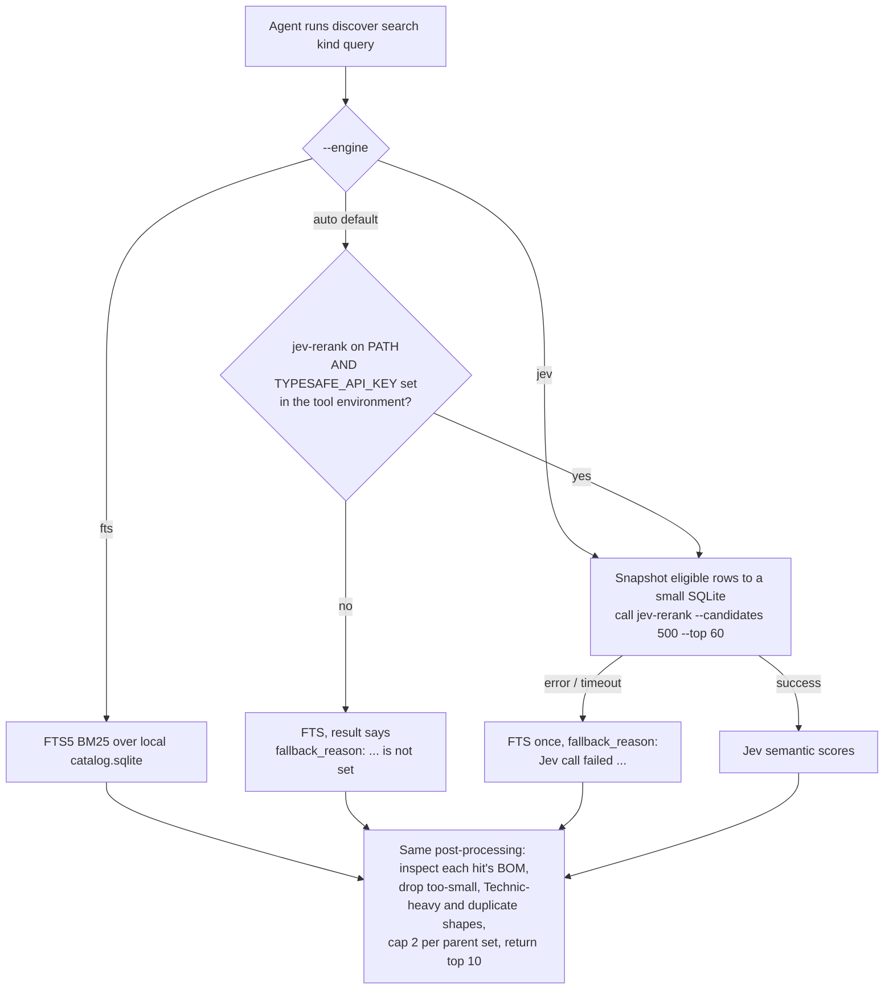
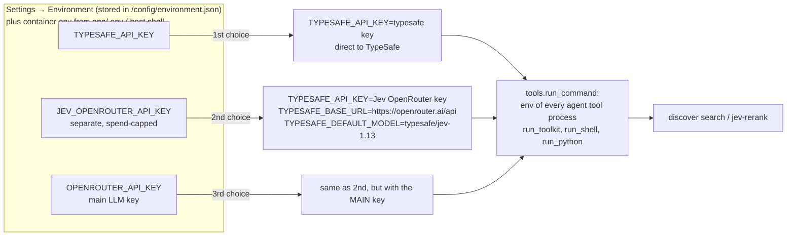

# Jev and search

**The short answer.** Jev is used **only by the paid AI agent**, and only when the agent runs `./ldraw-agent discover search ...`, or calls `jev-rerank` directly, through its `run_toolkit`, `run_shell` or `run_python` tools. Its subagent workers can do the same. It is **never** used by:

- the fast path,
- the understanding model,
- the generators,
- the editor parts palette,
- the "Your parts" search,
- My Parts,
- what-can-I-build,
- the parts check.

Without a key, the agent's searches quietly use local keyword search (FTS/BM25) instead, and nothing else changes.

## What Jev is

- **Jev System One** (model `jev-1.13.0`) is TypeSafe's relevance model. It reads text and returns typed judgements. Here it answers "how well does this description match the query" as a 0–1 score.
- **`jev-rerank`** is a CLI by the upstream author (`anteloc/jev-rerank`, pinned v0.5.0 in `app/Dockerfile:253-269`). It takes a SQLite table of descriptions and does two things:
  1. It shortlists up to `--candidates` rows (default 500) with BM25.
  2. It asks Jev to score each shortlisted row against the query (one yes/no judgement per candidate), then returns the top N.
- **What it searches** is the text descriptions in `data/ldraw-info.db`, through three views:

| View | Rows | Content |
|---|---:|---|
| `PARTS_DESCRIPTIONS_JEV` | 35,257 | `part\|description` |
| `MODELS_DESCRIPTIONS_JEV` | 1,821 | `model\|description` (the reference sets) |
| `SUBMODELS_DESCRIPTIONS_JEV` | 28,451 | `model\|submodel\|description` (assemblies inside the sets) |

  (`docs/reports/jev-assembly-discovery-assessment.md`, "What the new fields contain".)
- **Price**: $0.042 per million input tokens, and output is free (`docs/reports/typesafe-jev-ldraw-assessment.md`, "Product capabilities").

## Every place search happens, and which engine it uses

| Where (who triggers it) | What it searches | Engine | Code |
|---|---|---|---|
| Workspace **Parts tab, full library** (person typing) | All LDraw parts by code and description | **Substring match**: every word must appear. Exact code first, then shorter descriptions. No FTS, no Jev. | `routers/editor_palette.py:154` → `./ldraw-agent search parts` → `ldraw_tools/commands/library.py:80-90` |
| Workspace **Parts tab, "Your parts"** | Owned parts | Substring match over `part + description` | `editor_palette.py` (`inventory_only`) → `ldraw_tools/inventory.py:465-472` |
| **My Parts → a parts list** (search box) | Rows of one list | Substring match, sorted by quantity | `app/web/backend/inventories.py` `detail` (about line 250) |
| **What can I build** (text filter) | 1,821 reference models | Word match on file name plus description, then ranking by **coverage of your bricks** (not text relevance) | `ldraw_tools/buildable.py` `rank()` |
| **Fast path** / understanding model | Nothing: it reads the sentence and matches generator kinds by substring | No search | `fast_path.choose` (`fast_path.py:127-151`) |
| Agent tool **`my_parts`** | The chat's selected parts lists | Substring match | `tools.py` (`my_parts`), `parts_steering.py` |
| Agent tool **`buildable_models`** | Reference models ranked by your parts | Same as what-can-I-build | `tools.py` |
| Agent: `./ldraw-agent search parts` / `search models` / `search submodels` | Parts, or the model/submodel descriptions | Parts: substring. Models/submodels: SQLite **FTS5, BM25-ranked** | `library.py`, `ldraw_tools/resources.py` |
| **Agent: `./ldraw-agent discover search parts\|models\|submodels`** | The three `*_JEV` views, filtered and diversified | **Jev if a key is set, else FTS5/BM25** (`--engine auto`) | `ldraw_tools/discovery.py:281-386` |
| Agent: direct `jev-rerank ...` in `run_shell` | Whatever table it names | **Jev only**, with no fallback | suggested in `instructions.md:62-69`, `docs/agent/tooling.md:133-175` |
| Unknown-part suggestions during model checks (backend) | `/opt/index/parts.json` | Simple scored text match | `app/web/backend/ldraw.py:68` `find_parts` |

The only engine that costs money is Jev, and only the bold agent rows can reach it.

## When Jev is called and when FTS is used

- `resolve_engine` is at `ldraw_tools/discovery.py:32-43`, and the call is at `discovery.py:303-333`.
- The model id is `TYPESAFE_DEFAULT_MODEL`, else `jev-1.13.0` (`discovery.py:319`).
- `jev-rerank` is always installed in the image, so in practice **"is a key set" is the only switch**.
- The result always states `engine_used`, `ranking` ("Jev semantic ranking" or "Keyword/BM25 ranking (FTS) ...") and, after a fallback, `fallback_reason` (`discovery.py:377-386`).

### What the agent sees

- **Prompt.** `app/web/backend/prompts/system.md:13` tells the agent to "Run actual discovery for the design's part roles with `discover search`" and to record the engine used in `NOTES.md`. Line 20 says the key "is available to these tool processes and never needs printing or probing".
- **Guide.** The guide inlined into the agent's prompt depends on the key (`toolkit.py:23-24, 104-108`):
  - with a key: `docs/agent/reference-discovery.md` (the Jev procedure);
  - without a key: `docs/agent/reference-discovery-fts.md`, which teaches keyword-style queries ("2 to 5 keywords, try synonyms").
- So the agent is told what kind of search it has and adapts how it writes queries.
- **Subagent workers.** Researcher workers are told to use "my_parts and run_toolkit discover/search" (`subagents.py:52`), so they can call Jev too, inside the same EUR budget.

## How keys flow

- The order is set in `toolkit.jev_source()` and `toolkit.jev_environment()` (`app/web/backend/toolkit.py:30-50`). The first non-empty key wins. With none, the environment is empty and FTS is used.
- **Only agent tool processes get it.** `tools.run_command` adds it (`tools.py:112-120`) and tells the sandbox to redact the key from output. The build worker (`build_worker.py:74-82`), the editor palette (`editor_palette.py:127-129`) and buildable (`buildable.py:67`) use `toolkit.environment()` without it.
- **Keys count only as environment variables.** A key saved in Settings → Environment, or passed into the container (compose passes `OPENROUTER_API_KEY` and `TYPESAFE_API_KEY` from the host, `app/docker-compose.yml:30-33`), counts. A literal key typed into one LLM model entry does not.
- **Settings shows which key Jev uses**: `GET /api/environment` returns `jev_source` = `typesafe | jev_openrouter | openrouter | none`. If it is `openrouter`, a warning says the main key is readable by agent code (`EnvironmentSettings.tsx:93-94`).
- **Why the separate key exists.** Agent code runs as the sandbox user and can read its own environment, so it can read whichever key Jev uses. Security finding M4 (`docs/security/2026-10-24-security-pass.md`) is the reason for `JEV_OPENROUTER_API_KEY`: give Jev a key with a low spend cap.
- The OpenRouter price of `typesafe/jev-1.13` is **not recorded in the repo**. Check OpenRouter's model page. The numbers below use TypeSafe's direct price.

## Cost

| Item | Number | Source |
|---|---|---|
| Price | $0.042 per million input tokens, and output is free | typesafe-jev-ldraw-assessment.md |
| One `discover search` (500 candidates) | **about $0.011 and about 8 s** | jev-submodel-discovery-evaluation.md, Summary |
| Historical cathedral build | 3 searches = 1,500 Jev judgements = 752k tokens = about $0.03 | typesafe-jev-ldraw-assessment.md |
| A larger pool (3,000 candidates) | about 6× the cost; doubled useful hits on one rare query | jev-submodel-discovery-evaluation.md:104 |
| How often the agent searches | 10 `discover` calls across 5 recorded chats (about 2 per chat; the engine was not recorded) | docs/plans/done/loop-perf/analysis-output.md:108 |
| **Jev fee per paid build** | **about 2–5 cents**, against EUR 1–2 for the agent run itself | the rows above combined |

**The hidden cost is not Jev, it is the result size.**
- Every `discover` result hit the 20,000-character output cap: about 5,000 tokens.
- The agent re-sends that result on every later step, 120–146 more times (`loop-perf/analysis-output.md:69-123`).
- That makes about 0.6–0.7 million token-requests per search.
- With prompt caching that is about $0.07 (Sonnet 5.5) to $0.14 (Opus 5.5) per search. This is my estimate, using the cache-read prices in `model_catalog.py`.
- That is 6–13× the Jev fee. It is the same whether the engine was Jev or FTS.

`docs/reports/typesafe-jev-costs.py` is a **planning model, not a measurement**. For 11 hypothetical uses of Jev (U1–U11), it works out engineering hours, API cost and break-even volume, with benefits that are explicitly assumed. Its main conclusion: API cost is negligible, and engineering and review time dominate.

## What quality difference it makes

The evidence is two hand-labelled pilots from 2026-09-24. They are not blind benchmarks.

- **Submodel search is the valuable part.** For common scene roles (street lamp, tree, stairs, truck cab, roof), Jev returns 7–10 usable real LEGO assemblies per query (`jev-submodel-discovery-evaluation.md`, Summary and section 2).
- **Jev is not always better than BM25.** For a truck cab with seats and steering, BM25 ranked the right model first and Jev ranked it 15th (`jev-assembly-discovery-assessment.md:81`). The "window arch" keyword search found nothing where Jev found curved-top frames (line 94).
- **Most of the gain comes from the work around the search.** Filtering, de-duplication, resolving a hit to its source section, measuring it and rendering it matter more than the ranking itself. The report's own words: "Most of the gain for generated models comes from locating and checking the source, not from better ranking." Those steps are now in `discover search` and work the same with FTS.
- **The expected effect** (from the report): high for detail and variety of sub-assemblies and minifig-scale props; medium for novel-scale vehicles; **none** for physical validity.
- **No result shows that Jev makes a finished model better.** The cathedral used 4 retrieved references in 253 of 5,394 placements. The report says plainly that this shows reuse, not improvement.

## Without a key

- `discover search` uses FTS5/BM25 over the same descriptions (`discovery.py:334-346`), and the result says `fallback_reason: TYPESAFE_API_KEY is not set`.
- The agent gets the keyword-search guide and is told to use short keyword queries with synonyms.
- Everything else works exactly the same: generators, fast path, palette, My Parts, what-can-I-build, building, validation and rendering.
- An explicit `--engine jev` fails with an error, and a direct `jev-rerank` call fails.

## Recommendation

1. **Today Jev is a small optional upgrade for the paid agent, not a product feature.** At about 1 cent per search it is cheap, but its measured benefit is "better first reference, more variety", not better final models. Keep it optional. Tell people what it really does: change the Settings hint to say "used by the AI builder when it looks for reference parts and models".
2. **If you keep it, use the separate `JEV_OPENROUTER_API_KEY` with a low cap**, or a TypeSafe key. Do not let it fall through to the main OpenRouter key.
3. **The bigger cost lever is the size of search results.** Trimming the `discover` output, for example to fewer fields per hit or a top 5 by default, saves more per build than switching Jev off.
4. **Where search could help the deterministic path. These are ideas; none of them is built:**
   - **Reference requests.** "Build the 6929 starship" is routed to the paid agent today (`fast_path._unsupported_reason`). The deterministic-first plan's retrieve + recolour step (task 4) could serve these with FTS over model descriptions plus `sets search`, for free. Jev could rerank those few candidates for about 1 cent, with a clear "adapted from set X" label.
   - **Uncovered subjects** (lighthouse, train, tree). A `discover search submodels` on the noun, then "here are 3 real designs to start from", is a cheaper middle step than EUR 1–2 of agent time.
   - **Editor palette.** The palette's substring match fails on purpose-style queries ("something round for a window"). An FTS fallback is free. Jev would need the key outside the agent sandbox, which is a security decision, so keep it agent-only unless you decide otherwise.
   - **Not recommended:** using Jev for geometry, fit or "is this model good". The vendor and both reports say it cannot judge those.
5. **Clean up the agent docs.** Remove the direct `jev-rerank` recipe from `instructions.md:62-69` and the stale "check service availability" line in `prompts/ldraw-generative-tooling.md:26`, so the agent always goes through `discover search` with its fallback and filters.
