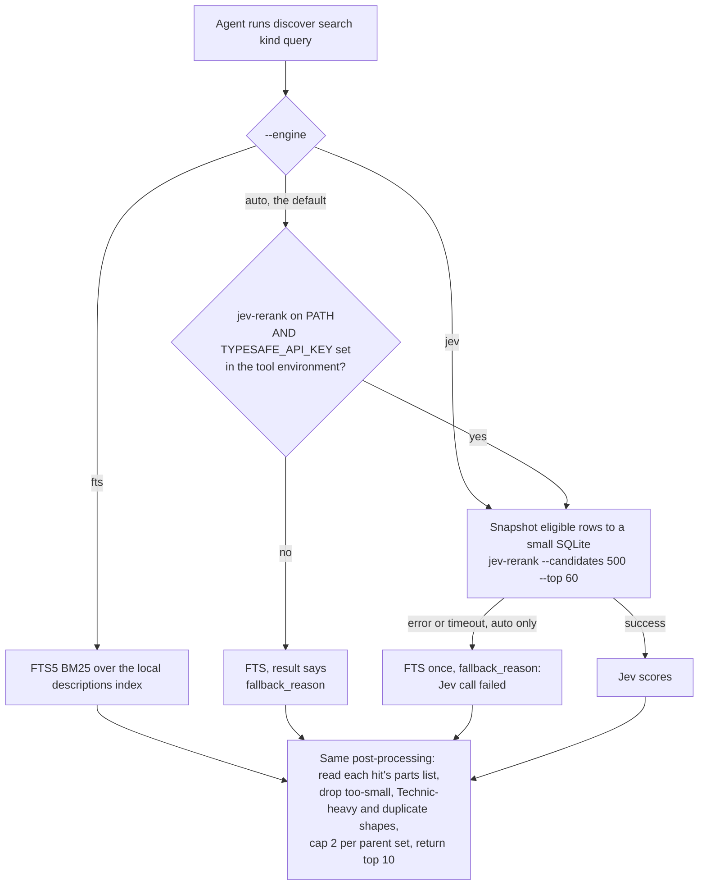
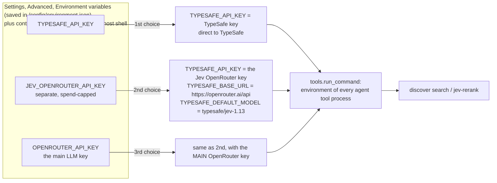

# Jev and search

Search in Open Brick Designer comes in two kinds. Almost every search box in the app is plain local text matching: it is free, instant, and needs no key. The one exception is **Jev**, an optional paid semantic search that only the AI agent can use, when it looks for reference parts and models. Without a Jev key the agent quietly uses local keyword search instead, and nothing else changes.

Backend paths are relative to `app/web/backend/`, frontend paths to `app/web/frontend/src/`. "Semantic" means matching by meaning ("something round for a window") rather than by exact words. "FTS" is SQLite's full-text search, which ranks rows by the words they contain using the BM25 formula (a standard keyword relevance score). "Jev" is the relevance model from TypeSafe (model `jev-1.13.0`) that scores how well a text description matches a query, from 0 to 1.

## How it works

**The short answer.** Jev is used only by the paid AI agent, and only when the agent runs `./ldraw-agent discover search ...` (through its `run_toolkit` tool) or calls `jev-rerank` directly. Its researcher workers can do the same. Jev is never used by the fast path, the understanding model, the generators, the editor parts palette, My Parts, My Sets, what-can-I-build, or the parts check.



`jev-rerank` is a command-line tool by the upstream author, pinned to v0.5.0 in `app/Dockerfile` and always installed in the image. It takes a SQLite table of descriptions, shortlists up to 500 rows with BM25, asks Jev to score each one against the query, and returns the best. In practice **"is a key set" is the only switch**.

What it searches is the text in `data/ldraw-info.db`, through three views:

| View | Rows | Content |
|---|---:|---|
| `PARTS_DESCRIPTIONS_JEV` | 35,257 | part and description |
| `MODELS_DESCRIPTIONS_JEV` | 1,821 | official reference set models |
| `SUBMODELS_DESCRIPTIONS_JEV` | 28,451 | assemblies inside those models |

The result always says which engine ran: `engine_requested`, `engine_used` (`jev` or `fts`), a `ranking` text ("Jev semantic ranking" or "Keyword/BM25 ranking (FTS) ... wording matters"), and after a fallback a `fallback_reason` (`ldraw_tools/discovery.py` `search()`).

## Every search in the app

| Where the person or agent searches | What is searched | Engine | Code |
|---|---|---|---|
| Workspace **Parts tab**, and the 3D editor palette (library mode) | All LDraw parts by number and description | Substring match, every word must appear. Exact code first, then shorter descriptions | `routers/editor_palette.py` `editor_palette()` runs `./ldraw-agent search parts`; `ldraw_tools/commands/library.py` `run_search()`. Front end: `components/workspace/PartsPanel.tsx`, `components/editor/Palette.tsx` |
| Same panels, **"My parts" switch** | Owned parts of the selected inventories | Substring match on part and description | `editor_palette()` runs `./ldraw-agent inventory search`; `ldraw_tools/inventory.py` `search_owned()` |
| **My Parts, collection** search box | The merged collection, grouped by part | Words must appear in part number, description, category or note. A size like `2x4` is read separately and compared to the part's size. A colour word ("red", "dark grey") narrows the colours shown. Filters for colour, category, size and source. No fuzzy matching | `collection.py` `browse()`, `_tokens()`; `GET /api/collection/parts`; `components/parts/CollectionView.tsx` |
| **My Parts, one parts list** | Rows of one list | Every word in part number or description, sorted by quantity | `inventories.py` `detail()`; `components/parts/InventoryDetailView.tsx` |
| **Quick add** ("20 red 2x4 bricks") | The LDraw part index and colour table | A small grammar, not a search: quantity, colour words, size, shape words or part number. Typos are corrected only toward known words and reported. Italian words work through a synonym table. No model call | `quick_add.py` `parse_line()`; `POST /api/collection/quick-add/parse` |
| **Add a set** dialog | The set catalogue | Every word in set number, name or theme; an exact number first, then newest | `set_catalog.py` `Catalog.search()`; `GET /api/catalog/sets`; `components/parts/AddSetDialog.tsx` |
| **My Sets** page, and the set detail page | The person's own sets / a set's part rows | Filter in the browser: name, number or source; part number, name or colour | `components/parts/SetsView.tsx`, `pages/SetDetail.tsx` |
| **What can I build** (text filter) | The 1,821 reference models | Words in file name plus description, then ranked by how much of the model the person's bricks cover (not by text relevance) | `ldraw_tools/buildable.py` `rank()`; `buildable.py` runs it; `components/parts/BuildablePanel.tsx` |
| **My Builds** filter | Builds and model files | Filter in the browser: title; file name, heading, description or chat title | `pages/Builds.tsx`, `pages/Models.tsx` |
| **Model picker** in a chat | The models the person has added | Filter in the browser on name, provider and model id | `components/ModelPicker.tsx` |
| **Fast path** and the understanding model | Nothing is searched. The model reads the sentence into a spec, and a generator is chosen by matching kind and family names | No search | `understand.py`, `fast_path.py` `choose()` |
| Agent tool **`my_parts`** | The chat's selected parts lists | Substring match, up to 5 queries per call | `tools.py` `t_my_parts()`, `parts_steering.py` |
| Agent tool **`buildable_models`** | Reference models ranked by the person's parts | As what-can-I-build | `tools.py` `t_buildable_models()` |
| Agent: `./ldraw-agent search parts` | Library parts | Substring match | `library.py` |
| Agent: `./ldraw-agent search models` and `search submodels` | Model and submodel descriptions | SQLite **FTS5**, ranked by BM25, with paging. Falls back to plain AND terms if the database file is missing | `ldraw_tools/resources.py` `search_models()` |
| **Agent: `./ldraw-agent discover search parts, models or submodels`** | The three `*_JEV` views, then filtered and de-duplicated | **Jev when a key is set, else FTS5 with BM25** (`--engine auto`) | `ldraw_tools/discovery.py` `search()`, `resolve_engine()` |
| Agent: direct `jev-rerank ...` in a shell | Whatever table it names | Jev only, no fallback | Suggested in the toolkit's `instructions.md` |
| Unknown-part suggestions in `ldraw.py` | The built parts index | Simple scored word match | `ldraw.py` `find_parts()`. Only that file's own validation helper calls it, and the app does not call the helper |

The only engine that costs money is Jev, and only the bold rows can reach it.

Two search paths work differently from the rest and are worth knowing:

- **The fast path does not search.** A typed request goes to the understanding model or the rules, which produce a structured spec. A generator is then picked by name. See [request-lifecycle.md](request-lifecycle.md).
- **Server-side versus browser-side.** The collection, parts lists, parts palette, set catalogue and what-can-I-build filter on the server. My Sets, My Builds, set detail rows and the model picker filter a list the browser already holds.

## Keys and where Jev gets its credentials



- **Order.** `toolkit.py` `jev_source()` and `jev_environment()` take the first non-empty key in the order above. With none, the environment is empty and the agent uses FTS. Only values saved in Settings or passed into the container count. A literal key typed into one model entry does not.
- **Only agent tool processes get it.** `tools.py` `run_command()` adds the Jev variables and tells the sandbox to redact the key from output. The build worker, the editor palette and the buildable ranking use `toolkit.environment()` without it.
- **Settings shows which key is used.** `GET /api/environment` returns `jev_source`: `typesafe`, `jev_openrouter`, `openrouter` or `none`. If it is `openrouter`, Settings warns that the main key is readable by agent code (`components/EnvironmentSettings.tsx`).
- **Why a separate key exists.** Agent code runs as the sandbox user and can read its own environment, so it can read whichever key Jev uses. `JEV_OPENROUTER_API_KEY` lets the person give Jev its own OpenRouter key with a low spend cap. Do not let it fall through to the main key. See [security.md](security.md).
- **What the agent is told.** `prompts/system.md` tells the agent to run `discover search` and to record the engine used in `NOTES.md`. The discovery guide inlined into its prompt depends on the key: `docs/agent/reference-discovery.md` (the Jev procedure) with a key, or `docs/agent/reference-discovery-fts.md` (short keyword queries, try synonyms) without one (`toolkit.py` `guide_paths()`, `KEYWORD_GUIDE`). The choice depends on the configured key alone, so it is stable within a chat.
- **Workers.** Researcher workers may run `discover` too, inside the same request budget (`subagents.py` `ROLE_PROMPTS`).

## Fallbacks and failure

| Situation | What happens |
|---|---|
| No `TYPESAFE_API_KEY` (and none of the other two) | `discover search` uses FTS; result says `fallback_reason: TYPESAFE_API_KEY is not set` |
| `jev-rerank` missing from PATH | FTS; `fallback_reason: jev-rerank is not on PATH` |
| Jev call fails or times out under `--engine auto` | FTS once for that search; `fallback_reason: Jev call failed, used FTS instead: ...` (the key is scrubbed) |
| `--engine jev` and the call fails | An error; there is no fallback for an explicit choice |
| Direct `jev-rerank` call without a key | Fails |
| FTS query with only stop words | Error "Query needs a searchable term" |

Everything outside the agent's discovery tool works identically with or without a key.

## Cost and what the evidence says

| Item | Number | Source |
|---|---|---|
| Jev price | $0.042 per million input tokens, output free | `docs/reports/typesafe-jev-ldraw-assessment.md` |
| One `discover search` (500 candidates) | about $0.011 and 8 s | `docs/reports/jev-submodel-discovery-evaluation.md` |
| A 3,000-candidate retry | about $0.07 and 47 s | same report |
| Jev fee per paid build | about 2 to 5 cents (2 searches per chat on average), against EUR 1 to 2 for the agent run | the rows above; search counts from `docs/plans/done/loop-perf/analysis-output.md` |

The OpenRouter price of `typesafe/jev-1.13` is not recorded in the repo; check OpenRouter's model page.

The hidden cost is not Jev but the result size. Recorded `discover` results hit the 20,000-character output cap (about 5,000 tokens), and the agent re-sends that result on every later step. At cache-read prices that is several times the Jev fee, and it is the same whether the engine was Jev or FTS (`analysis-output.md`; the multiple is an estimate, not a measurement).

Quality evidence is two hand-labelled pilots from 2026-09-24, not blind benchmarks:

- Submodel search is the valuable part: for common scene roles (street lamp, tree, stairs, truck cab, roof) Jev returned 7 to 10 usable real assemblies per query.
- Jev is not always better than BM25. For a truck cab with seats and steering, BM25 ranked the right model first and Jev 15th. The keyword search "window arch" found nothing where Jev found curved-top frames (`docs/reports/jev-assembly-discovery-assessment.md`).
- Most of the gain comes from the work around the search (filtering, de-duplication, resolving a hit to its source, measuring and rendering it), which now runs the same with FTS.
- No result shows that Jev makes a finished model better. Physical validity is not something it can judge.

## Where the code is

| File | What it does |
|---|---|
| `ldraw_tools/discovery.py` | `search()`, `resolve_engine()`: Jev or FTS, filters, diversity, `fallback_reason` |
| `ldraw_tools/commands/discover.py`, `library.py` | The `discover` and `search` commands and their options |
| `ldraw_tools/resources.py` | `search_models()` FTS5 over model and submodel descriptions |
| `ldraw_tools/inventory.py`, `buildable.py` | Owned-part search; what-can-I-build ranking |
| `data/ldraw-info.db` | The descriptions database with the `*_JEV` and `*_FTS` views |
| `app/web/backend/toolkit.py` | `jev_source()`, `jev_environment()`, guide choice, fixed Jev key names |
| `app/web/backend/tools.py` | `run_command()` adds the Jev environment to agent tools only |
| `app/web/backend/environment_config.py` | The two fixed Jev rows in Settings |
| `app/web/backend/routers/environment.py` | `jev_source` for Settings |
| `app/web/backend/routers/editor_palette.py` | Parts palette search |
| `app/web/backend/collection.py`, `inventories.py`, `quick_add.py`, `set_catalog.py` | My Parts, parts list, quick add and set catalogue search |
| `docs/agent/reference-discovery.md`, `reference-discovery-fts.md` | The two guides the agent reads |
| `app/Dockerfile` | Installs `jev-rerank` v0.5.0 |

## Changing it

- **Add a local search box.** Prefer a server route that tokenises the query and requires every word to match, as `collection.browse()` does, or a browser filter for lists already loaded. Do not add Jev to a person-facing search: it costs money per call and needs the key in the server's environment, which today only agent tools receive. That is a security decision; see [security.md](security.md).
- **Change which engine the agent uses.** `resolve_engine()` is the single place. Keep the `fallback_reason` text, because the agent's guide tells it to mention it once.
- **Change how the key is chosen.** Edit `toolkit.jev_source()` and `jev_environment()` together, and keep `tests/test_toolkit.py` passing. The guide choice follows `jev_environment()` automatically.
- **Change what the guides tell the agent.** Edit both `docs/agent/reference-discovery.md` and `reference-discovery-fts.md`, and run `tests/test_builder_guides.py`.
- **Shrink agent search output.** The biggest cost lever is the size of a `discover` result, not the Jev fee. Reduce the fields per hit or the default limit in `discovery.py` and `commands/discover.py`.
- **Ideas not built yet.** Using FTS over model descriptions to serve "build set X" requests without the agent; a free FTS fallback for the parts palette on purpose-style queries. None of these exist.

## Testing it

Toolkit tests (repo root, they use the bundled index):

```
uv run pytest -q tests/test_discovery.py
```

Key and prompt tests (inside the container):

```
cd /app/web/backend && pytest -q tests/test_toolkit.py tests/test_builder_guides.py tests/test_environment.py \
  tests/test_security.py tests/test_collection.py tests/test_inventories.py tests/test_set_detail.py
```

`tests/test_discovery.py` covers engine choice (`test_resolve_engine_needs_executable_and_key`, fallback on failure and timeout, explicit engines unchanged) and FTS paging. See [testing-and-ci.md](testing-and-ci.md).

## Related

- [ai-agent.md](ai-agent.md): the tools and prompt that use discovery.
- [settings-and-providers.md](settings-and-providers.md): where the Jev rows and keys live.
- [parts-and-collection.md](parts-and-collection.md): My Parts and the collection.
- [sets.md](sets.md): the set catalogue.
- [request-lifecycle.md](request-lifecycle.md): why the fast path does not search.
- [security.md](security.md): why the Jev key is readable by agent code.
- Reports: `docs/reports/typesafe-jev-ldraw-assessment.md`, `jev-assembly-discovery-assessment.md`, `jev-submodel-discovery-evaluation.md`.
