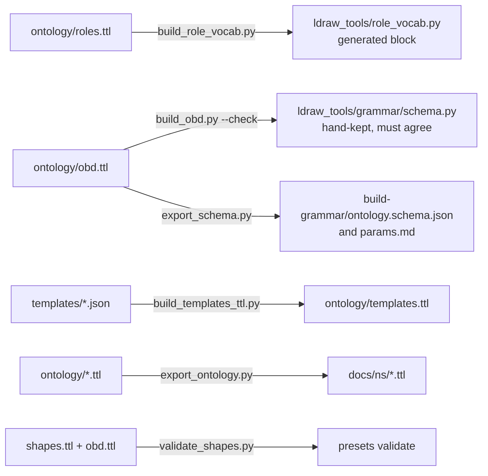

# The ontology (RDF vocabulary)

The ontology is a machine-readable description of what a build is made of: the kinds of component (footprint, walls, roof ...), their parameters and valid ranges, the vocabulary of roles ("roof", "wall", "window"), the rules that say which combinations are valid, vehicles, reference builds (templates), and sets and brands. It is written in RDF, the W3C standard for linked data, in the Turtle text format, and published on the web so other tools can read and query it.

Its practical job inside the project is to be the **single source of truth** for the role vocabulary and the building component schema, so that those cannot drift apart between code, docs and the AI prompts. For the role words and the component schema, the Python code is checked against the Turtle in CI. Other parts (vehicles, sets, templates) are vocabulary only: the app does not read them at run time.

## How it works

### The vocabularies used

The project reuses standard vocabularies and mints its own terms only when none fits (decided in `docs/plans/active/build-ontology/PROPOSAL.md`).

| Standard | Used for |
|---|---|
| SKOS (concept schemes) | Roles (`role:roof`), brands, parts-list sources. Aliases are `skos:altLabel`, definitions `skos:definition` |
| OWL (classes and properties) | Component classes (`obd:Roof`), parameters as datatype properties with ranges |
| SHACL (shapes) | Validity rules: "this combination of parameters is not allowed" |
| PROV-O and Dublin Core terms | Where a template or a set's parts list came from, who made it, under which licence |

Our own terms live in the `obd:` namespace and are kept to the minimum: a default value (`obd:default`), display order (`obd:order`), which component a parameter belongs to, which roles a component stamps (`obd:role`), colour parameters (`obd:ColourParameter`), and so on.

### The base IRI and the files

Every term has an IRI (a web-style identifier) under one base:

`https://alessionar.github.io/open-brick-designer/ns/`

That is a GitHub Pages address. MkDocs publishes `docs/` to GitHub Pages, so a file in `docs/ns/` is served at that address, for example `docs/ns/obd.ttl` at `.../ns/obd.ttl`. The prefixes are:

| Prefix | Namespace | Holds |
|---|---|---|
| `obd:` | `<base>obd#` | Classes and properties (`obd:Building`, `obd:wallThickness`) |
| `role:` | `<base>role/` | Role concepts (`role:roof`) |
| `build:` | `<base>build/` | Instances of builds (used in tests and examples) |
| `brand:` | `<base>brand/` | Brand concepts (`brand:lego`, `brand:cada`) |
| `psrc:` | `<base>partssource/` | Kinds of parts-list source |

Terms are never renamed; a retired one is marked `owl:deprecated`.

There are two folders and it matters which one you edit:

| Folder | Role |
|---|---|
| `ontology/` | **Source.** The files humans edit (and two generated ones, see below) |
| `docs/ns/` | **Published copy**, generated from `ontology/` by `tools/export_ontology.py`. Never edit by hand |

| Source file in `ontology/` | What it holds | Published in `docs/ns/` | Notes |
|---|---|---|---|
| `obd.ttl` | Build, Building and its eight components (Footprint, Storeys, Walls, Openings, Corners, Roof, Details, Base), every parameter with range, default and order | yes | Checked against the hand-kept schema in CI |
| `roles.ttl` | The role vocabulary (SKOS), its aliases and the order roles are listed in | yes | Generates a block of `ldraw_tools/role_vocab.py` |
| `shapes.ttl` | SHACL rules for buildings, one shape per validity rule | yes | |
| `vehicles.ttl` | Vehicle, road vehicle, motorcycle, watercraft, aircraft, rail vehicle, spaceship and their components | yes | Vocabulary only, see below |
| `sets.ttl` | Sets, set parts, brands, parts-list sources | yes | Vocabulary only. Owned sets stay in the app database |
| `sets-shapes.ttl` | SHACL shape for sets | **no** | Used by tests |
| `templates.ttl` | The reference builds as RDF with provenance and licences | **no** | **Generated** from `ldraw_tools/data/templates/*.json` |
| `templates-shapes.ttl` | SHACL shape for templates | **no** | Used by tests |

`docs/ns/` also holds `ontology.ttl` (the five published files merged into one, for loading in a single call) and `index.html` (a small page listing the files, with the licence). The ontology files are licensed CC BY-SA 4.0. Template instance data keeps the licence of its source model (CCAL 2.0).

### What is generated from what



- **Roles.** `tools/build_role_vocab.py` rewrites the block between the `BEGIN GENERATED` and `END GENERATED` markers in `ldraw_tools/role_vocab.py` from `roles.ttl`. The classifier (`ldraw_tools/roles.py`) and the grammar (`ldraw_tools/grammar/roles.py`) read that module. So the roles a person can name in chat, and the ones the generators stamp on parts, come from the Turtle.
- **Components and parameters.** The hand-kept schema `ldraw_tools/grammar/schema.py` is still what the app uses. `tools/build_obd.py --check` reads `obd.ttl` and fails if it disagrees with that schema about components, parameters, ranges, defaults, order or the colour flag. `docs/plans/active/build-grammar/export_schema.py` writes `ontology.schema.json` and `params.md` from `obd.ttl`; a test checks they are current and equal to the schema. So the schema is not generated from the ontology today; the two are kept equal by tests.
- **Validity rules.** `tools/validate_shapes.py` turns a (normalised) building config into a graph using the vocabulary of `obd.ttl` and checks it against `shapes.ttl` with pySHACL. At run time the app uses `normalise()` in the grammar instead, because pySHACL takes about 0.3 s per config, too slow for the agent loop. The shapes are the CI and toolkit check.
- **Templates.** `tools/build_templates_ttl.py` writes `ontology/templates.ttl` from the template JSON files (the JSON stays the runtime data). `--check` fails if it is out of date.
- **Vehicles and sets.** There is no vehicle grammar, and sets are not stored as RDF, so nothing is generated from or checked against these two files by the app. `tests/test_vehicle_ontology.py` keeps `vehicles.ttl` in step with the vehicle designs, spaceship briefs and the train and ship generators in Python (`ldraw_tools/vehicles.py`, `spaceships.py`, `generators/transport.py`).
- **Publishing.** `tools/export_ontology.py` re-serialises the five published files in a stable way (sorted, fixed prefixes, no timestamps, so a diff means a real change), builds `ontology.ttl` and `index.html`, and writes them to `docs/ns/`.

### Querying it

Load `docs/ns/ontology.ttl` (or the published URL) with rdflib or any SPARQL engine. Ready-to-run queries (roles, parameters, validity rules, brands ...) are in the cookbook at [`docs/ontology/SPARQL.md`](../ontology/SPARQL.md); it is not repeated here. A test runs every cookbook query and fails if one returns nothing, so the cookbook cannot go stale.

## Where the code is

| Path | What it does |
|---|---|
| `ontology/*.ttl` | The source Turtle files |
| `docs/ns/` | Published copy, `index.html` and the merged `ontology.ttl` |
| `docs/ontology/SPARQL.md` | The SPARQL cookbook |
| `docs/plans/active/build-ontology/PROPOSAL.md` | The modelling decisions (vocabularies, IRI scheme, what is generated) |
| `tools/export_ontology.py` | `ontology/` to `docs/ns/` (`render()`, `--check`) |
| `tools/build_role_vocab.py` | `roles.ttl` to the generated block in `ldraw_tools/role_vocab.py` |
| `tools/build_obd.py` | Reads `obd.ttl` as schema-shaped data; `--check` against `schema.py` |
| `docs/plans/active/build-grammar/export_schema.py` | `obd.ttl` to `ontology.schema.json` and `params.md` |
| `tools/validate_shapes.py` | SHACL validation of grammar configs and presets |
| `tools/build_templates_ttl.py` | Template JSON to `ontology/templates.ttl` |
| `ldraw_tools/role_vocab.py` | Role data, partly generated (do not edit between the markers) |
| `.github/workflows/ci.yml` (job `ontology`) | The CI check |
| `.github/workflows/docs.yml` | Builds the site and checks that `ns/obd.ttl` is served |

`rdflib` and `pyshacl` are an optional extra, `pip install -e ".[ontology,test]"` (pinned in `pyproject.toml`). The app never imports them.

## The CI check

The CI job named `ontology` (in `.github/workflows/ci.yml`) runs on every change and must pass:

1. `python tools/build_role_vocab.py --check`
2. `python tools/build_obd.py --check`
3. `python tools/export_ontology.py --check`
4. `python tools/validate_shapes.py --presets`
5. `pytest -q --noconftest tests/test_ontology_export.py tests/test_role_ontology.py tests/test_component_ontology.py tests/test_shapes.py tests/test_vehicle_ontology.py tests/test_sets_ontology.py`

Separately, the docs workflow fails if `site/ns/obd.ttl` or `site/ns/index.html` is missing from the built site, so the base IRI keeps resolving.

`tests/test_templates_ttl.py` (templates.ttl in sync, valid, queryable) and `build_templates_ttl.py --check` are not in the `ontology` job. The first runs with the full root test suite in the image job; the second you must run yourself.

## Changing it

To change a term, edit the file in `ontology/`, never `docs/ns/`, then regenerate:

1. **Edit** the Turtle in `ontology/`. Follow the existing style: classes `UpperCamelCase`, properties `lowerCamelCase`, role slugs equal to the lowercase ids the code already uses. Give every new thing an `rdfs:label` and a comment or definition.
2. **Regenerate what depends on it.**
   - Roles changed: `python tools/build_role_vocab.py`.
   - Component or parameter changed: update `ldraw_tools/grammar/schema.py` to match (or the other way round), then `python docs/plans/active/build-grammar/export_schema.py`. `build_obd.py --check` tells you what differs.
   - Template data changed: `python tools/build_templates_ttl.py`.
   - Always last: `python tools/export_ontology.py`.
3. **Run the checks** below and commit the regenerated files together with the source change.

Specific cases:

- **Add a role.** Add a `skos:Concept` to `roles.ttl` with `obd:order`, `skos:definition`, and `skos:altLabel` for the words people use (`skos:hiddenLabel` for grammar phrasing). A role that is a synonym gets `skos:broader` pointing at the real one. Regenerate, then make the generators stamp it.
- **Add a parameter.** Add a datatype property in `obd.ttl` with `rdfs:domain` (the component), `dcterms:identifier` (the JSON key), `rdfs:range` (with `owl:withRestrictions` for bounds), `obd:default`, `obd:order` and a comment. Add the same parameter to `schema.py`. Both must agree exactly or CI fails.
- **Add a validity rule.** Add a `sh:NodeShape` to `shapes.ttl` whose `dcterms:identifier` is the rule id, written as a SHACL-SPARQL constraint that selects the buildings that break it. Add a case to `tests/test_shapes.py`.
- **Add a brand.** Add a `skos:Concept` in the brand scheme of `sets.ttl` with `skos:altLabel` spellings. No code change.
- **Add a new file.** Add it to `FILES` in `tools/export_ontology.py` (and to the cookbook text if it should be queried), then regenerate. Files not in `FILES` are not published.
- **Never rename a term.** Mark it `owl:deprecated true` and add `dcterms:isReplacedBy`.
- **Move the base IRI.** Only the base changes (`BASE` in the tools and the prefixes in every file). The proposal suggests a `w3id.org` redirect as the lasting fix; that is not set up.

## Testing it

```
pip install -e ".[ontology,test]"
python tools/build_role_vocab.py --check
python tools/build_obd.py --check
python tools/export_ontology.py --check
python tools/build_templates_ttl.py --check
python tools/validate_shapes.py --presets
pytest -q --noconftest tests/test_ontology_export.py tests/test_role_ontology.py tests/test_component_ontology.py tests/test_shapes.py tests/test_vehicle_ontology.py tests/test_sets_ontology.py tests/test_templates_ttl.py
```

`--noconftest` is needed because the root `tests/conftest.py` requires the LDraw library; these tests do not. What each covers: `test_ontology_export.py` (docs/ns is in sync and every cookbook query returns rows), `test_role_ontology.py` (roles and the generated module), `test_component_ontology.py` (obd.ttl against the schema, generated schema and params.md), `test_shapes.py` (SHACL rules and presets), `test_vehicle_ontology.py` (vehicles.ttl against the Python designs), `test_sets_ontology.py` (set shapes on LEGO and CaDA samples in `tests/fixtures/sets-sample.ttl`), `test_templates_ttl.py` (templates).

## Differences from the proposal

The proposal in `docs/plans/active/build-ontology/PROPOSAL.md` is a design note and is partly ahead of or different from the code:

- It says `ldraw_tools/grammar/roles.py` and `schema.py` are generated from the ontology. In the code only `role_vocab.py` is generated; `schema.py` is hand-kept and checked against `obd.ttl`.
- It plans `ontology/context.jsonld` to turn plans into graphs. That file does not exist; `tools/validate_shapes.py` builds the graph in code.
- It says the generated JSON Schema and params go through CI by the export step. They are checked by `tests/test_component_ontology.py`.

## Related

- [generators-and-grammar.md](generators-and-grammar.md): the building grammar, role stamping and templates that the ontology describes.
- [sets.md](sets.md): the app side of sets and brands.
- [roadmap.md](roadmap.md): status of the ontology epic.
- Cookbook: [SPARQL.md](../ontology/SPARQL.md). Design: `docs/plans/active/build-ontology/PROPOSAL.md`.
