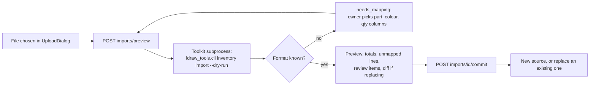

# My Parts: the collection

My Parts is where the owner keeps track of the LEGO bricks they physically have. The app adds every source of bricks together (a Brickit scan, a BrickLink order, a Rebrickable export, a whole set, a few loose pieces typed in) into one **collection**. The collection then drives three things: what the AI agent is told it may use, the "N of M owned" check in the editor, and the "What can I build?" ranking.

Whole sets and the set pages are documented separately in [sets.md](sets.md). This page covers the collection itself, how parts get in, how they come out, and how they are used.

## How it works

### Sources

A **source** is one file of owned bricks. The older code calls it an "inventory", so the words "source", "inventory" and "parts list" mean the same thing in the code and the API. A source has a `kind`:

| Kind | What it is | Editable by hand |
|---|---|---|
| `import` | A parts list read from a file (the default) | Yes, and it can be replaced by a newer file |
| `set` | The parts of a set, copied in when the set is added (see [sets.md](sets.md)) | Yes |
| `loose` | The single built-in source with id `loose` ("Loose parts"), where Quick add and manual edits go | Yes |

The collection is not a separate store. It is every source summed, exactly as the per-chat "which lists to use" setting already summed them. Only **exact** rows (a specific LDraw part in a specific LDraw colour) are ever counted. LDraw is the open parts library the whole app uses for part numbers and colour codes.

### "Maybe" pieces and the review queue

Brickit (the phone app that scans a pile of bricks) reports colour **families** such as "Grays", not exact colours. Those pieces are stored in a separate `review` list on the source. They are not counted as owned, so a maybe can never make an answer look better than it is. The **Colour review** tab in My Parts lists them grouped by source and family. The owner picks an exact colour for one piece, or for a whole family at once (`resolve_family()`), and the pieces move into the exact rows. They can also be discarded. The tab only appears while something is waiting.

"Maybe" pieces are still shown in two places, always labelled as possible and never added to the exact numbers: the shortage list (`maybe` field per line) and the "What can I build?" cards ("+N maybe from colour-family pieces").

### Changes, history and undo

Every edit goes through one function, `apply_ops()` in `app/web/backend/collection.py`. An edit is a list of operations (`add`, `set`, `remove`, `review_resolve`, `review_discard`). The whole list is validated first, so one bad line changes nothing, and then applied as one **batch**. Each batch is appended to an append-only log per source. `undo()` reverses the last batch that has not already been undone. The log keeps both the change and the undo, so history stays honest. A re-import over an existing source (`replace_source()`) is also one undoable batch, and it keeps the stored CSV so undo can restore it. The UI shows a toast with an Undo button after each change, and a History panel per source.

Creating a source (an import or a set) writes the first log entry. Marking a set built or taken apart, and creating or releasing a reservation, are not logged and cannot be undone; they are simply switched on and off.

### Imports

An import always has two steps: preview, then commit. Nothing is stored until the owner confirms.



The parsing runs in the toolkit (`ldraw_tools/`) as a sandboxed subprocess, because the backend's own Python cannot import the toolkit. The preview is kept in memory for 30 minutes (at most 8). If the owner re-imports over an existing source, the preview shows a diff first (added, removed, changed lines).

| Format id | Source file | Notes |
|---|---|---|
| `rebrickable-csv` | Rebrickable parts list or database CSV | Rebrickable ids are mapped to LDraw through `ldraw_tools/data/rebrickable-parts.json` and `rebrickable-colours.json` |
| `brickit-pileometer` | Brickit / Pileometer export | Colours are families, so the pieces go to review unless the owner assigned a family colour |
| `bricklink-xml` | BrickLink inventory or wanted list XML | |
| `brickstore-bsx` | BrickStore file | |
| `bricklink-csv` | BrickLink CSV (Item No, Color, Qty) | |
| `generic-csv` | Any CSV | Never auto-detected. The owner names the part, colour and quantity columns and the colour system (`bricklink`, `rebrickable`, `ldraw` or `name`). The choice is remembered per header row, so the next file with the same headers needs no questions |

The importer registry is `ldraw_tools/importers.py` (`detect()` and `parse()`); the BrickLink-family readers are in `ldraw_tools/bricklink.py`. Nothing is guessed: a line whose part or colour cannot be mapped goes into `unmapped_parts` or `unmapped_colours` with a reason and is not counted as owned. The upload limit is 25 MB.

### Other ways in

- **Quick add** (`quick_add.py`). The owner types lines such as `20 red 2x4 bricks` or `3 x 3001 blue`. A small rule-based grammar (no AI model) resolves each line against the LDraw part index and colour table and answers one status per line: `ok`, `needs_part` (unknown or ambiguous, with candidates) or `needs_colour` (including plain "grey", which is genuinely four different colours). Typos are fixed only toward known colour and shape words and reported in `notes`. Some Italian colour and shape words work. At most 60 lines per request. The commit step adds the resolved lines to the Loose parts source as one batch.
- **Add a set**: by catalogue number or by hand. See [sets.md](sets.md).
- **Edit in place**: the Collection view lets the owner change a count, remove a line, add more of a part and write a short free-text note per part (for example "blue tub"). Notes are the first step towards storage locations; bins and drawers are not built yet.

### Reservations: built sets and built models

Owning a part and having it free are different. **Available = owned minus reserved**, where reserved is:

- every part of an owned set marked **built** (the set is assembled, so its bricks are not loose), plus
- every active **reservation**: the owner pressed "I built this" on one of their models, which holds that model's parts list.

Reserving never changes a source. Releasing deletes the reservation, and taking a set apart only flips its `state` back to `parts`. A reservation may exceed what is owned (parts lost since); that shows as "short by N" in **Built & reserved** (a tab on the My Sets page). Reservations are stored per model file, and reserving the same file again replaces the old one. `reservations.py` also computes **shortage lists**: for a model, what it needs, what is owned, reserved and available, what is missing, which other owned colours of the same part could substitute (mode `substitute`), and how many pieces are only "maybe". A shortage list can be downloaded as text or CSV, or exported as a wanted list (below).

### What can I build

`GET /api/inventories/buildable` ranks the **bundled reference models** (the set models shipped with the app, about 1,800 of them) by how much of each the collection covers. The ranking is done by the toolkit (`ldraw_tools/buildable.py`); the backend (`buildable.py`) runs it and manages the cache.

- For each model: matched = sum of min(needed, available) per part and colour. Models are sorted by matched share, then by fewest missing pieces.
- It uses **available** parts (owned minus reserved), because the backend passes `--available`.
- Small models (under 20 parts by default) are dropped, and filters exist for maximum missing share and a text query on the file name and description.
- An optional "substitute" mode also reports how complete a model would be if another owned colour of the same part were allowed.
- Review ("maybe") pieces add a separate `maybe_matched` figure, never mixed into `matched`.
- The first run expands every model's parts list once and caches it on disk under the toolkit's `.cache/buildable/`. That takes minutes, so the first call starts a background job and answers **HTTP 202** with progress, which the UI polls every 1.5 seconds. Nothing starts at server startup, and the image build pre-warms the cache.
- It ranks by brick coverage, not by text relevance, so there is no search engine involved.
- The roughly 20,000-set offline catalogue is **not** used by this ranking. It has its own `ldraw-agent sets buildable` command-line ranking (see [sets.md](sets.md)); the web app does not call it.

### Parts check and parts steering

| Where | What it shows | Code |
|---|---|---|
| Editor and workspace Parts tab | "N of M owned" for the draft, plus missing lines | `GET /api/builds/{id}/draft/parts-check`, `workspace.check()` in `app/web/backend/workspace.py`, which uses `reservations.available_totals()` |
| Agent chat with parts steering | A `parts-check.json` card: short lines, parts not owned, colour substitutions | `check_model()` in `ldraw_tools/inventory.py`, `attach_parts_checks()` in `parts_steering.py` |

**Steering** is a per-chat setting, saved with the chat (`PartsControl.tsx`):

| Mode | Effect on the agent |
|---|---|
| `off` | Owned parts are ignored |
| `prefer` | The system prompt lists the chosen parts lists and the top owned parts and colours, and the agent gets the `my_parts` and `buildable_models` tools |
| `only` | The agent may use only owned parts |

Builds in the workspace use `prefer` whenever parts lists exist. The prompt block is capped at 6,000 bytes and list names reach the model only after `safe_name()` strips unusual characters, because names are user text.

## Where the code is

| Path | What it does |
|---|---|
| `app/web/backend/collection.py` | The write path: `apply_ops()`, `undo()`, `history()`, import preview/diff/commit, sets, notes, quick-add commit, `browse()`, `review_queue()`, `resolve_family()` |
| `app/web/backend/collection_store.py` | The one storage boundary. Chooses files or PostgreSQL once per process |
| `app/web/backend/collection_files.py` | File backend: `<id>.json`, `<id>.csv`, `<id>.log.jsonl` and dot-files for notes, reservations and import mappings in `INVENTORIES_DIR` |
| `app/web/backend/collection_pg.py` | PostgreSQL backend. Keeps a derived JSON copy in `COLLECTION_EXPORT_DIR` for the sandboxed toolkit |
| `app/web/backend/migrate_collection.py` | One-off import of the files into PostgreSQL |
| `app/web/backend/inventories.py` | Source files, listing, rename, delete, `parse_csv()` (runs the toolkit import), `InventoryError`, colour-family mapping |
| `app/web/backend/quick_add.py` | The rule-based Quick add grammar: `parse()`, `parse_line()` |
| `app/web/backend/reservations.py` | `reserve()`, `release()`, `set_state()`, `reserved_totals()`, `available_totals()`, `shortage()`, `export_shortage()` |
| `app/web/backend/buildable.py` | Runs the toolkit ranking, background cache warm-up, status |
| `app/web/backend/parts_steering.py` | Steering modes, prompt block, parts-check payloads |
| `app/web/backend/collection_export.py` | Export: `lines_for()`, `build()` |
| `app/web/backend/part_info.py` | Part descriptions, categories, sizes and colour names from the LDraw library |
| `app/web/backend/part_images.py` | Lazy part thumbnails: `get()`, `status()` |
| `app/web/backend/routers/collection.py` | Routes under `/api/collection/*`, plus the set catalogue and set routes |
| `app/web/backend/routers/inventories.py` | Routes under `/api/inventories/*` |
| `app/web/backend/routers/reservations.py` | Reservations, set state and shortage routes |
| `ldraw_tools/importers.py`, `ldraw_tools/bricklink.py`, `ldraw_tools/inventory.py` | Format detection and parsing, Rebrickable mapping, `check_model()` |
| `ldraw_tools/buildable.py` | The ranking and its on-disk cache |
| `app/web/frontend/src/pages/Parts.tsx` | The My Parts page (`/parts`, and `/parts/:id` for one source) |
| `app/web/frontend/src/components/parts/` | `CollectionView`, `SourcesView`, `ReviewQueue`, `UploadDialog`, `QuickAddDialog`, `ExportDialog`, `SourceHistory`, `PartThumb`, `PartsControl`, `BuildablePanel`, `ReservedView`, `BuiltButton`, `ShortageDialog` and others |

The frontend splits like this. `Parts.tsx` has three views, switched with the `?view=` query: **Collection** (browse and edit every part, filter by source), **Sources** (one card per imported list, not sets) and **Colour review**. The "+ Add parts" menu (`AddPartsMenu.tsx`) is the single way in: Quick add, Add a set, Import a file. The set-related pieces (`SetsView`, `ReservedView`, `BuildablePanel`, `AddSetDialog`) are used by the My Sets page; see [sets.md](sets.md).

## Storage

Sources live as files by default, and can live in PostgreSQL. The switch is `use_database()` in `collection_store.py`: `LDRAW_NOVA_STORAGE=postgres` always uses it, and `auto` uses it once `python -m migrate_json --collection --commit` recorded that the import is done (or when there are no files to import). Until then the files stay in use, which is the safe way to cut over. See [database.md](database.md) and [data-and-storage.md](data-and-storage.md). Callers never touch either backend directly; they call `collection_store` and hold its `lock` around read-modify-write sequences.

A source file is JSON: `rows` of `{part, colour, qty, rb_part, rb_colour, note?}`, plus `kind`, `set` (for sets), `origin` (the format it came from), `review` (maybe pieces), `unmapped_parts`, `unmapped_colours`, `warnings`, `import` (parser report), and `schema: 2` once edited. `rb_part` and `rb_colour` remember the Rebrickable ids so exports can use them.

The agent's sandboxed toolkit only ever reads sources. Only the backend writes them.

## API reference

| Endpoint | Purpose |
|---|---|
| `GET /api/collection` | Sources plus collection totals and filter facets |
| `GET /api/collection/parts` | Browse the summed parts: `q`, `colour`, `category`, `size`, `source`, `sort`, `limit`, `offset`, `maybe` |
| `GET /api/collection/parts/{part}` | One part across sources |
| `PUT /api/collection/parts/{part}/note` | Set or clear the free-text note |
| `GET /api/collection/colours` | Colour list for pickers |
| `POST /api/collection/sources/{id}/ops` | Apply a batch of operations |
| `GET /api/collection/sources/{id}/history` | Batches with summaries |
| `POST /api/collection/sources/{id}/undo` | Undo the last batch |
| `GET/POST /api/collection/review` | Queue; resolve one family to a colour |
| `POST /api/collection/imports/preview` | Parse a file, store nothing. May answer `needs_mapping` |
| `POST /api/collection/imports/{id}/diff` | Diff against an existing source |
| `POST /api/collection/imports/{id}/commit` | Store as new or replace |
| `POST /api/collection/quick-add/parse`, `POST /api/collection/quick-add` | Understand lines, then add them |
| `GET /api/collection/export/formats`, `/export/preview`, `/export` | Export (see below) |
| `POST /api/collection/export/lines` | Export a caller-supplied list, such as a shortage list |
| `GET/POST/DELETE /api/collection/reservations` | List, create ("I built this"), release |
| `PUT /api/collection/sources/{id}/set-state` | `parts` or `built` |
| `GET /api/collection/shortage`, `/shortage/export` | What a model is missing |
| `GET/POST/PATCH/PUT/DELETE /api/inventories...` | The original source API: list, create, rename, family colours, delete |
| `GET /api/inventories/buildable`, `/buildable/status`, `POST /buildable/warm` | What can I build |
| `GET /api/parts/{part}/thumb` | Part picture, `202` with a placeholder until rendered |

Errors from this layer are `InventoryError` with an HTTP status; the routers turn them into responses.

### Exports

`collection_export.py` turns the exact rows into a file. Scope is `collection` or `source:<id>`.

| Format | File |
|---|---|
| `bricklink-xml` | BrickLink wanted list |
| `rebrickable-csv` | Rebrickable CSV (Part, Color, Quantity) |
| `csv` | Plain CSV with names and notes, for spreadsheets |

Review pieces are never exported. A line whose colour has no id in the target system is left out and listed with the reason in the response, never guessed. Where a part was imported as a print or variant, the original number is used. Cells that start with `=`, `+`, `-` or `@` are escaped so spreadsheets do not run them.

### Part thumbnails

`part_images.py` renders one neutral grey picture per part type with LeoCAD, only when someone looks at it, one at a time, and caches it under `<DATA_DIR>/cache/part-thumbs/`. Until it is ready the endpoint answers 202 with a placeholder and the page retries. A part that fails to render is remembered for 10 minutes. The colour is shown separately as a swatch, which keeps it to one render per part.

## Changing it

- **Add an import format.** Write the parser in `ldraw_tools/` returning a `ParseResult`, register it in `FORMATS`, `detect()` and `parse()` in `ldraw_tools/importers.py`, and add the id to `IMPORT_FORMATS` in `app/web/backend/inventories.py`. Add a sample to the toolkit tests.
- **Add an export format.** Add an entry to `FORMATS` and a branch in `build()` in `collection_export.py`.
- **Add an edit operation.** Add a branch in `_apply()` and in `_reverse()` in `collection.py`. The entry returned by `_apply()` must hold everything `_reverse()` needs, and the history text comes from `_entry_text()`.
- **Never write a source any other way.** All edits go through `apply_ops()` or `replace_source()` so history and undo stay correct, and through `collection_store` so both backends work.
- **Keep maybe pieces out of exact counts.** Anything that answers "do I have this" must read `rows`, not `review`.
- **Change what counts as free.** `reserved_totals()` in `reservations.py` is the single definition. The editor check, shortage lists, set pages and the ranking all call it.

## Testing it

Backend tests (they need the backend environment; CI runs them in the image):

```
cd app/web/backend && pytest -q tests/test_collection.py tests/test_collection_formats.py tests/test_collection_pg.py tests/test_inventories.py tests/test_reservations.py tests/test_buildable.py tests/test_parts_steering.py
```

Toolkit tests (from the repo root): `pytest -q tests/test_inventory.py tests/test_bricklink_import.py tests/test_collection_toolkit.py tests/test_buildable.py`.

The frontend has no automated tests for these pages; type-check with `npm run build` in `app/web/frontend`.

## Related

- [sets.md](sets.md): the set catalogue, My Sets pages and how sets add parts here.
- [database.md](database.md) and [data-and-storage.md](data-and-storage.md): the PostgreSQL option and where files live.
- [ai-agent.md](ai-agent.md): how the agent uses the `my_parts` and `buildable_models` tools.
- [workspace-and-editor.md](workspace-and-editor.md): the parts check in the editor.
- Plans: `docs/plans/active/parts-catalogue/PROPOSAL.md` (design and owner decisions), `docs/plans/done/rebrickable-mapping.md`.
