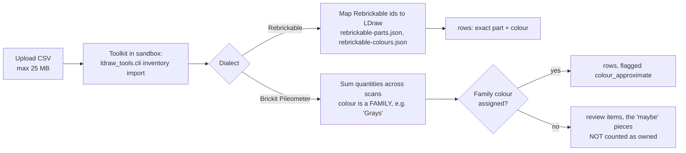

# My Parts: parts lists, imports, buildable, parts check

Paths are relative to `app/web/backend/` (backend), `ldraw_tools/` (toolkit) and `app/web/frontend/src/` (frontend). The plan for the future collection is `docs/plans/active/parts-catalogue/PROPOSAL.md`, with the owner decisions at lines 325–331.

## Parts lists ("inventories")

A **parts list** is one imported file of owned bricks. The code calls these "inventories".

- **Storage**: `/data/inventories/<id>.json` holds the parsed rows `{part, colour, qty, rb_part, rb_colour}` plus import notes. `<id>.csv` is the original upload. Since phase 2b the same data can live in PostgreSQL (see database.md, "The parts collection"); `collection_store.py` is the one module that switches between the two.
- **API**: `GET/POST /api/inventories`, `GET/PATCH/DELETE /api/inventories/{id}`, `PUT .../family-colours` (`routers/inventories.py`).
- **UI**: `pages/Parts.tsx`, with the tabs "Parts lists" and "What can I build?" (`components/parts/`).

### Import

- **Rebrickable mapping.** 99.74% of colour uses and about 94% of pieces map by identity, plus 2.6% by alias (`docs/plans/done/rebrickable-mapping.md`).
- **Pileometer** is Brickit's export. Its columns are Scan, Part, PartName, Color (a family) and Quantity (`ldraw_tools/inventory.py` `_parse_pileometer`).

- **PDF and photo parts pages** (`ldraw_tools/partslist_reader.py`, `inventory read-page`, `POST /api/collection/imports/read-page`). PDF text is read first (`pypdf`, else `pdftotext`); a PDF without text, or a photo, goes through OCR with the `tesseract` command (PDF pages are rendered by `pypdfium2` or `pdftoppm`). Every tool is optional: without one the import dialog says what to install, and the rest of the app is unchanged. The lines come back as BrickLink CSV with a confidence each; lines below 0.8 (no colour, no `x` on the quantity, OCR look-alike repairs, low OCR confidence) start unticked in a check step, and the confirmed lines go through the normal preview. The patterns were written against generated pages and may need tuning once a real instruction page is available.

### "Maybe" pieces: colour families to review

- Brickit reports colour **families** such as "Grays", not exact colours. Those pieces go to `review`, not to `rows`, and are **not counted as owned** (`inventory.py:67, 98`).
- The person picks an LDraw colour per family (`PUT /api/inventories/{id}/family-colours`, for example `{"Grays": 72}`). The list is then re-imported in place from the stored CSV. The pieces move into `rows`, flagged `colour_approximate`.
- Home shows "N colour families to review".
- **Owner decision 3 is not implemented yet.** The decision is that family pieces count as a separate "maybe" in buildable and shortage answers. Today they are simply left out until assigned.

## What can I build

`GET /api/inventories/buildable`, implemented in `buildable.py` (backend) and `ldraw_tools/buildable.py`.

- **What it compares.** Your parts lists, summed as exact part + colour, against the 1,821 reference models.
- **How it ranks.** For each model, matched = the sum of min(needed, owned). Models are sorted by matched / needed, then by the fewest missing.
- **Filters and extras.**
  - Small models (under 20 parts) are dropped.
  - Sub-variants that fit inside a parent set are dropped.
  - An optional text filter matches words in the file name and description.
  - A looser score lets any owned colour of a part stand in for the needed one.
- **The first scan takes minutes.** Each model's BOM is expanded once and cached on disk under `<toolkit>/.cache/buildable/`. While that runs, the API answers **HTTP 202** with progress, and the UI polls.
- **No search engine.** It ranks by brick coverage, not by text relevance. No Jev.
- **Not used: the sets catalogue.** About 20,000 real sets live in `ldraw_tools/data/set-catalog.bin` with a working `sets` CLI, but they are **not wired** into the API or UI. "What can I build" only knows the 1,821 reference models.

## Parts check

| Where | What it shows | Code |
|---|---|---|
| Workspace bottom bar / Parts tab | "N of M owned" for the draft, plus missing lines | `GET /api/builds/{id}/draft/parts-check` → `workspace.check` (`workspace.py:188-231`) |
| Version strip | owned / needed / missing count per version | inside `GET /api/builds/{id}/workspace` |
| Agent chat with parts steering | `parts-check.json` card: short lines, parts not owned, colour substitutions | `ldraw_tools/inventory.py` `check_model`, `PartsCheckCard.tsx` |

- **Owned** = all parts lists summed, exact rows only. Review pieces are excluded.
- **Steering modes for a chat** (`parts_steering.py`):
  - `off`: owned parts are ignored.
  - `prefer`: the agent is told to use owned parts, and gets the `my_parts` and `buildable_models` tools.
  - `only`: the agent may use only owned parts.

  Builds in the workspace use `prefer` whenever parts lists exist.

## Planned: real collection management

These are proposals with owner decisions recorded on 2026-10-24. **None of this is built yet.** The parts-catalogue proposal adds:

- a Collection / Sources / Review / Reserved / What-can-I-build structure;
- adding whole sets;
- loose parts;
- BrickLink and BSX import;
- exports;
- part thumbnails;
- a rule-based quick add.

The owner decisions:

1. Marking a model or owned set as built reserves its parts by default.
2. Storage is a free-text note per part now. Bins and drawers come later, and notes must convert to them.
3. Colour-family pieces count as a separate "maybe" until assigned.
4. Quick add is rule-based only, with no LLM.
5. Brickit stays an occasional import, and this app is the home of the collection.
