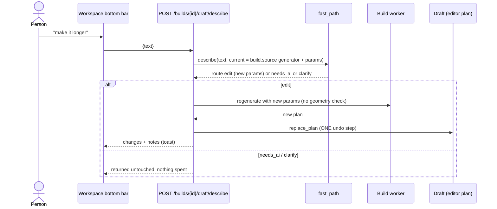

# What happens when someone types a request

Backend paths are relative to `app/web/backend/`, and frontend paths to `app/web/frontend/src/`. Measured numbers come from `docs/plans/nl-review/REVIEW.md` (warm container, 8 cores, software GL) and `docs/plans/deterministic-first/PROPOSAL.md`. **Caveat:** the NL review could not call the understanding model live (no key), so its LLM numbers are estimates.

## The five layers, cheapest first

| # | Layer | Cost | Time | Code |
|---|---|---|---|---|
| 1 | **Hint** while typing (rules only) | 0 | 0.2 ms median | `GET /api/describe/estimate` → `fast_path.rules_guess` |
| 2 | **Rules shortcut** at submit | 0 | 1–11 ms | `understand.rules_shortcut` (`understand.py:246`) |
| 3 | **Understanding call**: one small LLM reads the sentence into `spec.v1` | about EUR 0.0002 (cached) to 0.0004 (cold) | about 1.5 s (estimated) | `understand.understand` |
| 4 | **Generator** builds the model | 0 | 11–21 s warm; 17–67 s on a cold worker | `build_worker.py` → `ldraw_tools/pipeline.py` |
| 5 | **Paid AI agent**, only after the person agrees | EUR 1–2 typical | 15–30 min | `agent.py`, `turn.py`, `agent_loop.py` |

## Hint vs decision

- **Hint** = `GET /api/describe/estimate?text=&generator=` (`routers/describe_api.py:50`). It uses keywords only and never calls a model. It shows "Fast path: free, ~N s" or "AI build: ~EUR a–b, ~m–n min", prefixed "Probably:" when confidence is below 0.7 (`components/workspace/BottomBar.tsx`).
- **Decision** = `POST /api/describe` (`describe_api.py:35`), or `POST /api/builds/{id}/draft/describe` inside a build. It may spend one cheap call, and it is the only one that triggers a build or an edit.
- The two use different readers, and they **disagree on 15 of 54 realistic prompts** (REVIEW.md:160). For example, the hint says "AI build EUR 1–2" where the decision would ask a question or use a generator.

## What the decision returns

`fast_path.describe` (`fast_path.py:531`) returns one of four routes:

| Route | Meaning | What the UI does |
|---|---|---|
| `generator` | A new model that a generator can build. Includes params, notes, `cost_eur: 0` and a time estimate. | Creates the build, runs the generator, and opens the workspace |
| `edit` | A change to the current generator build. Includes `changes[]` (from→to) and new params, or `history: undo/revert`. | Regenerates into the draft as **one undoable step** |
| `needs_ai` | The request cannot be done deterministically. Includes a reason and a cost/time estimate. | Shows "Build with AI for ~EUR x–y?" with Cancel and "Build with AI" |
| `clarify` | One question back to the person | Shows the question; nothing is spent |

**Why a request becomes `needs_ai`** (`fast_path._unsupported_reason`, `fast_path.py:162`; `route`, line 415):
- it names a real set or franchise (`reference_hint`);
- it asks to prefer or use only owned parts (`parts_mode`);
- it needs a feature no generator has;
- no generator matches and the request has 3 or more words.

**Estimate shown for AI.** By default it is EUR 1–2 and 15–30 min. Once there are 3 finished chats, it becomes the quartiles of your own past turns (`fast_path.ai_estimate`, `history_stats`).

## New build

`/new` has no screen of its own. It creates an empty build (`POST /api/builds` with `source: {kind: "empty"}`) and opens it in the workspace (`pages/NewBuild.tsx`). The person then describes what they want in the workspace chat, which goes through the same fast path, or places parts by hand. A prompt handed to `/new` ("Design something like this" on What can I build?) is put in the chat's composer. Importing a model file starts from My Builds → Import a model file (`POST /api/builds`, then `POST /api/builds/{id}/import`).

The describe box that used to sit on Home and on the New build page, with its own create-then-generate and "Build with AI" flow, was removed with the app shell redesign (October 2026).

## Change to an existing build (workspace bottom bar)

- Code: `routers/workspace_api.py:240` (`draft_describe`), `_regenerate`, and `fast_path._route_edit` (line 436).
- Edits change only the **generator params**: colour, size and feature toggles (`fast_path.edit_params`).
- **Routing in the workspace chat.** There is one chat per build and the server decides who answers (`chat_routing.state`; `chat_mode` in `GET /workspace`). While the AI agent is engaged (its turn is the latest real one and it asked a question or has not delivered a proposal since the person wrote) every message goes to the agent and `draft/describe` returns `route: "agent"` without applying or saving anything; only the per-message "Quick change instead" (`quick: true`) reaches the fast path. In quick mode, replies and follow-ups (yes, go on, step N, questions) get a clarify about the build instead of a guess, and an understood edit is applied only if the whole message is one short edit command with a confident reading. Details in workspace-and-editor.md.

## How the person agrees to spend

1. **The estimate hint** shows under the workspace chat before an AI turn starts.
2. **Per-tool approval** applies when the chat's permission is "ask" (the default). Every tool that is not read-only waits up to 600 s for Approve or Deny (`agent.execute_tool`, `tool_policy.py:9`).
3. **A EUR budget per request**: the UI default is EUR 2, with choices 1/2/5/10/20/custom/none (`components/ChatSettings.tsx:7-8`). See [ai-agent.md](ai-agent.md).

## How agent results reach a build

- An agent chat attached to a build never writes a version. `publish_model` validates the model and creates a **proposal** (`tools.py` `_propose` → `workspace.create_proposal`).
- The person sees Keep / Preview / Discard. Keep replaces the draft as one undoable step (`workspace_api.py:286`).
- Then "Save as vN" makes a version. See [workspace-and-editor.md](workspace-and-editor.md).

## Measured timings

| Request (REVIEW.md, `results-journey.json`) | Decision | Cold first build | Cache hit | Warm regenerate (no check) | Warm new version with check |
|---|---|---|---|---|---|
| small red car | 1.4 ms | 33.8 s | 0.03 s | 0.32 s | 15.2 s (check 14.9 s) |
| 10x8 house + chimney + porch | 0.9 ms | 66.7 s | 0.01 s | 0.45 s | 19.5 s |
| white/blue starship | 0.8 ms | 17.4 s | 0.02 s | 0.50 s | 11.3 s |

- **Almost all of a new build's time is the geometry check.** The generator already guarantees most of what it checks.
- **Before the resident worker**, every CLI call paid 15–25 s of start-up, so a car took 79 s (PROPOSAL.md:31-40).
- **Agent vs fast path.** In the measured Sonnet 5.5 runs, an agent build took 24–25 min and cost EUR 1.51–2.05 (`swarm-subagents/E2E.md:15-28`). A generator build takes about 15 s and costs nothing.
- **Session cost.** One build plus 10 edits, all through the LLM, costs about EUR 0.003 (REVIEW.md:182-189).

## Where it is weak today

From REVIEW.md section 5, ranked by the reviewer:

1. **Edits on non-generator builds.** AI-built, imported or hand-edited builds cannot be edited by text. "Make the roof blue" gets "AI build EUR 1–2" or "There is nothing to change yet".
2. **Stale generator source.** After you accept a proposal or edit by hand, a text edit regenerates from the old params and **silently overwrites your work**. You only learn this afterwards.
3. **Handover sends only the raw sentence.** The agent does not receive the spec, the nearest generator or the draft summary.
4. **"Can't place it" means "spend EUR 1–2".** There is no clarify-first policy and no choice chips.
5. **No conversation memory.** Each message is read alone. "Again" works only in tests, because no caller sends `previous_text`.
6. **LLM-first in practice.** Rules answer 3 of 54 realistic prompts (10 of 74 golden prompts). Without an understanding model, the keyword fallback drops about half of a request.
7. **Wrong picks without a note.** The substring match maps "lighthouse" to a house, "scarecrow" to a car, "fire truck" to the tipper truck and "cargo ship" to the small launch (`fast_path.py:129`).
8. **Notes are thrown away.** The Home and New build pages never show the assumptions made.
9. **Slow first build.** People wait 11–21 s for a check, and the worker is not warmed when the app starts.
10. **Other gaps.** There is no colour harmony, no tower, castle, train, tree, helicopter or furniture generator, and no telemetry.

The fix plan is REVIEW.md section 6. Wave 1 takes about 8–10 days: role-based edits on any build, a divergence guard, context, clarify chips, agent seeding, word-boundary matching, colour harmony, and "show first, check later". See [roadmap.md](roadmap.md).
