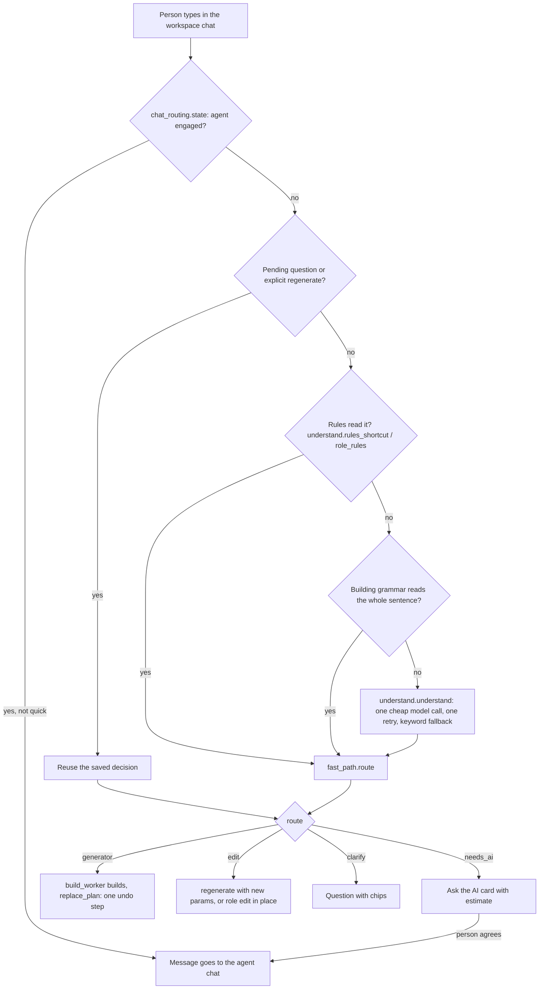

# What happens when someone types a request

When a person types a sentence into the workspace chat ("a small red car", "make the roof blue", "two more windows"), the app does not send it straight to the paid AI agent. It tries a ladder of cheaper steps first: plain rules, one small and cheap language-model call that only reads the sentence, and then deterministic builders called generators. The expensive agent runs only if nothing cheaper can do the job and the person agrees. This page describes that ladder, the data it passes around, and the files to touch when you change it.

## How it works

### The layers, cheapest first

| # | Layer | Costs money? | What it does | Code |
|---|---|---|---|---|
| 1 | Hint while typing | no | Guesses the route from keywords, never calls a model, and shows a line under the chat box ("Fast path: free" or "Needs the AI, about EUR 1-2"). The frontend asks for it, debounced by 350 ms, in `ChatPanel.tsx` `onTextChange()` through `buildsApi.hint()` | `app/web/backend/fast_path.py` `rules_guess()` |
| 2 | Rules shortcut | no | Regular expressions that read the easy cases: undo, revert, "make the roof blue", "two more windows", "again", and four preset sentences | `app/web/backend/understand.py` `rules_shortcut()`, `role_rules()`, `rules_edits()` |
| 3 | Understanding call | a fraction of a cent | One structured call to a small model (default Claude Haiku 5.5). It turns the sentence into a `spec.v1` JSON document and builds nothing | `app/web/backend/understand.py` `understand()` |
| 4 | Generator or role edit | no | Deterministic code builds the model or edits the draft | `app/web/backend/build_worker.py`, `ldraw_tools/generators/`, `ldraw_tools/role_edits.py` |
| 5 | Paid AI agent | yes, EUR 1-2 typical | A tool-using agent loop with its own budget | `app/web/backend/turn.py`, `agent_loop.py`, `agent.py` |

The "fast path" is the name used throughout the code for layers 1 to 4 together: everything that answers a request for free (or almost free) without the agent. The whole decision is made by `fast_path.describe()`.

The understanding model only reads language. It never sees parts, plans or tools. Its output is data (`spec.v1`) that ordinary code routes. If the model is missing, fails twice, or returns invalid JSON, `understand()` falls back to `heuristic_spec()`, a keyword reader, and the answer is marked `rules_fallback`.

### Who answers a message in the workspace chat

Each build has one chat. The server decides whether the next message goes to the fast path ("quick" mode) or to the agent ("ai" mode). `chat_routing.state()` reads the saved chat to decide.

- The agent is "engaged" when its turn is the latest real turn and it either asked the person something or has not delivered a proposal since the person last wrote. While engaged, every message goes to the agent, whatever words it contains.
- Quick-change turns made in between do not end an agent conversation (they are marked `_fast_path` in the saved messages).
- The person can override per message with "Quick change instead". The chat panel (`app/web/frontend/src/components/workspace/ChatPanel.tsx`) sends `quick: true` in that case.
- In quick mode, replies and follow-ups such as "yes", "go on", "step 4" or any question are not commands. `chat_routing.is_continuation()` spots them and the server answers with a question about the build instead of guessing a colour or size.
- An edit that the model (not the rules) understood is applied only if the whole message is one short edit command (`chat_routing.whole_edit_command()`) and the model's confidence is at least 0.6. Otherwise the person is asked.

### The route a decision returns

`fast_path.describe()` returns a dictionary whose `route` is one of:

| Route | Meaning | What happens next |
|---|---|---|
| `generator` | A new model that a generator can build; carries `generator`, `params`, `notes`, `cost_eur: 0` | The build worker builds it into the draft |
| `edit` | A change to the current build: either new generator `params` plus `changes`, or `role_edits` for a build without a live generator, or `history: undo/revert` | Applied to the draft as one undoable step |
| `needs_ai` | Nothing deterministic fits; carries a `reason` and an `estimate` | The chat shows "This needs the AI" and waits. Nothing is spent until the person presses "Ask the AI" |
| `clarify` | One question back to the person, with optional `choices` (chips) | Shown in the chat; nothing is spent |
| `agent` | Only from `draft/describe`: the agent is engaged, so the message was not handled here | The frontend sends the message to the agent chat |

A request becomes `needs_ai` (see `fast_path._unsupported_reason()` and `route()`) when it names a real set or franchise (`reference_hint`), asks to prefer or use only owned parts, needs a required feature no generator has, or no generator matches the family and kind. The estimate defaults to EUR 1-2 and 15-30 minutes. After three finished chats exist it becomes the quartiles of the person's own past turns (`fast_path.ai_estimate()`, `history_stats()`).

### The full flow for one message



The step "Building grammar reads the whole sentence" is `fast_path.grammar_decision()`. For a build made by the `building` generator it asks the toolkit's rule-based text reader (`ldraw_tools/grammar/nl.py` `apply_text()`, called through `generator_bridge.apply_text()`) to read phrases like "three storeys" or "arched windows". It is used only when it understands every clause, so nothing is applied half-way.

### Understanding step in detail

1. **Rules first** (`understand.rules_shortcut()`): the four home-page preset sentences, `undo`, `revert`, "make the roof blue", chains of simple edits ("2 studs longer, then add a chimney"), "again" (repeats the last change the rules understood). The keyword tables also fold a few Italian, Spanish and French words onto English, for the rule path only. The model reads any language.
2. **Model call** (`understand.understand()`): a cacheable system prompt (instructions, a digest of the generator registry, the colour list) plus a variable tail (options, `CURRENT_SPEC` for follow-ups, a short `CONTEXT` of the build and last turns, then the `REQUEST`). The tool schema is `spec.v1`. Output is capped at 500 tokens and requests are cut at 2000 characters. One retry tells the model what was invalid. The call is recorded in the cost history (`usage_log.record`, kind `understand`).
3. **Which model**: `understand.model_params()` picks, in order, an explicit id, the environment variable `LDRAW_NOVA_UNDERSTAND_LLM_ID`, the "Understanding model" chosen in Settings, a configured Haiku 5.5 entry, then the main model. Any model that can do a forced tool call works.
4. **Routing** (`fast_path.route()`): for a new model it picks the generator (`choose()`, by kind and family, matching whole words so "lighthouse" no longer means "house"), maps the spec's size, colours and features onto the generator's parameters (`params_from_spec()`), picks a preset for the building generator (`pick_preset()`), chooses a roof and trim that go with a single named wall colour (`_harmony()`), then clamps every value to the generator's schema and notes each adjustment (`clamp()`). For an edit it changes parameters (`edit_params()`), or builds role edits if the build has no live generator.
5. **Unsure readings are asked about**: a model reading with confidence below 0.5, or with an ambiguity question (for example "6 x 8 in studs or in bricks?"), becomes a `clarify` with the options as chips instead of being applied.
6. **Several steps in one sentence**: "a red car, then make it longer" is split by `split_steps()`; the first part builds, the rest is applied to the result in a scratch plan, and the answer lists both steps.

### Edits on builds without a live generator

A generator build remembers its generator id and parameters in `build.source`. If the person hand-edits the draft, accepts an AI proposal, or imports a file, the draft no longer matches that source. `workspace_api.build_context()` reports this (`diverged`, `has_model`, role counts). In that case:

- "make the roof blue", "remove the chimney", "paint this red" (with a canvas selection) become **role edits**: recolour or remove all placements that carry a role such as `roof`, resolved by the toolkit (`ldraw_tools/role_edits.py` `resolve()`) and applied as one undoable batch (`routers/editor.py` `apply_role_edit()`).
- If the role is unknown, nothing matches, or the roles were guessed with low confidence, the answer is a `clarify`. The person can confirm ("Yes, change them") and the edit is then forced.
- A whole new model over an existing, non-generator draft is never applied silently. The chat asks "Start over with X?" first, and the old model stays in its versions.
- "regenerate", "start over" or "reset" rebuilds from the saved settings and replaces manual edits, explicitly.

How roles work is in [generators-and-grammar.md](generators-and-grammar.md).

### The hint versus the decision

The hint (`GET /api/describe/estimate`) uses `rules_guess()` and never calls a model. It reads the same rules and the same build context as the decision, so the two agree whenever no model is needed. The decision (`POST /api/builds/{id}/draft/describe`) may spend one cheap call and is the only one that changes the draft. When the hint is unsure it says "Probably".

## Where the code is

| File | What it holds |
|---|---|
| `app/web/backend/routers/workspace_api.py` | `draft_describe()` (the endpoint), `build_context()`, `_regenerate()`, `_role_edit()`, pending-question handling, saving the turn into the chat (`_persist_turn()`) |
| `app/web/backend/routers/describe_api.py` | `POST /api/describe` (no build, no draft) and `GET /api/describe/estimate` (the hint) |
| `app/web/backend/fast_path.py` | `describe()`, `route()`, `choose()`, `params_from_spec()`, `edit_params()`, `clamp()`, `rules_guess()`, `ai_estimate()`, `grammar_decision()`, `split_steps()` |
| `app/web/backend/understand.py` | Rules, keyword fallback, the prompt, `understand()`, `validate()`, `normalise()`, `model_params()` |
| `app/web/backend/chat_routing.py` | `state()`, `is_continuation()`, `whole_edit_command()`, `contextual_clarify()` |
| `app/web/backend/generator_bridge.py` | The generator registry as data in the backend process, `apply_text()` |
| `app/web/backend/build_worker.py` | The resident toolkit process that builds plans |
| `app/web/backend/turn.py`, `agent_loop.py`, `agent.py` | The paid agent: `run_turn()` streams a model reply, runs tools, repeats until done, a budget is reached or the step cap is hit |
| `app/web/backend/request_log.py` | The local request log |
| `app/web/backend/spec.v1.schema.json`, `edit-intent.v1.schema.json` | The data contracts |
| `app/web/backend/understand_golden.json`, `understand_eval.py` | The golden prompts and the live scorer |
| `app/web/backend/routers/understand_api.py` | `POST /api/understand`, an internal test endpoint for the understanding step alone |
| `app/web/frontend/src/components/workspace/ChatPanel.tsx` | The chat: quick or AI toggle, hint line, clarify chips, the "Ask the AI" tray |

## Reference

### API endpoints

| Endpoint | Purpose |
|---|---|
| `POST /api/builds/{id}/draft/describe` | The real entry point. Body: `text`, optional `previous_text`, `quick`, `selection`, `persist`. Applies the answer to the draft and saves the turn in the build's chat |
| `GET /api/builds/{id}/workspace` | Includes `chat_mode` (`quick` or `ai`) and `agent_chat` |
| `GET /api/describe/estimate?text=&build_id=` | The hint. Rules only, milliseconds |
| `POST /api/describe` | The same decision without a build or a draft. The current UI does not call it; it is there for tests and tools |
| `POST /api/understand` | Runs only the understanding step and returns the spec, cost and source |
| `GET/PUT /api/request-log/settings` | Whether the full sentence is stored in the request log |

### Spec and edit-intent schemas

`spec.v1.schema.json` is "what the user wants, as understood from one message" and the only input of the router. The model is forced to call a tool whose parameters are this schema.

| Field | Meaning |
|---|---|
| `intent` | `new_model`, `edit`, `question` or `other` (required) |
| `subject` | `family` (required: car, truck, van, motorcycle, boat, aircraft, spaceship, train, house, building, tower, garden, technic, mechanism, scene, other), `kind` (free noun), `style` |
| `size` | `scale` (micro to large), `studs` (width, depth, length, height_courses), `unit_ambiguous` |
| `colours` | role to colour name, e.g. `{"body": "Red", "wheels": "Black"}` |
| `features` | list of `name`, `count`, `where`, `required` |
| `constraints` | `parts_mode` (off, prefer, only), `max_parts`, `budget_eur`, `must_use`, `avoid` |
| `edits` | up to 8 edit objects (below) |
| `reference_hint` | a named real set or franchise; routes to `needs_ai` |
| `ambiguities`, `confidence` | questions worth asking and a 0 to 1 score |

An edit object has `op` and `target` (required), plus `value`, `delta`, `amount`, `unit`, `where`, `count`. The ops are `set_colour`, `set_param`, `scale_param`, `add_feature`, `remove_feature`, `swap_part`, `replace_model`, `undo`, `revert`.

`edit-intent.v1.schema.json` is a stricter view for `intent: edit` (at least one edit, and the edit object must be identical to the one in spec.v1; a test enforces that). `understand.validate()` checks a spec against spec.v1 and, for edits, also against edit-intent.v1.

### The request log

`request_log.py` writes one row per describe or estimate request into the `request_log` table (see [database.md](database.md)): surface, route, who decided (`rules`, `llm`, `grammar`, `rules_fallback`), family, kind, generator, latency, a 12-character hash of the text, and a few fields such as confidence and the understanding cost. The sentence itself is stored only when the owner switches on `keep_request_text` (through `PUT /api/request-log/settings`, or `LDRAW_NOVA_KEEP_REQUEST_TEXT=1`; the frontend has no switch for it yet). Rows older than 180 days are pruned. Writes never fail a request, and nothing leaves the machine. Columns `applied`, `undone_within_60s`, `went_to_agent` and `lang` exist in the table but nothing fills them yet.

### Golden tests

`understand_golden.json` holds 74 prompts with the spec each should produce (new models, follow-up edits with a `current_spec`, the owner's three example prompts). `understand_eval.py` scores a run per dimension: intent, family, colours, edits. The target is at least 0.90 on family, colours and edits and a median cost under USD 0.0005. A live run calls a real model about 70 times (a cent or two) and is manual by design:

```sh
docker compose exec ldraw-nova-app bash -c "cd /app/web/backend && python3 understand_eval.py --live"
```

Options: `--llm-id <entry>`, `--limit N`, `--rules` (let rules answer what they can), `--json FILE`. Without `--live` it refuses to run.

## Changing it

- **A new phrase the rules should read**: add a pattern in `understand.py` (`_clause_edit()` for follow-ups, `_PRESET_SPECS` for exact sentences). Rules must be all-or-nothing: if any clause is not understood, return `None` so the whole message goes to the model. Add a golden prompt with `"rules": true`.
- **A new spec field or edit op**: change both schema files (keep `$defs.edit` identical), update the `INSTRUCTIONS` text in `understand.py`, and handle the field in `fast_path.params_from_spec()` or `edit_params()`. Changing the prompt or schema changes the cached prefix; tests pin that it is byte-stable.
- **A new generator or preset**: you do not change the router. The registry digest in the prompt and the routing both read the registry. See [generators-and-grammar.md](generators-and-grammar.md).
- **Routing wording or thresholds**: `fast_path.py` (`BIG_CHANGE` 0.30 sends a large size change to a preview proposal; confidence 0.5 and 0.6 limits are in `describe()` and `_unsure()`).
- **Do not** make the hint call a model, or make a decision apply an understood edit from a long sentence. Both rules are what keep the free path predictable.
- After a prompt or routing change, re-run the model-less regression (below), and run the live golden check once.

## Testing it

Backend tests live in `app/web/backend/tests/`. They stub the model, so they are free and deterministic. In the container:

```sh
cd /app/web/backend && pytest -q tests/test_understand.py tests/test_fast_path.py tests/test_chat_routing.py tests/test_nl_wave1.py tests/test_nl_regression.py
```

| Test file | Covers |
|---|---|
| `tests/test_understand.py` | Schemas, golden set through a mocked provider, retry and fallback, prompt prefix stability, cost |
| `tests/test_fast_path.py` | Routing, clamping, edits, presets, estimates |
| `tests/test_chat_routing.py` | Quick versus AI mode |
| `tests/test_nl_wave1.py` | Role edits on any build, divergence guard, context, hint and decision agreement |
| `tests/test_nl_regression.py` | `nl_prompts.json`: 54 review prompts plus more, with recorded routes. Re-record on purpose with `NL_REGRESSION_RECORD=1 pytest tests/test_nl_regression.py` and review the diff |
| `tests/test_database.py` | Request log hashing and the opt-in to keep the sentence |

## Related

- [ai-agent.md](ai-agent.md): the paid agent, budgets and approvals
- [workspace-and-editor.md](workspace-and-editor.md): drafts, versions, proposals and undo
- [generators-and-grammar.md](generators-and-grammar.md): what the router routes to
- [settings-and-providers.md](settings-and-providers.md): the understanding model setting
- [database.md](database.md): the `request_log` table
- [roadmap.md](roadmap.md)
- Plans: `docs/plans/active/nl-review/REVIEW.md` (measurements and the ranked weak points; its numbers predate the role-edit and context work), `docs/plans/done/deterministic-first/PROPOSAL.md`, `docs/plans/done/phase2/fast-path.md`
