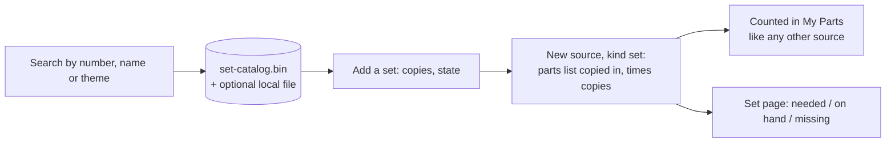

# My Sets: the set catalogue and owned sets

My Sets is the part of the app for boxed sets: the sets the owner has, shown as cards with a picture, and a page per set that says which of its parts are on hand or missing. It rests on an **offline catalogue** of about 20,000 real LEGO sets that ships inside the app, so looking up "8448" or "tipper truck" needs no internet. Adding a set copies its parts list into the owner's collection, which is how sets feed [My Parts](parts-and-collection.md).

## How it works

### Two kinds of "set" in this app

The word is used for two different things, and mixing them up is the most common confusion:

| Name in the UI | What it is | Where it lives |
|---|---|---|
| Catalogue set | A real LEGO set, with name, year, theme, piece count and a parts list. Read-only reference data | `ldraw_tools/data/set-catalog.bin` |
| Owned set | A set the owner has added. It is a **source** of kind `set` in the collection | Same storage as every other source (files or PostgreSQL) |
| Bundled reference model | A 3D model of a set shipped with the app, used by "What can I build?" and as a fallback picture | `ldraw_tools/data/models-annotated/` |

Only the first two are covered here. Bundled models are described in [parts-and-collection.md](parts-and-collection.md) (ranking) and in the toolkit pages.

### The offline catalogue

The catalogue is built from Rebrickable's database downloads by `tools/build_set_catalog.py`. The script never downloads anything; the maintainer fetches the files by hand (Rebrickable allows once a day) and the script reads them. For each set it stores the Rebrickable name, year, theme path, piece count, and the physical parts list translated to LDraw part numbers and LDraw colour codes. Spare parts are left out, and minifigures and sub-sets are expanded into the list. Pieces with no LDraw equivalent are not listed but counted (`dropped_part`, `dropped_colour`), so the UI can say "N pieces have no LDraw part". The current file holds 20,094 sets (the source had 28,547; sets with no inventory and the themes Books and Gear were dropped).

The file is a small binary: a magic header, a zlib-compressed JSON header (metadata, part table, theme table, one row per set with an offset), then one compressed blob per set holding its parts lines as variable-length integers. The header is read into memory at once and a set's parts list is decoded only when asked for. The layout is documented at the top of `ldraw_tools/sets.py`.

Two readers of the same file exist on purpose:

- `ldraw_tools/sets.py` is the toolkit reader. It also writes the file and ranks sets by how much of each the owner's parts cover.
- `app/web/backend/set_catalog.py` is a stand-alone reader for the web backend. The backend's system Python cannot import the toolkit, and starting a subprocess for every keystroke in a search box would be far too slow. It is read-only and cached in memory, and reloaded when the file's modification time changes.

If you change the file layout you must change both readers.

### Other brands: the local catalogue

LEGO is the default brand, but a set record carries a free-text `brand`. The backend can merge an optional **local catalogue** at load time: `data/local/set-catalog-local.json`, written by `tools/fetch_cada_sets.py`. That script fetches the CaDA set list (set number, name, year, piece count) from a third-party site in exactly three polite requests, after reading robots.txt, and refuses to overwrite an existing file. The file is gitignored and must not be committed, because the site publishes no licence. Entries from it are keyed `<brand>:<number>` (for example `cada:C51026W`), so numbers cannot clash with LEGO's, and they have **no parts list**. If the file is missing or broken, nothing changes. Brand display names come from `BRAND_NAMES` in `set_catalog.py` (`lego`, `cada`); an unknown brand uses the text as written. The path can be overridden with `LDRAW_NOVA_LOCAL_SET_CATALOG`, and the main catalogue with `LDRAW_NOVA_SET_CATALOG`.

For a set no catalogue knows at all, the owner can **add it by hand**: brand, name, product code, year and copies. This creates an empty source of kind `set` marked `manual`, and the parts come afterwards from a file import over it ("Import parts" on the set page).

### From catalogue to collection

`add_set()` in `app/web/backend/collection.py` copies the parts list into a new source at add time, multiplied by the number of copies (1 to 99). It is a copy on purpose: refreshing the catalogue later cannot silently change what the owner owns. The source records the set number, brand, name, year, theme, piece count, copies, state, dropped piece count and which catalogue it came from.

A set has a **state**:

| State | Meaning |
|---|---|
| `parts` | Taken apart. The parts are loose and free to use |
| `built` | Assembled. The parts still count as owned, but are **reserved**, so they are not offered to the agent, the editor check or "What can I build?" |

The owner switches the state on the set page ("Mark as built" / "Mark as parts only"). The reservation rule is described in [parts-and-collection.md](parts-and-collection.md). Sets are left out of the My Parts "Sources" tab, since they have their own page, but their parts are in the Collection view like everything else, and they can be exported like any source.

### Pictures

`set_images.py` serves a picture for any set at `GET /files/set-image/{set_num}`. The order is:

1. A photo the owner uploaded (PNG, JPEG or WebP, at most 2 MB; the type is checked from the file's first bytes, not from what the browser claims). Works for every brand.
2. The catalogue picture already cached on this machine.
3. The catalogue picture fetched now, **only** for an owned LEGO set with a Rebrickable-style number, and only if remote fetching is on. It is linked from Rebrickable's image server (`cdn.rebrickable.com`), downloaded once and cached under `<DATA_DIR>/cache/set-images/`. Cached pictures are never committed or redistributed.
4. A render of the bundled 3D model of that set, if the app ships one (made with LeoCAD, cached).
5. A neutral SVG placeholder.

Remote fetching is **on by default** (decided on issue #111) so pictures appear without setup. The owner can switch it off with a checkbox on the My Sets page, which writes `<DATA_DIR>/cache/set-images-settings.json`. The environment variable `LDRAW_NOVA_SET_IMAGE_FETCH` (`0`/`1`) overrides the checkbox, for offline deployments. A failed fetch or render is remembered for an hour so a dead link costs one request. CaDA sets have no catalogue picture, so they show an uploaded photo or the placeholder.

### The pages

| Page | Route | What it shows |
|---|---|---|
| My Sets | `/sets` | Tab **Sets**: a card per owned set with picture, brand, state and on-hand or missing counts; search, brand and state filters and a sort (name, year, completeness); the picture-fetch checkbox; "+ Add a set". Tab **Built & reserved**: built sets and "I built this" model reservations. Tab **What can I build?**: the ranking of bundled models |
| Set detail | `/sets/:id` | Large picture, name, brand, number, year, theme, state, copies; every part with needed, on hand and missing; group by colour or category; "only missing" filter; wanted-list download of what is missing; replace or remove picture; Import parts (manual sets); Export; History; Remove |
| Home | `/` | A "My Sets" tile with a one-line summary |

Opening the old address `/parts?view=sets` (and `reserved`, `build`) redirects to the new pages, and `/parts/:id` for a set redirects to `/sets/:id`.

"On hand" and "missing" use the same arithmetic everywhere. For each part and colour of the set, the collection's reserved pieces are compared with what is owned, and anything the collection cannot cover is missing. The functions are `owned_sets()` in `collection.py` (one line per set) and `detail()` in `set_detail.py` (one line per part). A built set holds its own pieces; a parts-only set is counted as if it were built, so the page shows what you would be short of if you built it now.

## Where the code is

| Path | What it does |
|---|---|
| `ldraw_tools/sets.py` | Catalogue format, writer, reader, `search_sets()`, `get_set()`, `set_bom()`, `rank_sets()` |
| `ldraw_tools/data/set-catalog.bin` | The catalogue (committed binary, about 3.7 MB) |
| `ldraw_tools/commands/sets.py` | CLI: `ldraw-agent sets search`, `show`, `stats`, `buildable` |
| `tools/build_set_catalog.py` | Rebuilds the catalogue from Rebrickable CSV downloads. `--check` compares with the committed file |
| `tools/fetch_cada_sets.py` | One-off fetch of the CaDA list into the local catalogue file |
| `app/web/backend/set_catalog.py` | Backend reader and the optional local-catalogue merge: `load()`, `Catalog.search()`, `Catalog.get()`, `lines()` |
| `app/web/backend/set_detail.py` | `detail()`: one owned set with per-part counts |
| `app/web/backend/set_images.py` | Pictures: upload, fetch, cache, render, `get()`, `remote_enabled()` |
| `app/web/backend/collection.py` | `add_set()`, `add_manual_set()`, `set_record()`, `owned_sets()`, `owned_set_nums()` |
| `app/web/backend/reservations.py` | `set_state()` and the built-set reservation rule |
| `app/web/backend/routers/collection.py` | Catalogue and set routes (`/api/catalog/sets`, `/api/sets`, image routes) |
| `app/web/backend/routers/set_detail.py` | `GET /api/sets/{source_id}` |
| `app/web/backend/routers/files.py` | `GET /files/set-image/{set_num}` |
| `app/web/frontend/src/pages/Sets.tsx`, `SetDetail.tsx` | The two pages |
| `app/web/frontend/src/components/parts/SetsView.tsx`, `AddSetDialog.tsx`, `ReservedView.tsx`, `BuildablePanel.tsx` | The My Sets tabs and the add dialog (catalogue search or by hand) |
| `app/web/frontend/src/setDetailApi.ts` | Client for the set detail and image routes |
| `ontology/sets.ttl`, `ontology/sets-shapes.ttl` | Vocabulary for sets and brands (see [ontology.md](ontology.md)) |

## API reference

| Endpoint | Purpose |
|---|---|
| `GET /api/catalog/sets?query=&limit=` | Search the catalogue (limit 1 to 50). All words must match number, name, brand or theme; an exact number comes first, then newest |
| `GET /api/catalog/sets/{set_num}` | One catalogue set with line counts and which owned sources hold it. `8448` means `8448-1` |
| `GET /api/sets` | Owned sets with brand, image, copies, state, pieces, reserved, missing, on hand |
| `GET /api/sets/{source_id}` | One owned set with every part row |
| `POST /api/collection/sets` | Add a catalogue set: `set_num`, `copies`, `state`, `brand` |
| `POST /api/collection/sets/manual` | Add a set by hand: `brand`, `name`, `code`, `year`, `copies`, `state` |
| `PUT /api/collection/sources/{id}/set-state` | `parts` or `built` |
| `POST/DELETE /api/sets/{source_id}/image` | Upload or remove the owner's own picture |
| `GET/PUT /api/set-images/settings` | Read or change the remote-fetch switch |
| `GET /files/set-image/{set_num}` | The picture itself (placeholder when none) |

If the catalogue file is missing the catalogue routes answer 503 with the reason.

## Changing it

- **Refresh the catalogue.** Download Rebrickable's CSVs by hand, run `python3 tools/build_set_catalog.py RB_DIR LDRAW_DIR`, and commit the new `set-catalog.bin`. Keep the attribution in `ATTRIBUTION.md` (Rebrickable must be acknowledged). Run the tests below, which include a check against the committed data.
- **Add a brand.** Brands are data, not code. Add the display name to `BRAND_NAMES` in `app/web/backend/set_catalog.py` if you want a nicer label than the raw text, and add a `skos:Concept` for the brand in `ontology/sets.ttl` (then regenerate `docs/ns/`, see [ontology.md](ontology.md)). Set numbers for non-LEGO brands are stored as `<brand>:<code>`.
- **Change the file layout.** Update `ldraw_tools/sets.py` and `app/web/backend/set_catalog.py` together, and bump the magic string so an old reader fails loudly.
- **Change what "missing" means.** Edit both `owned_sets()` and `set_detail.detail()`, since the card totals and the page rows must agree, and keep `reservations.reserved_totals()` the single definition of "reserved".
- **Change the picture order.** `get()` in `set_images.py`. Anything that downloads must stay behind `remote_enabled()` and the owned-set check.

## Testing it

From the repo root: `pytest -q tests/test_sets.py tests/test_fetch_cada_sets.py tests/test_sets_ontology.py` (catalogue builder, loader, search, ranking, committed data, CaDA parser, set shapes; the ontology test needs `pip install -e ".[ontology,test]"`).

Backend: `cd app/web/backend && pytest -q tests/test_set_detail.py tests/test_collection.py` (set pages, adding sets, the local-catalogue merge, pictures; some tests need the backend image environment).

The frontend has no automated tests for these pages.

## Related

- [parts-and-collection.md](parts-and-collection.md): sources, reservations, imports, "What can I build?".
- [ontology.md](ontology.md): the RDF vocabulary for sets and brands.
- [data-and-storage.md](data-and-storage.md): where sources, caches and pictures live on disk.
- Plans: `docs/plans/done/set-catalog.md` (how the catalogue was built), `docs/plans/active/parts-catalogue/PROPOSAL.md`.
