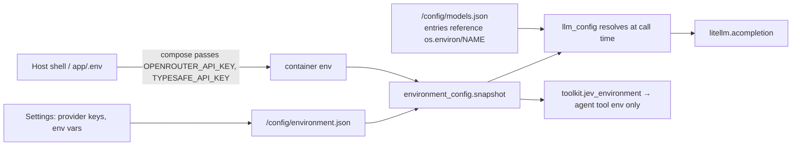

# Settings, providers and cost tracking

Paths are relative to `app/web/backend/`. The page is `app/web/frontend/src/pages/Settings.tsx`.

## What the Settings page holds

| Section | What it sets | Stored in |
|---|---|---|
| **Provider keys** (top) | `ANTHROPIC_API_KEY`, `OPENAI_API_KEY`, `MISTRAL_API_KEY`, `OPENROUTER_API_KEY`, each with a free "Test" call (`provider_errors.KEY_CHECKS`) | `/config/environment.json` |
| **Roles** | The three model roles described below | `/config/models.json` (`default_id`, `understanding_id`, `worker_id`) |
| **Advanced → Environment variables** | Any variable. Two are fixed rows: `TYPESAFE_API_KEY` and `JEV_OPENROUTER_API_KEY` (Jev). Also shows "Sandbox isolation: on/off" and which key Jev uses. | `/config/environment.json` |
| **Advanced → Custom agents** | LLM entries in LiteLLM format: model id, `api_key` (usually a reference like `os.environ/OPENROUTER_API_KEY`), `api_base`, ... | `/config/models.json` (mode 0600) |

The Jev key sits under **Advanced**, so it is easy to miss. See [jev-and-search.md](jev-and-search.md) for what it does.

## The three model roles

| Role | Used for | Default | Code |
|---|---|---|---|
| **Main model (builds)** | The paid agent: plans, writes code, runs the toolkit. It must support tools and vision. | Whatever you mark default | `llm_config`, `agent.start_turn` |
| **Understanding model** | One cheap call per typed request in the fast path | "Automatic": Haiku 5.5 if you added it, else the main model (`understand.model_params`) | `understand.py:427-447`, `PUT /api/llm-understanding/default` |
| **Worker model** | Cheap delegated jobs inside an agent run (optional) | "No workers" | `subagents.worker_entry`, `PUT /api/llm-workers/default` |

The env overrides are `LDRAW_NOVA_UNDERSTAND_LLM_ID` and `LDRAW_NOVA_WORKER_LLM_ID`.

## Providers (LiteLLM SDK)

- The app uses the **LiteLLM Python SDK** (`litellm.acompletion`), not the LiteLLM proxy (`providers.py`).
- The UI offers four providers: Anthropic, OpenAI, Mistral and OpenRouter. The registry also knows Azure, Gemini, Vertex, Bedrock and Ollama (`providers.REGISTRY`).
- Per-provider quirks are handled in two places:
  - `inference.params_for` maps the "effort" setting to each provider's field name.
  - Prompt caching is only used on Anthropic-family models.
- `litellm.drop_params = False` (`agent.py:31`): an unsupported setting fails visibly instead of being silently dropped.
- Local models (Ollama, LM Studio) are reachable via `api_base: http://host.docker.internal:11434`.

## How keys flow

- **Who can read the keys.** `/config` is root-only, mode 0700, so agent code cannot read it. LLM keys are never passed to tool processes. The only key that reaches agent code is the Jev key.
- **Masking.** API responses mask secrets as `••••` (`llm_config.mask_secrets`), and `/api/environment` is write-only for values.
- **Endpoint-change guard.** Changing an entry's `api_base` requires typing the key again (`llm_config._guard_endpoint_change`, from security finding H1).

## Cost tracking

- **Every agent step** stores `_usage {prompt, completion, cache_read, cache_write, cost_usd}` on the message (`agent_loop.py`, `usage.py`).
- **Prices** come from `model_catalog_data.json`, overlaid by `PRICE_BOOK` (`model_catalog.py:22-27`; Anthropic prices read 2026-10-23):

| Model | Input / output, $ per million tokens |
|---|---|
| Haiku 5.5 | 0.10 / 0.50 (5× over 100k-token prompts) |
| Sonnet 5.5 | 2 / 10 |
| Opus 5.5 | 4 / 20 |
| Fable 5.1 | 10 / 50 |

- **Cache pricing.** Reads are priced at 0.025–0.1× input and writes at 1.25× (5 min) or 2× (1 h). For non-Anthropic providers, cached tokens are counted at full price, which is safe for budgets.
- **Totals.** `usage_totals` gives cost in EUR, worker cost and unpriced steps. `turn_stats` gives the latest turn's cost and duration, which feed the AI estimate on the fast path.
- **Not tracked:** the understanding call (only returned per request and logged), and Jev fees.
- **Conversion**: `LDRAW_NOVA_EUR_PER_USD`, default 0.92.
