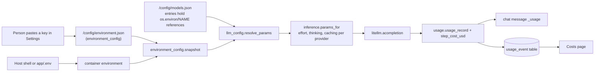

# Settings, providers and cost tracking

Open Brick Designer does not ship with a language model. The person brings their own API key from a provider (Anthropic, OpenAI, Mistral or OpenRouter), picks which models do which job, and the app tracks what each call costs. This page covers the Settings screen, how models are called through LiteLLM, where keys are stored, how prices and costs are worked out, and the Costs page.

Backend paths are relative to `app/web/backend/`, frontend paths to `app/web/frontend/src/`. LiteLLM is a Python library that gives one calling style to many providers. A "model role" is a job a model is chosen for (main builder, request reader, worker).

## How it works



1. **Keys.** Each provider card on Settings stores one key as an environment variable (`ANTHROPIC_API_KEY`, `OPENAI_API_KEY`, `MISTRAL_API_KEY`, `OPENROUTER_API_KEY`) in `/config/environment.json`. The value is write-only: the API never sends it back.
2. **Models.** The person adds models from a catalogue of presets. Each model is an "entry" in `/config/models.json` in LiteLLM's own shape (`model_name`, `litellm_params`). Its `api_key` is normally the reference `os.environ/ANTHROPIC_API_KEY`, resolved at call time, so one key serves every model of that provider.
3. **Roles.** Three roles pick from the added models (below).
4. **Calling.** `inference.params_for()` resolves the entry and adds provider-specific fields, then `agent_loop.py` or `understand.py` calls `litellm.acompletion()`.
5. **Cost.** Every call's tokens are priced from the catalogue and stored on the chat message and in the cost history.

## The Settings page

`pages/Settings.tsx` has these sections, top to bottom.

| Section | What it does | Stored in |
|---|---|---|
| **Providers** (`components/ProviderSettings.tsx`) | One card per provider: paste a key, **Save key** (the app then checks it), **Test**, **Remove key**. A badge shows No key, Key set or Key rejected | `/config/environment.json` |
| **Models** (same component) | For each provider, the catalogue presets with **Add** / **Remove**. Added models use the provider key. A model with its own literal key is badged "own key" and can be switched to the provider key | `/config/models.json` |
| **Roles** | Main model, Understanding model, Worker model (below) | `/config/models.json` (`default_id`, `understanding_id`, `worker_id`) |
| **Advanced, Environment variables** (`components/EnvironmentSettings.tsx`) | Any variable. Two fixed rows: `TYPESAFE_API_KEY` and `JEV_OPENROUTER_API_KEY` for Jev search. Also shows Sandbox isolation on/off, database status and which key Jev uses | `/config/environment.json` |
| **Advanced, Custom agents** (`components/AgentForm.tsx`, `AgentDetails.tsx`) | Add or edit an entry by hand: any LiteLLM model id, base URL, extra parameters. Shows context size, reasoning, image input, tools, max output and price. **Test** checks the connection | `/config/models.json` |

The Home page checklist (`components/FirstRun.tsx`) sends a new user to Settings until some provider key exists. `components/KeyBanner.tsx` shows a red banner when the default model's provider is known to have rejected its key.

Entries saved by the removed browser or subscription login (`chatgpt/` models or `auth_mode: browser`) stay in the list under "Needs an API key" and cannot run until edited (`llm_config.unsupported()`).

## The three model roles

| Role | Used for | Default | Code |
|---|---|---|---|
| **Main model (builds)** | The paid agent. It must support tool calling and image input | The first added model, or the one marked default | `llm_config.builder_entries()`, `agent.start_turn()` |
| **Understanding model** | The one cheap call that turns a typed request into settings for the free generators | "Automatic": a configured Claude Haiku 5.5 entry, else the main model | `understand.py` `model_params()` |
| **Worker model** | Cheap delegated jobs inside an agent run. Optional | "No workers" | `subagents.worker_entry()` |

Order for the understanding model: the entry id passed in, then `LDRAW_NOVA_UNDERSTAND_LLM_ID`, then the Settings choice, then a Haiku 5.5 entry, then the main model. The worker default is the Settings choice, then `LDRAW_NOVA_WORKER_LLM_ID` only when `LDRAW_NOVA_SUBAGENTS=1`. A chat can override the worker model in its own settings. Deleting an entry clears any role that pointed to it (`llm_config.delete()`).

A model is only accepted as a builder if the catalogue says it supports tools and image input (`model_catalog.builder_supported()`).

## Providers through LiteLLM

The app uses the LiteLLM Python library (`litellm.acompletion`), not the LiteLLM proxy server. `providers.py` is a table with one record per provider, so behaviour is declared in one place.

| Provider (prefix) | Shown in the UI | Effort style | Prompt caching | Live model lookup |
|---|---|---|---|---|
| `anthropic/` | yes | `thinking` adaptive + `output_config.effort` | yes | yes |
| `openai/` | yes | `reasoning_effort` | no | no (bundled snapshot) |
| `mistral/` | yes | `reasoning_effort` in `extra_body` | no | yes |
| `openrouter/` | yes | `extra_body.reasoning.effort` | through to Anthropic models only | yes |
| `azure/`, `gemini/`, `vertex_ai/`, `bedrock/`, `ollama/`, `ollama_chat/` | through Custom agents | varies | Vertex and Bedrock for Claude models | no |

Rules worth knowing:

- **Gateways.** A model string like `openrouter/anthropic/claude-opus-5` is resolved through the gateway to the inner provider for caching (`providers.supports_prompt_caching()`).
- **Unsupported settings fail visibly.** `litellm.drop_params = False` (`agent.py`), so a field the provider does not accept raises an error instead of being silently dropped.
- **OpenAI GPT models** are routed to the Responses API (`openai/responses/...`) because function calling needs it (`inference.params_for()`).
- **Local models** (Ollama, LM Studio) work with `api_base: http://host.docker.internal:11434` on a Custom agent.
- **Plain-words errors.** `provider_errors.py` `describe()` turns a rejected key, rate limit, unknown model or network failure into one sentence for the chat, and never includes a key or the raw provider message.
- **Key checks cost nothing.** The Test button on a provider card calls the provider's free model-list endpoint (`provider_errors.KEY_CHECKS`), not a completion. A rejected key is remembered in memory by fingerprint so the banner can show.
- **Model Test** (per entry, `POST /api/llm-models/{id}/test`) sends a one-word completion, and also refreshes capability and price details from the provider where it publishes them (`model_discovery.py`). A successful reply is never taken as proof of vision, tools or a context limit.

## The model catalogue and prices

`model_catalog_data.json` holds 34 profiles (21 of them presets shown in Settings): name, context window, max output, reasoning efforts, tools and vision flags, price per million tokens in USD, a source link and a verification date. `model_catalog.py` loads it, falls back to LiteLLM's own table for unknown models, and overlays `PRICE_BOOK`:

| Model | Input / output, USD per million tokens |
|---|---|
| Claude Haiku 5.5 | 0.10 / 0.50 (0.50 / 2.50 for prompts over 100,000 tokens) |
| Claude Sonnet 5.5 | 2 / 10 |
| Claude Opus 5.5 | 4 / 20 |
| Claude Fable 5.1 | 10 / 50 |

`PRICE_BOOK` was read from Anthropic's pricing page on 2026-10-23 and corrects two things the catalogue and LiteLLM miss: the Haiku long-prompt tier, and cache reads at 0.05x input for Opus 5.5 and Sonnet 5.5 and 0.025x for Fable 5.1 (0.1x for others). Other presets carry their provider's published price and the date it was checked. A model with no known price runs, but cannot be given a budget.

`validate_options()` is the gate for per-chat settings: mode (agent or plan), permissions, effort, context size, budget and worker model.

## Cost tracking

- **Per step.** `usage.py` `usage_record()` reads the token counts from LiteLLM (providers report caching differently). `step_cost_usd()` prices them. For Anthropic a cache read is 0.1x input (or the model's own factor), and a cache write is 1.25x (5 minute cache) or 2x (1 hour). For every other provider cached tokens are priced in full, which can overstate but never understate a budget.
- **Per chat.** Each assistant message carries `_usage`. `usage_totals()` sums them into tokens, cost in USD and EUR, worker cost and a count of unpriced steps. `turn_stats()` gives the latest turn's steps, cost and duration, which feeds the AI estimate on the fast path.
- **Cost history.** `usage_log.record()` writes one `usage_event` row per model call, kept independent of chats. The kinds are `agent`, `worker`, `understand` and `other`. The understanding call is recorded here too (`understand.py`), so it shows on the Costs page, but not on a chat's own total. Recording never fails a request (`db.best_effort`), and without the database it is skipped. Jev fees are billed by TypeSafe or OpenRouter and are not tracked.
- **Conversion.** `LDRAW_NOVA_EUR_PER_USD`, default 0.92. A fixed estimate, not a live rate.
- **Request log.** `request_log.py` stores one row per describe or estimate request: route, who decided it, generator, timing, and a 12-character hash of the sentence. The full sentence is kept only if `keep_request_text` is on (`PUT /api/request-log/settings`, or `LDRAW_NOVA_KEEP_REQUEST_TEXT=1`). Rows older than 180 days are pruned. There is no screen for this switch yet.

### The Costs page

`pages/Costs.tsx` (menu entry "Costs") shows spend from `GET /api/costs?from=&to=`: totals (spend, model calls, unpriced calls) and a table per UTC day with a column per kind (Chat agent, Workers, Understanding, Other). Optional date range. Figures are converted at today's rate and are estimates from list prices. The endpoint reads the `cost_daily` database view and answers 503 without the database.

## Where keys are stored and who can read them

- `/config` is a separate Docker volume, not under `/data`. It is root-only (mode 0700); `models.json` and `environment.json` are written with mode 0600. Agent code runs as the `agent` user and cannot read it.
- LLM keys are never put in the environment of agent tool processes. Only the Jev key is (see [jev-and-search.md](jev-and-search.md)).
- API responses mask secrets as `••••` (`llm_config.mask_secrets()`), and `/api/environment` returns no values.
- Changing an entry's `api_base` requires typing the key again, so a stored key cannot be sent to a new server (`llm_config._guard_endpoint_change()`).
- The container also reads keys passed from the host shell or `app/.env` (`OPENROUTER_API_KEY`, `TYPESAFE_API_KEY` in `docker-compose.yml`). A value saved in Settings overrides the inherited one for new requests. Removing it restores the inherited one.
- Variables that change how programs start (`PATH`, `PYTHON*`, `LD_*`, `UV_*`, and so on) cannot be set (`environment_config.FORBIDDEN_NAMES`).

## Environment config

`environment_config.py` keeps the list of saved variables. `snapshot()` merges the process environment with the saved rows (saved wins). `save()` validates names and values (up to 256 variables, 65,536 characters each), writes the file atomically and applies the values to the running process, so no restart is needed. `OPENROUTER_LDRAW_NOVA_API_KEY` is an old alias for `OPENROUTER_API_KEY`.

## Where the code is

| File | What it does |
|---|---|
| `app/web/frontend/src/pages/Settings.tsx` | The page and the Roles section |
| `app/web/frontend/src/components/ProviderSettings.tsx` | Provider key cards and the model presets list |
| `app/web/frontend/src/components/EnvironmentSettings.tsx` | Environment variable editor, isolation and Jev status |
| `app/web/frontend/src/components/AgentForm.tsx`, `AgentDetails.tsx`, `ModelPicker.tsx`, `WorkerModelPicker.tsx`, `ModelCard.tsx` | Custom agent form, capability facts, model pickers |
| `app/web/frontend/src/pages/Costs.tsx` | The Costs page |
| `app/web/backend/providers.py` | Provider table |
| `app/web/backend/llm_config.py` | Entry storage, masking, roles, connection test state |
| `app/web/backend/inference.py` | Provider-specific request fields, bounded history |
| `app/web/backend/provider_errors.py` | Free key checks, plain-words errors |
| `app/web/backend/model_catalog.py`, `model_catalog_data.json` | Profiles, `PRICE_BOOK`, option validation |
| `app/web/backend/model_discovery.py` | Live capability and price lookup on Test |
| `app/web/backend/usage.py` | Token records, step cost, chat totals |
| `app/web/backend/usage_log.py`, `request_log.py` | Cost history and request log tables |
| `app/web/backend/environment_config.py` | Saved variables |
| `app/web/backend/routers/llm_models.py` | Models, roles, catalogue, provider key routes |
| `app/web/backend/routers/environment.py`, `costs_api.py` | Environment routes; `/api/costs` and request log settings |

## API

| Endpoint | Purpose |
|---|---|
| `GET /api/llm-models`, `POST`, `PUT /{id}`, `DELETE /{id}` | List, add, edit, remove entries (secrets masked) |
| `POST /api/llm-models/{id}/default` | Set the main model |
| `PUT /api/llm-workers/default`, `PUT /api/llm-understanding/default` | Set the worker or understanding role (`{id}` or null) |
| `POST /api/llm-models/{id}/test` | Connection test and detail refresh |
| `GET /api/llm-models/export`, `POST /import` | LiteLLM `model_list` YAML |
| `GET /api/model-catalog`, `/api/llm-providers`, `/api/llm-providers/{p}/models` | Catalogue and provider lists |
| `GET /api/llm-providers/keys`, `POST /api/llm-providers/{p}/test` | Which providers have keys; free key check |
| `GET`, `PUT /api/environment`, `GET /api/environment/check` | Saved variables, Jev source, isolation, database status |
| `GET /api/costs`, `GET`, `PUT /api/request-log/settings` | Cost history; request log switch |

## Changing it

- **Add a model to the presets.** Add a profile with `"preset": true` to `model_catalog_data.json` (model id, context, efforts, tools and vision flags, price, source, date). If it is an Anthropic model whose price or cache terms differ from the list, add it to `PRICE_BOOK`.
- **Add a provider.** Add a `Provider` record to `providers.REGISTRY` (prefix, effort style, caching, discovery). If it needs a free key check, add it to `provider_errors.KEY_CHECKS` and `components/ProviderSettings.tsx` `PROVIDERS`. Add its request quirks to `inference.params_for()`.
- **Change a price.** Edit the data file or `PRICE_BOOK`, and update the date. Costs of past chats do not change: they are stored.
- **Add a model role.** Follow the worker role: a field in `/config/models.json` (`llm_config._load()`), getter and setter, a route in `routers/llm_models.py`, and a picker on Settings.
- **Add a setting that agent code could read.** Do not. Anything in the tool environment is visible to agent code; see [security.md](security.md).

## Testing it

```
cd /app/web/backend && pytest -q tests/test_providers.py tests/test_provider_errors.py tests/test_environment.py \
  tests/test_builder_settings.py tests/test_usage.py tests/test_cost_and_budget.py tests/test_model_discovery.py \
  tests/test_model_delete.py tests/test_openrouter.py tests/test_mistral.py tests/test_security.py
```

`tests/test_database.py` covers the cost history tables when a database is available. See [testing-and-ci.md](testing-and-ci.md) for how the suite is run.

## Related

- [ai-agent.md](ai-agent.md): budgets, caching and workers that use these settings.
- [jev-and-search.md](jev-and-search.md): the Jev key rows.
- [database.md](database.md): the `usage_event` and `request_log` tables.
- [security.md](security.md): why `/config` is separate and what agent code can reach.
- [operations.md](operations.md): volumes and environment variables in Docker.
