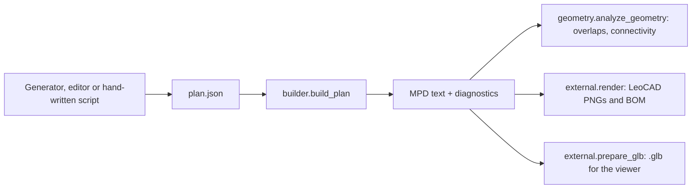

# The Python toolkit and the `ldraw-agent` command line

The toolkit is the Python package `ldraw_tools/` plus its command line, `./ldraw-agent`. It is the part of Open Brick Designer that knows LEGO and LDraw: it reads and writes model files, checks that a model is physically plausible, builds models from generators, snaps parts together, and renders pictures. The web app does not import it directly. It runs the toolkit in a separate, resident process (the "build worker") and the AI agent drives the same functions through the command line. Every command prints a JSON report, which is what makes it usable by both people and an AI.

## How it works

### Core concepts

| Concept | Plain explanation |
|---|---|
| **LDraw** | The open file format for LEGO models. A text file of numbered lines; type 1 lines place a part (position, a 3x3 rotation matrix, colour, part file). Coordinates are in LDraw units (LDU): a stud is 20 LDU apart, a brick body is 24 LDU high, a plate 8 LDU, and **negative Y is up**. The official parts library (`LDRAW_DIR`) supplies thousands of `.dat` part files |
| **MPD** | Multi-Part Document: one LDraw file holding several sub-models (`0 FILE name.ldr` blocks). Everything the app saves and shows is an MPD |
| **Plan (`plan.json`)** | The toolkit's own JSON description of a model, validated by `ldraw_tools/data/plan.schema.json`. A plan has sections (sub-models), steps (build order), and placements with an `id`, a `ref` (part), a `colour`, one position mode (`at`, `on`, `attach` or `snap`) and an optional `role`. The builder turns a plan into an MPD. Plans, not MPDs, are what generators and the editor produce and change |
| **Generator script** | Code that produces a plan from parameters; see [generators-and-grammar.md](generators-and-grammar.md). For hand-made models the agent writes a small Python script that calls `build_plan` |
| **Validation** | `validate`, `build` and `cad-check` check syntax, missing parts, cycles, BFC and units, and (with geometry) overlaps and connectivity |
| **Collision** | `ldraw_tools/collision.py` and `geometry.py` use conservative box tests. A box overlap is evidence, not proof of a collision, because studs legitimately overlap sockets |
| **Snapping / connectors** | Parts carry connector metadata (stud, anti-stud, axle, pin...) from the library and the LDCad shadow library in `data/offLibShadow/`. `snap` moves a part so a chosen pair of connectors mate; `connectors` lists them |
| **Connectivity** | Whether the model is one physical piece. The check builds a graph of parts that touch through matching connectors and counts components. The "optimistic" count treats any plausible contact as connected; the "confirmed" count needs a verified connection |
| **Rendering** | **LeoCAD** (the `leocad` command) draws PNG views from an MPD. The toolkit rewrites the model so embedded `.dat` definitions render, frames a stable camera, and also asks LeoCAD for a parts list (BOM) to compare with Python's. LDView is credited in the README but the toolkit does not call it |
| **glb export** | `glb` converts an MPD to a glTF binary (`.glb`) for the web viewer through the global `mpd2glb.sh` tool, with Draco compression and part descriptions |

### One build, end to end



Start-up is slow: loading the parts library costs 15 to 25 seconds per CLI call. `ldraw_tools/pipeline.py` therefore also runs as a **resident worker** (`python -m ldraw_tools.pipeline --serve`) that loads the library once and answers JSON-line requests: `build`, `editor`, `template`, `generators`, `load`, `ping`. Results are cached by content hash. The web backend talks to it through `app/web/backend/build_worker.py`. See [backend.md](backend.md).

### How the agent instructions relate

`instructions.md` at the repository root is the task prompt for the AI agent: prepare, plan, build reproducibly, check, deliver. It tells the agent to use `./ldraw-agent` for everything and links to the guides in `docs/agent/` (LDraw rules, geometry, validation, vehicles, spaceships, Technic, mechanisms, tool reference in `docs/agent/tooling.md`). The web app injects these into the agent's system prompt (see [ai-agent.md](ai-agent.md)). When you add or rename a CLI command, update `docs/agent/tooling.md` and, if the workflow changes, `instructions.md`, or the agent will not know about it.

## Where the code is

| Path | What it holds |
|---|---|
| `ldraw-agent` | Shell wrapper: runs `.venv/bin/python -m ldraw_tools.cli` (run `./setup.sh` first) |
| `ldraw_tools/cli.py` | Parser, command registry (`COMMANDS`, `ORDER`), dispatch, JSON output, exit codes |
| `ldraw_tools/commands/*.py` | One module per command group; each defines `Command(register, run, needs_parts)` |
| `ldraw_tools/common.py` | Library path resolution, parts loading, `dumps`, `atomic_write` |
| `ldraw_tools/builder.py` | `load_plan()`, `build_plan()`: plan to MPD, schema-checked |
| `ldraw_tools/document.py` | MPD namespaces, physical-part boundaries, dependency-closed extraction |
| `ldraw_tools/validation.py` | Extra checks derived from the LDraw specification PDF |
| `ldraw_tools/geometry.py`, `collision.py`, `fastbounds.py` | Geometry and connection evidence |
| `ldraw_tools/connectivity.py`, `connection_adapter.py`, `fastsnap.py`, `snapindex.py` | Connection discovery and snapping |
| `ldraw_tools/editor.py`, `incremental.py` | Manual plan editing with inverse history; validating by what changed |
| `ldraw_tools/pipeline.py` | The resident worker |
| `ldraw_tools/external.py` | LeoCAD rendering, BOM comparison, glb export |
| `ldraw_tools/generators/`, `grammar/`, `templates/`, `roles.py`, `role_edits.py`, `role_vocab.py` | Deterministic builders, roles, templates ([generators-and-grammar.md](generators-and-grammar.md)) |
| `ldraw_tools/architecture.py`, `details.py`, `vehicles.py`, `vehicle_details.py`, `vehicle_families.py`, `vehicle_review.py`, `spaceships.py`, `technic*.py`, `reference_recipes.py` | Construction vocabularies and reviewed recipes for buildings, vehicles, spaceships and Technic |
| `ldraw_tools/discovery.py`, `reference_catalog.py`, `manuals.py`, `examples.py`, `catalog.py`, `boards.py` | Finding and studying reference parts and models, build manuals, visual boards |
| `ldraw_tools/inventory.py`, `buildable.py`, `sets.py`, `importers.py`, `bricklink.py` | Parts inventories, set catalog, file importers |
| `ldraw_tools/resources.py` | Locates bundled resources |
| `ldraw_tools/data/` | `plan.schema.json`, `structure.schema.json`, colour tables (`rebrickable-colours.json`, `bricklink-colours.json`), `rebrickable-parts.json`, `technic-parts.json`, `rectangular-parts.json`, `design-palettes.json`, `set-catalog.bin`, `templates/` |

## Command reference

Global options go before the command: `--library DIR`, `--shadow PATH` (repeatable), `--no-shadow`. The library comes from `--library`, then `LDRAW_DIR`, then `LDRAWDIR`. Exit status: 0 success, 1 a check failed, 2 bad input or an execution error (the JSON then has `error` and `error_type`). Many commands take `--report FILE` to also save the JSON. `./ldraw-agent --help` is always the authoritative list.

| Command | What it does |
|---|---|
| `doctor` | Show dependencies and source paths |
| `index` | Refresh the local parts index (the library itself is never changed) |
| `search parts\|models\|submodels` | Search real library parts or annotated models |
| `part REF...` | Metadata, local bounds and connectors of real parts (several per call) |
| `colours` | Look up colour codes in the installed `LDConfig.ldr` |
| `catalog` | Search part and colour categories using descriptive symbols |
| `part-board` | Render 1 to 12 candidate parts into an offline visual shortlist |
| `spec` | Search the LDraw specification PDF or fetch a page |
| `sections` | Read original annotated model sections with source line numbers |
| `matrix` | Compute a right-handed rotation matrix in LDraw coordinates |
| `profiles` | List curated ordinary brick and plate dimensions for `on` placement |
| `examples` | Find generated example buildings, vehicles, spaceships, Technic or mechanisms (`--family`, `--details`) |
| `discover index\|search\|show\|recipe\|parts\|prepare\|catalog\|review\|example` | Find, measure and visually review reference parts, models and submodels (Jev semantic or keyword ranking; see [jev-and-search.md](jev-and-search.md)) |
| `generate list\|digest\|show\|colours\|plan` | The deterministic generators: list them, print the prompt digest, show one entry, resolve colour names, produce a checked plan |
| `design palettes\|details` | Role-based palettes and reusable architectural detail plans |
| `build PLAN` | Build a validated MPD from a plan (`--output`, `--detail`, `--contacts`, `--force`) |
| `validate FILE` | Syntax, resolution and (with `--geometry`) overlap checks; `--profile assembly\|syntax`, `--strict` |
| `inspect FILE` | Full geometry and contact evidence |
| `bom FILE` | Physical bill of materials |
| `compare-bom FILE --csv F` | Compare the Python BOM with a LeoCAD-exported one |
| `snap FILE --moving N` | Propose rigid moves that mate connectors |
| `connectors FILE` | List connection candidates |
| `study FILE` | Inventory an OMR assembly hierarchy, BOM and source issues |
| `extract FILE --section S` | Copy a dependency-closed section with namespacing and attribution |
| `cad-check FILE` | Python validation plus a LeoCAD snapshot and BOM import (also `./check-model.sh FILE`) |
| `render FILE` | LeoCAD views (`--views home top front ...`, `--section`) and a BOM CSV |
| `glb FILE --output F` | Export a `.glb` |
| `manual prepare\|review\|export` | Step-by-step build pages of any source submodel, for studying and reuse |
| `mechanism list\|prepare\|review\|export` | The same for mechanisms from source models |
| `spaceship list\|details\|brief\|export` | Spaceship design briefs and reusable constructions |
| `vehicle list\|wheels\|details\|plan\|check` | System-vehicle starting points, wheel packs, fitting recipes, review profiles (`road`, `motorcycle`, `watercraft`, `aircraft`) |
| `technic list\|parts\|plan\|check` | Reviewed Technic structural recipes and joint and brace checks |
| `inventory import\|list\|show\|search\|check\|buildable\|remove` | The person's parts inventories (Rebrickable CSV); check a model against them |
| `sets search\|show\|stats\|buildable` | The offline catalog of real LEGO sets and which ones an inventory can build |
| `editor open\|replace\|apply\|role\|undo\|redo` | Manual editor sessions on a plan, with history. Used by the web app's draft; `role` applies role edits ([generators-and-grammar.md](generators-and-grammar.md)) |

Other scripts at the root: `setup.sh` (unpack models, install pinned dependencies with `uv`, run `doctor` and `index`), `check-model.sh`, `prepare-glb.sh` (glb for a local file, a reference model or a part).

## Data and reference models

| Path | What it is |
|---|---|
| `models-packed/` | The reference models, 1,821 annotated MPDs from LEGO sets, stored compressed in 130 `.tar.xz` shards plus `manifest.json`. A model lives in the shard of its set number (10270-1 is in `s10200`). Packing is deterministic so git stores nothing when content is unchanged |
| `data/models-annotated/` | Where the models are unpacked to. Gitignored. Everything that reads reference models reads this folder |
| `tools/models_pack.py` | `pack`, `unpack`, `verify` (`--packed-only` for a fresh clone), `add FILE...`, `list [PATTERN]`. Standard library only |
| `data/ldraw-info.db` | SQLite database of part, model and submodel descriptions (with full-text search tables), categories, keywords, bounding boxes, colours and BrickLink and Rebrickable mappings. It feeds `search`, `discover` and the Jev ranking |
| `data/categories/` | Generated part and colour categories with descriptive symbols such as `@arches.Arch1X6X2...` (these can be used as part references in a plan) |
| `data/offLibShadow/` | The LDCad shadow library: connector metadata for snapping |
| `ldraw_tools/data/set-catalog.bin` | Offline catalog of real sets (parts lists only); see [sets.md](sets.md) |
| `ontology/*.ttl` | RDF sources of truth for roles, the grammar's components, sets, vehicles and templates; see [ontology.md](ontology.md) |

## Changing it

- **Add a CLI command.** Create or extend a module in `ldraw_tools/commands/` with `add_x(commands)` (argparse), `run_x(args, library, parts)` returning `(report_dict, exit_status)`, and a `COMMANDS` entry `Command(add_x, run_x, needs_parts=...)`. Import the module in `cli.py`, add the name to `ORDER` (an assertion fails if `ORDER` and `COMMANDS` differ) and document it in `docs/agent/tooling.md`. Set `needs_parts=False` when the command does not need the library, so it starts instantly.
- **Heavy imports** go inside `run_x`, not at module top, so `--help` and light commands stay fast.
- **Change the plan format** in `data/plan.schema.json` and `builder.py` together, and check the editor (`editor.py`) and the worker (`pipeline.py`) still accept saved plans. Generators, the editor and saved builds all depend on it.
- **Change anything in `generators/`, `grammar/` or `templates/`**: the web app's registry cache is keyed on those files, so it refreshes by itself.
- **Add or replace a reference model**: `python tools/models_pack.py add FILE.mpd`, then commit the touched shard and `manifest.json`.
- Never edit `data/models-annotated/` by hand; it is regenerated from `models-packed/`.

## Testing it

The toolkit tests are in `tests/` at the repository root (about 45 files). Most need the LDraw parts library (`LDRAW_DIR`); `tests/conftest.py` unpacks the reference models on first use and builds a tiny fake library for tests that do not need the real one. Rendering tests need LeoCAD, which the Docker image has.

```sh
./setup.sh                      # once: unpacks models, installs pinned dependencies
uv run pytest -q                # everything
uv run pytest -q tests/test_validation.py tests/test_workflow.py   # a subset
```

| Area | Test files |
|---|---|
| Format, build, validation | `test_validation.py`, `test_workflow.py`, `test_architecture.py`, `test_complex_models.py` |
| Geometry, snapping | `test_connectivity.py`, `test_shapes.py`, `test_editor.py`, `test_editor_delta.py`, `test_editor_performance.py` |
| Generators, grammar, roles, templates | see [generators-and-grammar.md](generators-and-grammar.md) |
| Vehicles, spaceships, Technic | `test_vehicles.py`, `test_spaceships.py`, `test_technic.py`, `test_technic_atlas.py`, `test_vehicle_ontology.py` |
| Discovery, manuals, examples | `test_discovery.py`, `test_manuals.py`, `test_design.py` |
| Inventory, sets, collection | `test_inventory.py`, `test_buildable.py`, `test_sets.py`, `test_collection_toolkit.py`, `test_bricklink_import.py`, `test_rebrickable_maps.py` |
| Worker | `test_pipeline.py` |
| Data packing | `test_models_pack.py` |
| Ontology (no library needed) | `test_ontology_export.py`, `test_role_ontology.py`, `test_component_ontology.py`, `test_shapes.py`, `test_vehicle_ontology.py`, `test_sets_ontology.py` |

CI runs the ontology subset with `pytest -q --noconftest`, and the full suite inside the built image. See [testing-and-ci.md](testing-and-ci.md).

## Related

- [generators-and-grammar.md](generators-and-grammar.md): the deterministic builders in `ldraw_tools/`
- [request-lifecycle.md](request-lifecycle.md): how a request reaches them
- [backend.md](backend.md): the build worker and the toolkit environment
- [ai-agent.md](ai-agent.md): how the agent uses the command line
- [jev-and-search.md](jev-and-search.md), [sets.md](sets.md), [ontology.md](ontology.md), [testing-and-ci.md](testing-and-ci.md)
- Agent guides: `docs/agent/tooling.md`, `docs/agent/validation.md`, `docs/agent/ldraw-reference.md`
