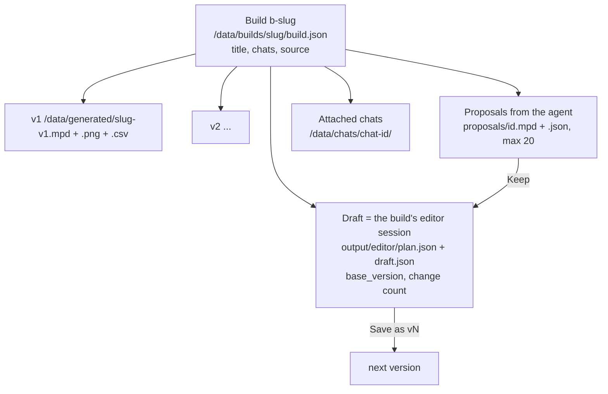
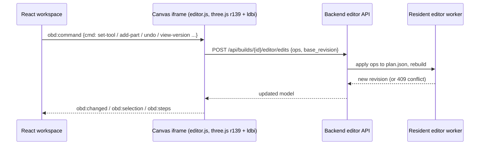

# Builds, the workspace and the editor

Paths are relative to `app/web/backend/` (backend) and `app/web/frontend/src/` (frontend). The owner decisions for this part are recorded in `docs/plans/build-workspace/CONTRACT.md:3-7`.

## The build model

### Owner decisions

- **One draft per build.** Edits autosave into it, and leaving the page keeps it.
- **"Save as vN" makes an immutable version.** Versions are plain files. The version list is rebuilt by scanning `/data/generated` for `<slug>-vN.*` (`builds.group_versions`).
- **Regenerate replaces manual edits.** There is a warning, and Undo brings them back.
- **AI changes arrive as a proposal**: Keep, Preview or Discard.
- **Phones get View and Player only**, with no editing.

### Build `source`

`source` records how the build was made: `generator` (with id and params), `ai`, `import`, `editor` or `empty` (`builds.py:30`). The text edit path depends on it: only a `generator` source can be edited by text. See [request-lifecycle.md](request-lifecycle.md).

### Legacy models

A model in `/data/generated` without a `build.json` is still listed, as a "legacy build". Its `build.json` is written the first time something acts on it (`builds.ensure`).

## Pages and journeys

| Route | Page | Notes |
|---|---|---|
| `/` | Home | A menu of four tiles (New build, My Builds, My Parts, Settings), each with one live line: build count and the latest build, pieces and colour families to review |
| `/new` | New build | No screen: creates an empty build and opens it in the workspace |
| `/build/:id` | **Workspace** (`components/workspace/Workspace`) | Fills the window under the app bar, with the build's own bar (build name, status, downloads, undo/redo, save) |
| `/build/:id/edit`, `/chat/:id/edit` | Legacy editor page (`EditorPage.tsx`) | Still used by My Builds → All model files → Edit |
| `/builds` | My Builds (`pages/Builds.tsx`) | Every build as a card, newest first, with a name filter, a New build card and "Import a model file"; "Older chats" (chats without a build) and "All model files" (every file in `/data/generated`, with zip download, edit and delete) fold away below. `/models` redirects here |
| `/chat/:id` | Chat | The agent conversation |
| `/parts` | My Parts | See [parts-and-collection.md](parts-and-collection.md) |
| `/settings` | Settings | See [settings-and-providers.md](settings-and-providers.md) |

Every page, the workspace included, sits under the app bar (`components/AppBar.tsx`): the logo and name link Home, and My Builds, My Parts and Settings sit on the right (a menu button below 820 px). There is no sidebar. The standalone viewer, player and editor pages carry the same logo as a link Home, hidden when they are embedded (`?embed=1` or inside an iframe).

Starting a build:

- **New build** (Home, My Builds, `/new`) creates an empty build and opens the workspace on it. Its empty canvas offers "Describe it" (the workspace chat: fast path first, the AI agent if needed) and "Pick a part". A generator type is reached by describing it.
- **Import a model file** (My Builds) makes an `.mpd` or `.ldr` file v1 of a new build (`POST /api/builds/{id}/import`) and opens it.

## The workspace

**Layout** (`docs/plans/build-workspace/README.md`):
- a top bar;
- a tool rail: select, move, rotate, add, paint, delete;
- the **3D canvas**;
- right-hand tabs: **Chat / Parts / Piece / Settings**. The panel is resizable (drag, arrow keys on the focused handle, double-click resets, collapsible), as is the version strip; sizes are kept in `localStorage` (`obd.ws.layout`). Phones keep the bottom sheet;
- a bottom version strip and a live "N of M owned" parts check.

**One chat per build.** Every message in the Chat tab first goes to `POST /api/builds/{id}/draft/describe` (the free fast path, with the last user message as `previous_text`). A generator or edit answer is applied to the draft and shown as a compact reply with Undo; a clarify answer is one question with quick-reply chips; a needs_ai answer is a card with the estimate and "Ask the AI" / "Cancel" (nothing paid runs before Ask the AI). The server saves every turn (user text, then an assistant message with `_fast_path` metadata: route, changes, notes, cost 0, timing) in the build's attached chat, creating it on first use, so the agent later reads them as ordinary history. The needs_ai turn's text carries the understood spec. `/chat/:id` of a build chat redirects to `/build/:id?tab=chat`; chats without a build keep the chat page.

**Chat mode: who answers.** The server decides (`chat_routing.state`, returned as `chat_mode: "ai" | "quick"` and `agent_chat` by `GET /workspace`). The mode is `ai` while the agent is engaged: a turn of its own is the latest real turn (fast-path turns do not count, notes are skipped) and either it asks the person something (a trailing "?", "should I", "would you like"...) or it has not delivered a proposal since the person last wrote; a user message with no answer yet (a turn in flight) also means `ai`. Otherwise `quick`. In `ai` mode messages go to the agent (`POST /api/chats/{id}/messages`) whatever words they contain; `draft/describe` itself answers `route: "agent"` and applies and saves nothing unless the body says `quick: true` (the per-message "Quick change instead"). The composer shows "Talking to the AI · costs apply" with "Quick change instead", or "Quick changes · free" with "Ask the AI instead"; the toggle affects one message. The needs_ai card's "Ask the AI" (and the "Ask the AI" chip, present when an agent conversation exists) puts the chat in `ai` mode. In `quick` mode a reply or follow-up (yes, ok, go on, next, step N, what about..., anything ending in "?", or "the <thing the agent mentioned>") that is not itself a whole edit command gets a clarify about this build, never a colour or size guess. An understood edit is applied only when the whole message is one short edit command (`chat_routing.whole_edit_command`) and the reading is a confident model one; otherwise it is a clarify. Clarify text is about the build ("What would you like to change on the House? (roof colour, size, ...)") with chips from the generator's own colour parameters. A quick turn is saved with a bracketed note in its text so the agent knows the app, not it, changed the draft.

**State** lives in `components/workspace/useWorkspace.ts` and the API calls in `wsApi.ts`.

The canvas is a **separate static page in an iframe**: `/viewer/editor.html?space=builds&id=<slug>&embed=1&mode=edit|view|player`. It talks to React with `postMessage`:

- The message types are defined in `CONTRACT.md:39-57`.
- The **player mode** uses `ldraw-player`, a Rust-to-WebAssembly step player. It is loaded lazily from `/viewer/player-vendor` (`app/web/viewer/editor-player.js`).
- GLB export for viewing uses `mpd2glb` (`/api/glb`).

## Editor operations

- **Ops the person can do**: `add, move, rotate, recolour, delete, snap` (`ldraw_tools/editor.py:25`). At most 100 per request.
- **Internal ops**: `set_entry, insert, replace_plan`. `replace_plan` is what Regenerate, text edits and Keep-proposal use, so each of those is **one** undo step.
- **The plan JSON is the source of truth.** The MPD is rebuilt from it, and nothing is written if the rebuild fails (`routers/editor.py:1-17`).
- **Requests are serialised.** A stale `base_revision` returns 409, and the client re-reads.
- **Speed.** A resident editor worker was added, separate from the build worker so edits never queue behind a build. On a 1,124-part cottage:
  - move went from about 3.5 s to 105–200 ms;
  - undo went from about 4 s to 25–32 ms;
  - reopening went from 3.2 s to 28 ms

  (`docs/plans/build-workspace/editor-performance.md`).

## Versions, draft and API

| Action | Endpoint (`routers/workspace_api.py`) |
|---|---|
| Load everything | `GET /api/builds/{id}/workspace`: the build, versions with per-version parts check, draft, generator, proposals, chat |
| Start from a version | `POST .../draft/open`. Returns 409 if the draft has changes, unless forced. |
| Save as vN | `POST .../draft/save`. Returns 409 when nothing changed. |
| Discard draft | `POST .../draft/discard` |
| Regenerate | `POST .../draft/regenerate {generator, params}` |
| Text edit | `POST .../draft/describe {text}` |
| Parts check | `GET .../draft/parts-check` |
| Proposals | `GET .../proposals`, `POST .../proposals/{pid}/accept` or `/discard` |

- **What saving does.** A version goes through the same publish step as the agent's: validate, render a snapshot and write a BOM (`routers/editor.py` `editor_publish`). The file name is forced to `<slug>-vN.mpd`.
- **"Changes"** is the net undo depth since the draft's base, not the raw revision count (CONTRACT.md "Backend notes").

## The parts palette (Parts tab)

- **Full library**: `GET /api/builds/{id}/editor/palette?query=` runs `./ldraw-agent search parts`. It is a **substring match**: every word must appear in the code or description. No FTS, no Jev.
- **Your parts**: the same endpoint with `inventory_only`, which searches all your parts lists summed.
- **Steering**: when you have parts lists, the build uses mode `prefer`, which warns about parts you lack and never refuses them. Available = owned minus already used, computed on the fly.
- Details are in [jev-and-search.md](jev-and-search.md) and [parts-and-collection.md](parts-and-collection.md).
