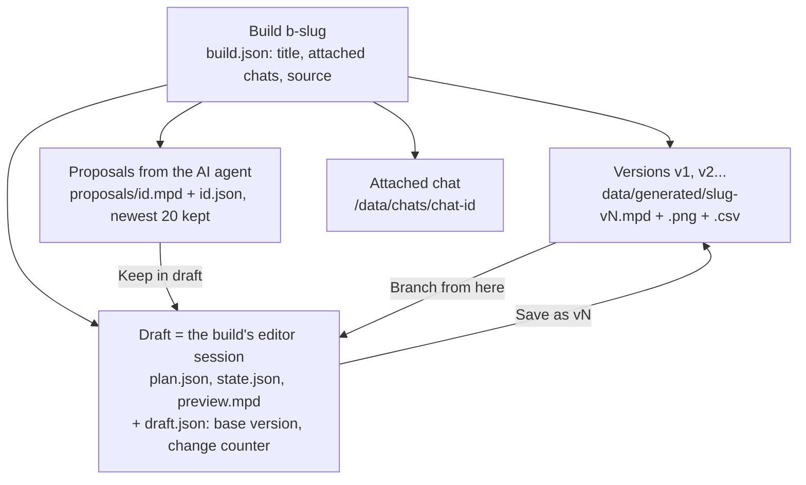

# Builds, the workspace and the editor

A **build** is one model project with a list of saved versions (v1, v2, ...). The **workspace** is the page where the person works on a build: a 3D canvas with tools, a side panel with chat, parts and piece details, and a bar with the versions. The **editor** is the part that changes the model: every move, rotation, colour change, add and delete is a small operation applied to a JSON "plan", and the model file is rebuilt from the plan. The point of all this is that the person can edit freely, undo anything, and decide when a state becomes a saved version.

Owner decisions for this part are recorded in `docs/plans/done/build-workspace/CONTRACT.md`. Where code and that file differ, this page follows the code.

## How it works

### Builds, versions, draft, proposals



- **Build.** Stored in `data/builds/<slug>/build.json` (id `b-<slug>`, title, attached chat ids, `source`). The `source.kind` records how it started: `generator` (with the generator id and parameters), `ai`, `import`, `editor` or `empty`. A model file in `data/generated` with no build folder is still listed as a "legacy build"; its `build.json` is written the first time anything acts on it (`builds.ensure()`).
- **Version.** An immutable model file `data/generated/<slug>-vN.mpd` with a preview picture and a parts list (BOM). There is no version table: the list is rebuilt by scanning the folder for `<slug>-vN.*` (`builds.group_versions()`, cached until the folder changes). MPD is LDraw's "multi-part document", a text file holding a model and its sub-models.
- **Draft.** The build's working copy. It is the build's editor session, so there is **one draft per build**, and every edit is written to the server at once (there is no separate autosave step). `draft.json` beside it remembers which version the draft started from and how far it has moved. Leaving the page keeps the draft. The number of **changes** shown in the UI is the net distance in undo steps from the starting point, so an edit followed by its undo counts as zero (`workspace.draft_summary()`, `workspace.touch_draft()`).
- **Save as vN.** Turns the draft into the next version. It goes through the same publish step the AI agent uses: validate, render a picture, write the BOM (`routers/editor.py`, `editor_publish()`). The file name is forced to `<slug>-vN.mpd`. It is refused when there are no changes or no bricks.
- **Proposal.** When an AI chat attached to a build publishes a model, it is not a new version. It waits as a proposal (`tools._propose()` calls `workspace.create_proposal()`), and the person previews it, keeps it or discards it. Keeping it replaces the draft's plan as one undoable step.
- **Regenerate** (generator builds only) replaces the draft with freshly generated output as one undoable step; manual edits are replaced and Undo brings them back.
- **With PostgreSQL** the draft record, proposal records and build records are kept in the database instead of JSON files (`pg_builds.py`); the plan and model files stay on disk. See [database.md](database.md).

### Pages and entry points

A build opens at `/build/:id` (`BuildPage.tsx`, which renders `components/workspace/Workspace.tsx`). `/new` creates an empty build and opens it. My Builds can import an `.mpd` or `.ldr` file as v1 of a new build (`POST /api/builds/{id}/import`). The page list and the frontend structure are in [frontend.md](frontend.md).

### The workspace layout

```
+----------------------------------------------------------+
| App bar (logo, My Builds, My Parts, My Sets, Costs, ...) |
+----------------------------------------------------------+
| TopBar: name, kind tag, status, download, undo/redo, save|
+------+-------------------------------------+-------------+
| Tool |                                     | Tabs: Chat  |
| Rail |        CanvasPane (3D iframe)       | Parts Piece |
|      |                                     | Settings    |
+------+-------------------------------------+ Template    |
| BottomBar: version strip, parts check      +-------------+
+----------------------------------------------------------+
```

All files are in `app/web/frontend/src/components/workspace/`.

| Component | What it shows and does |
|---|---|
| `Workspace.tsx` | The frame. Builds the tab list: Chat always; Parts and Piece; Settings only for a generator build; Template only while "Make this a template" is open. A dot on Chat means a proposal waits; a dot on Piece means something is selected. Also the toast and the confirm dialog. |
| `TopBar.tsx` | Build name (click to rename), a tag (Generator, Template, AI build, Imported), the status line, a download menu (model file, `.glb`, BOM), a "more" menu (Make this a template, Delete build), Undo, Redo, Discard draft and **Save as vN**. The status reads "v3 · draft, 4 changes · autosaved", "Viewing v2 · read-only", "Previewing an AI proposal", "New build · empty draft" or "v3 · saved". |
| `ToolRail.tsx` | Left rail: the six tools (select V, move M, rotate R, add B, paint P, delete Del) and the Edit / View / Player mode switch. Tools are disabled outside Edit mode or while a version is being viewed. |
| `CanvasPane.tsx` | The canvas iframe (`/viewer/editor.html?space=builds&id=<slug>&embed=1&mode=edit&theme=...`) and its overlays: a read-only banner with "Branch from here" or "Keep in draft" and "Back to draft", a reset-view button, the part count, "Step N of M" in Player mode, a chip describing the selection, and the empty-build card with "Describe it" and "Pick a part". |
| `ChatPanel.tsx` | The one chat of the build. See the editor chat section below. |
| `PartsPanel.tsx` | Search box, "Colour for new bricks" picker, a live "Missing from your collection" list, "Your parts" (owned, with what is left after this draft), and "Full library" (every LDraw part; not-owned parts are marked and still allowed). Clicking a part arms the add tool. |
| `PiecePanel.tsx` | The selected piece(s): name, colour swatches that recolour the selection, position and rotation (read-only numbers), Delete. |
| `SettingsPanel.tsx` | For generator builds: the generator's parameter form (`GeneratorForm.tsx`, or `BuildingEditor.tsx` for the building grammar, a component tree with preset chips) and a Regenerate button. Changing a setting does nothing until Regenerate is pressed. |
| `TemplatePanel.tsx` | "Make this a template": a quality check, a role-coloured preview with role corrections, a background derivation job with progress, and a card of the adjustable settings it found. Saving stores the template for this person. Backed by `routers/templates_api.py`. |
| `BottomBar.tsx` | The version strip (each version with origin badge, part count, parts-check mark and geometry-check result; click to view read-only; a "Draft on vN" entry while there are changes) and the **parts check**: "N of M owned", with a pop-up listing the missing parts. Resizable and collapsible. |
| `Splitter.tsx`, `useLayout.ts` | Drag, arrow keys, double-click reset and collapse for the side panel and the version strip. Sizes are kept in `localStorage` key `obd.ws.layout`. |

State and actions live in `src/workspace/useWorkspace.ts`; the components only render them. Its main pieces: `reloadAll()` refetches the build, workspace and parts check after a backend change; `onCanvasEvent()` handles the canvas messages ([frontend.md](frontend.md) lists the protocol); `viewVersion()`, `branch()`, `save()`, `discard()`, `regenerate()`, `keepProposal()`, `dropProposal()`, `previewProposal()` and `describe()` are the user actions. A selection on the canvas switches the side panel to Piece and back when it clears, except for the chat's own "Show them".

## Editing on the canvas

The canvas page (`app/web/viewer/editor.js`) shows the model, one group per part, and sends **edit batches** to the backend. Operations the person can cause (`ldraw_tools/editor.py`, `PUBLIC_OPS`): `add`, `move`, `rotate`, `recolour`, `delete`, `snap`. A request holds at most 100 operations (`MAX_EDITS`). Internal operations that make one undo step out of a large change: `set_entry`, `insert`, `replace_plan` (used by Regenerate, text edits and Keep proposal).

**Mouse.**

- Click a part to select it (clicking again cycles through parts under the pointer). Shift-click adds to the selection. Ctrl-drag (or Cmd-drag) on empty space draws a rectangle that selects what is inside it.
- **Move tool.** Drag a coloured arrow handle to move along an axis. Movement snaps to the stud grid (20 LDU, one stud) vertically 8 LDU (one plate); hold Alt for free movement. Press on an already selected part and drag to carry the selection over the surface under the pointer: it follows the grid, lands on the ground or on top of whatever is below, and shows a green outline when the spot is clear and red when it overlaps another part. Esc cancels the drag.
- **Rotate tool.** Drag a ring handle. Steps are 15 degrees; Alt for free rotation.
- **Add tool.** Pick a part in the Parts tab, move the pointer over the model or the ground to see a ghost outline and a chip saying what it will snap to, click to place. The click sends the add together with a **snap** request in one batch (so one undo removes the part). If nothing can be snapped to, the part stays where it was dropped.
- **Paint tool.** Click a part to give it the chosen colour. **Delete tool.** Click a part to remove it.

**Snapping.** LDraw parts have connection points (studs, tubes, pins). A snap finds the nearest valid connection to the drop point and moves the part onto it, avoiding collisions. The fast version lives in `ldraw_tools/fastsnap.py`; it examines candidates nearest first and gives up after 0.25 seconds (`BUDGET_SECONDS`, environment variable `LDRAW_NOVA_SNAP_BUDGET`), in which case the canvas adds the part unsnapped. Anything the fast version does not cover falls back to the full `snap_report` in `ldraw_tools/connectivity.py`.

**Grid.** `H` switches between one-stud (20 LDU) and half-stud (10 LDU) steps for arrows, dragging and handles.

### Keyboard shortcuts

These work with the canvas focused (it takes focus when clicked) and are ignored while typing in a text field. Edit-only shortcuts do nothing in View or Player mode. The list is also in the canvas help panel (`?`, in `editor.html`).

| Keys | Action | Mode |
|---|---|---|
| `V` `M` `R` `B` `P` | Select, move, rotate, add, paint tool | Edit |
| `Delete` or `Backspace` | Delete the selection | Edit |
| `Ctrl+Z` | Undo | Edit |
| `Ctrl+Shift+Z` or `Ctrl+Y` | Redo | Edit |
| `Ctrl+S` | Save as the next version (sent to the workspace as `obd:shortcut`; also caught by the workspace page itself) | any |
| `Ctrl+A` | Select all | Edit |
| `Ctrl+C`, `Ctrl+V`, `Ctrl+D` | Copy, paste, duplicate. Each paste lands one stud further to the right of the camera. Sub-models, repeated runs and parts tilted about several axes are skipped and counted. | Edit |
| Arrow keys | Move the selection one stud (or half a stud) on the ground, relative to the camera view | Edit |
| `Page Up` / `Page Down` | Move the selection up or down one plate (8 LDU) | Edit |
| `Shift+Left` / `Shift+Right`, `[` / `]` | Turn the selection a quarter (90 degrees) about the vertical axis | Edit |
| `G` | Widen the selection to the whole sub-model the part sits in | Edit |
| `H` | Stud or half-stud grid | Edit |
| `F` | Frame the selection (or the whole model) | Edit, View |
| `Home` | Reset the view | Edit, View |
| `Esc` | Cancel a drag, or leave the add, paint or delete tool, or clear the selection; closes the help panel | Edit |
| `?` | Show or hide the shortcut list | any |
| `Space` | Play or pause | Player |
| `Left` / `Right` | Previous or next step | Player |
| `Home` / `End` | First or last step | Player |

The undo and redo buttons in the top bar and the Session changes list in the chat do the same as `Ctrl+Z` and `Ctrl+Shift+Z`.

### Undo, redo and the session changes list

History lives on the server in `state.json` beside the plan (an undo stack and a redo stack), so it survives a page reload. `undo` and `redo` are endpoints (`POST .../editor/undo`, `.../redo`). The number of steps is shown on the buttons. While a version or proposal is being viewed, undo and redo are disabled.

The chat tab has a collapsible **Session changes** list: "Undo (n)" and "Redo (n)" buttons for the draft, the last five quick changes (what each changed), and "Go back to vN" buttons for saved versions. "Go back to vN" is a branch: it replaces the draft with a fresh draft on that version and asks first when the draft has unsaved changes. Undo works on the draft as a whole, step by step; there is no per-entry undo yet.

## The editor chat

The Chat tab is the only place to talk to the app about the build. Everything is saved in one chat attached to the build (created on first use), so the AI agent later reads quick changes as ordinary history. The design notes are in `docs/ux/editor-chat-journeys.md`; this section lists what is actually built.

**One timeline with type badges.** Each message carries a small badge (`MessageList.tsx`): **You**, **Free · instant** (answered by the rules, cost 0) or **AI · costs apply**.

**Who answers: Quick or AI.** The server decides the mode from the saved chat (`chat_routing.state()`, returned by `GET /workspace` as `chat_mode` and `agent_chat`). The mode is `ai` while the agent is engaged: its turn is the latest real turn and it either asked the person something or has not yet delivered a proposal since the person last wrote, or a turn is in flight. Otherwise it is `quick`. The composer shows a **Quick / AI switch** and one cost line beside it ("Free · instant", "Costs apply · it asks before it spends", or a live hint while typing such as "Free, about 1 s" or "Needs the AI, about €1-2"). The switch affects one message only.

**Quick path.** In quick mode a message goes to `POST /api/builds/{id}/draft/describe`, the free "fast path" (rules plus at most one cheap reading call; see [request-lifecycle.md](request-lifecycle.md)). The answer has a route:

| Route | What the chat shows | What happens to the draft |
|---|---|---|
| `generator` / `edit` | "Built a House from the generator" or "roof colour: red -> blue", with "free", the time, and an **Undo** button on the latest answer, plus any notes | Applied at once as one undo step. A generator answer regenerates only while the draft still matches the generator; otherwise colour and removal words change the model in place, by role or by the canvas selection. |
| `clarify` | One question, with quick-reply chips in the Needs you tray; after the person answers, the card keeps "You chose: Red" | Nothing changes. |
| `needs_ai` | "This needs the AI: about €1-2, about 5-10 min" with the reason | Nothing changes, nothing is spent. |

An understood edit is applied only when the whole message is one short edit command (`chat_routing.whole_edit_command()`). A reply or follow-up ("yes", "next", "what about...", anything ending in "?") is answered with a clarify about this build instead of a guess. A quick turn is saved with a bracketed note, so the agent knows the app, not it, changed the draft.

**Needs you tray.** Whatever waits for the person sits in one tray above the composer: the clarify chips (with "Show them", which selects the parts the question is about on the canvas, and "Just pick for me", which answers with the first choice), or "Ask the AI" and "Cancel" for a `needs_ai` answer, and the AI proposal card ("Keep in draft", "Preview", "Discard", with the +added / removed / moved counts and the cost). "Ask the AI" puts the chat in AI mode and sends the understood request to the agent. Nothing paid runs before it.

**AI path.** In AI mode (or with the switch on AI, or with attachments) the message goes to the agent: `POST /api/chats/{id}/messages`, with the model picker, effort and budget controls of the normal chat composer. Progress streams in live (`useChatStream`). The agent can look at and change the plan with the `editor_state`, `editor_edit` and `editor_open` tools. When it publishes, the result arrives as a proposal.

**Empty chat.** Shows three example prompts as buttons ("Build a small house", "Make the roof blue", "Add two more windows") and a line explaining that simple changes are free and bigger ones show their cost first.

**Not built yet** (listed in the journeys document): per-change undo of older quick changes, a context chip in the composer for the selected part, a before-you-send estimate for attachments, a proposal diff grouped by role, and a visible on/off state for "Show them".

## Where the code is

| Path | What it is |
|---|---|
| `app/web/backend/builds.py` | Build records, version scanning, listing, `record_version()`, `ensure()`. |
| `app/web/backend/model_versions.py` | `diff()`: what changed between two versions, from their BOMs. |
| `app/web/backend/workspace.py` | Draft record and change counting, parts usage and the parts check, proposals. |
| `app/web/backend/routers/builds_api.py` | `/api/builds`: list, create, rename, delete, generate, import, open editor, attached chat; `/api/generators`. |
| `app/web/backend/routers/workspace_api.py` | `/workspace`, `/draft/*`, `/proposals/*`, `/chat/note`; `draft_describe()` is the quick path. |
| `app/web/backend/routers/editor.py` | The editor API: open, edits, undo, redo, publish; the per-plan lock; `apply_edits()`, `replace_plan()`, `editor_publish()`. |
| `app/web/backend/routers/editor_palette.py` | Parts palette search and the add check. |
| `app/web/backend/chat_routing.py` | Quick or AI, follow-up detection, build-specific clarify text. |
| `app/web/backend/editor_tools.py` | The agent's `editor_open`, `editor_state`, `editor_edit` tools and the note about edits made since it last looked. |
| `app/web/backend/build_worker.py` | `get_editor_worker()`: a resident toolkit process just for edits, so edits never queue behind a long build. |
| `app/web/backend/tools.py` | `t_publish_model()` and `_propose()` (publish becomes a version or a proposal). |
| `ldraw_tools/editor.py`, `ldraw_tools/commands/editor.py` | The operations, history, rebuild, and `plan_delta()` for small answers. |
| `ldraw_tools/fastsnap.py`, `ldraw_tools/connectivity.py` | Snapping. |
| `app/web/frontend/src/components/workspace/`, `src/workspace/` | The workspace UI and its state. |
| `app/web/viewer/editor.js`, `editor-core.js`, `editor-scene.js` | The canvas. |

## Reference

### API

All routes are under `/api/builds/{id}` where `id` is the build slug. The editor routes take a `space` (`builds` for a build, `chats` for a plain chat): `/api/{space}/{id}/editor...`.

| Endpoint | Purpose |
|---|---|
| `GET /workspace` | Everything the page needs: build summary, versions with parts check and geometry check, draft, generator source, proposals, attached chat id, `chat_mode`, `agent_chat`. |
| `POST /draft/open {version?, force?}` | Resume the draft, or start one from a version. Returns 409 with the change count if that would drop unsaved changes, unless `force`. |
| `POST /draft/save` | Save as the next version. 409 when there is nothing to save. |
| `POST /draft/discard` | Throw away the draft and restart it from its base version. |
| `POST /draft/regenerate {generator, params}` | New generated base into the draft, one undo step. |
| `POST /draft/describe {text, previous_text?, quick?, selection?, persist?}` | The quick path described above. Answers `route: "agent"` and applies nothing when the AI is engaged, unless `quick: true`. |
| `GET /draft/parts-check` | The draft against all parts lists, minus what built sets and reservations hold. |
| `POST /chat/note {text}` | A UI-only line in the chat (for example "Cancelled. Nothing was spent."), not sent to the AI. |
| `GET /proposals`, `POST /proposals/{pid}/accept`, `POST /proposals/{pid}/discard`, `GET /proposals/{pid}.mpd` | Proposal list, keep, discard, and the file for read-only preview. |
| `GET /api/{space}/{id}/editor` | The editor view: plan, revision, undo and redo depth, preview MPD, parts table. Starts the editor worker and warms the part geometry. |
| `POST /api/{space}/{id}/editor/edits {edits, base_revision, delta}` | Apply a batch. A stale `base_revision` is a 409 with the current revision. |
| `POST .../editor/undo`, `.../redo` | Step back or forward. |
| `POST .../editor/publish` | Save the preview as a version. |
| `GET .../editor/palette?query=&colour=&inventory_only=` | Palette search: substring match on code and description, every word must appear. |
| `POST .../editor/palette/check {part, colour, quantity}` | Whether adding is allowed under the chat's parts steering. |

### How an edit travels

1. The canvas shows the change immediately (optimistic), then sends `POST .../editor/edits` with `delta: true`.
2. The backend takes a per-plan lock, writes the batch, and sends it to the resident editor worker (`LDRAW_NOVA_EDITOR_WORKER=0` falls back to one CLI process per call).
3. The worker applies the operations to `plan.json`, rebuilds `preview.mpd`, and commits plan, state and preview together. If the rebuild fails, nothing is written.
4. With `delta`, the answer lists only the changed plan entries (`splices`), the new revision, the depths and the parts table; the canvas patches itself (`EditorCore.applyDelta`). Without it, or when the plan's shape changed, the whole view is sent.
5. The canvas posts `obd:changed`; the workspace refreshes the draft counter after 250 ms and the parts check after 800 ms.

Adds are queued in order and slide to their snapped place when the server answers; a refused add is removed with the reason (`obd:error`). If the plan changed elsewhere (the AI, another tab), the 409 makes the canvas re-read.

The plan JSON is the source of truth; the MPD is rebuilt from it. On a 1,124-part model the resident worker took a move from about 3.5 s to 105-200 ms and undo from about 4 s to 25-32 ms (`docs/plans/done/build-workspace/editor-performance.md`).

### Parts steering

When the person has parts lists, the build uses mode `prefer`: parts they lack are marked and counted as missing in the parts check, but never refused. "Available" is owned minus what the draft uses and what built sets and reservations hold (`workspace.available_parts()`). Details: [parts-and-collection.md](parts-and-collection.md).

## Changing it

- **Add an editor operation.** Define it in `ldraw_tools/editor.py` (validation, the inverse for history, and `PUBLIC_OPS`), cover it in `plan_delta()` in `ldraw_tools/commands/editor.py` if it changes entries in a new way, update the allowed list in the `editor_edit` schema in `app/web/backend/editor_tools.py`, and send it from `editor-core.js`.
- **Add a tool or shortcut.** Add the key to `TOOL_KEYS` or the keyboard handler in `app/web/viewer/editor.js`, a row in the help panel in `editor.html`, the button in `ToolRail.tsx`, and the row in the table above. Keep `Tool` in `src/workspace/types.ts` in step.
- **Add a workspace panel.** Add a tab in `Workspace.tsx` and a `Tab` value in `useWorkspace.ts`; put the logic in the hook, not the component.
- **Add a chat route or reply type.** Return it from `fast_path.describe()` (see [request-lifecycle.md](request-lifecycle.md)), keep the fields in `_persist_turn()`'s `keep` list, extend `FastPathTurn` in `src/api.ts`, and render it in `ChatPanel.tsx` (`fast()` for the transcript, `tray` for what waits).
- **Change when the AI is "engaged".** Only `chat_routing.state()` decides it; the frontend just follows `chat_mode`. Update `tests/test_chat_routing.py` with the change.
- **Change how versions are numbered or found.** `builds.group_versions()` and `builds.next_version()`; everything else reads from them.
- Keep the draft rules: one draft per build, edits are never lost silently (confirm before anything replaces unsaved changes, as `draft/open` and Regenerate do), and every large change is one undo step.

## Testing it

| What | Command |
|---|---|
| Builds, drafts, proposals, workspace API | `cd app/web/backend && pytest -q tests/test_builds.py tests/test_workspace.py tests/test_editor_builds.py` |
| Editor API, delta answers, palette, agent tools | `pytest -q tests/test_editor_api.py tests/test_editor_delta.py tests/test_editor_palette.py tests/test_editor_agent.py` (same folder) |
| Quick or AI routing and fast path | `pytest -q tests/test_chat_routing.py tests/test_fast_path.py` |
| Editor operations and snapping (toolkit) | `uv run pytest tests/test_editor.py tests/test_editor_delta.py tests/test_editor_performance.py` from the repo root |
| Canvas maths | `cd app/web/viewer-deps && npm ci && npm run test:core` (`test/editor-core.test.mjs`, `test/editor-add.test.mjs`) |
| Canvas in a browser | `npm run test:editor`, `npm run test:canvas` in `app/web/viewer-deps` |
| Whole workspace journey | `app/web/viewer-deps/test/workspace.e2e.mjs` against a throwaway app; setup commands are in the file header |

Backend tests need LeoCAD and the LDraw library, so they run inside the container (`pip install -r requirements-dev.txt` first); see [operations.md](operations.md).

## Related

- [frontend.md](frontend.md): app structure, the `obd:*` message protocol, styling.
- [request-lifecycle.md](request-lifecycle.md): the quick path, `needs_ai`, and how a chat message is handled.
- [ai-agent.md](ai-agent.md): the agent, its tools and proposals.
- [parts-and-collection.md](parts-and-collection.md): owned parts, reservations and the parts check.
- [data-and-storage.md](data-and-storage.md): where builds, drafts and versions live on disk.
- `docs/plans/done/build-workspace/CONTRACT.md`, `docs/plans/done/build-workspace/editor-performance.md`, `docs/ux/editor-chat-journeys.md`.
